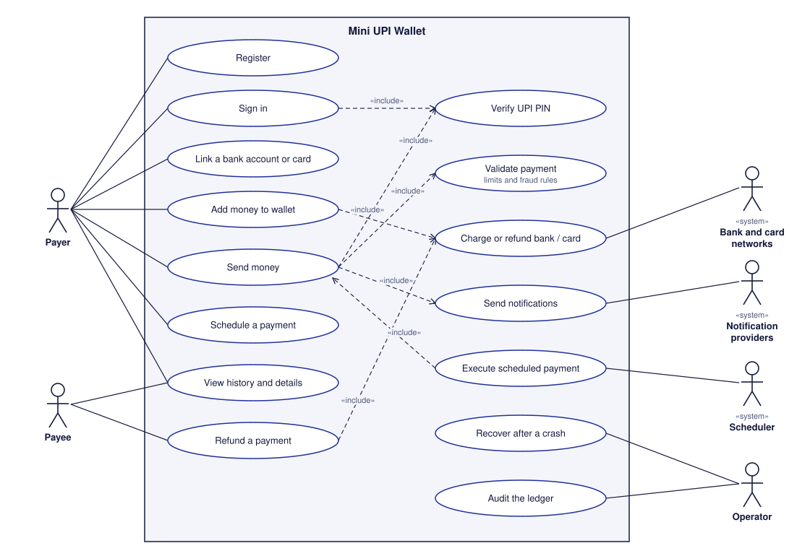

# Requirements analysis

This document answers two questions: what the Mini UPI Wallet must do, and how well it must do it. Every functional requirement has a priority and the class or endpoint that implements it; every non-functional requirement has a measurable target, the mechanism that delivers it, and the test or demonstration that checks it. A traceability table at the end links the most important requirements to the design and the tests.

## Problem statement

People want to pay each other instantly from a phone, using a short UPI ID such as `alice@miniupi` instead of bank details. A payment touches money, so it must never be applied twice, never spend the same balance twice, and always leave an audit trail. Payments also depend on systems the wallet does not control (bank and card networks, SMS and email providers), and those systems are sometimes slow or down; the wallet's own process can also crash in the middle of a payment.

The Mini UPI Wallet is a backend and small web UI that solves this for a simplified UPI. Users hold a wallet, link a bank account or a card, and send money. Each transfer is validated, moves through a defined lifecycle, is idempotent, is safe under concurrency, is written to an immutable ledger, and triggers notifications.

## Goals

1. Move money correctly: no lost money, no double debit, no double spend.
2. Make every payment request safe to retry.
3. Keep working, or fail clearly, when a dependency is slow or down, and finish cleanly after a crash.
4. Make every rupee traceable through an append-only, tamper-evident ledger.
5. Show the design: each concern sits behind an interface, and new payment methods, rules and reactions plug in without editing the payment flow.

## Actors

| Actor | Type | How the actor interacts | Entry point in code |
|---|---|---|---|
| Payer (sender) | Primary, human | Registers, signs in, links sources, tops up, sends, schedules, reads history, may release a captured charge that was never credited | `UserController`, `PaymentController` in `src/api/controllers.ts` |
| Payee (receiver) | Primary, human | Receives money and notifications, reads history, may refund a payment received | Same controllers |
| Scheduler | System actor | Executes due scheduled payments every `schedulerIntervalMs` (1 s by default); the `compensations` queue worker retries stuck refunds; start-up reconciliation recovers after a crash | `PaymentScheduler` (`src/service/ScheduledPaymentService.ts`), the `compensations` subscriber and `ReconciliationService.run` wired in `src/container.ts` |
| Bank and card networks | External system | Charge, refund and report the status of a charge on linked bank accounts and cards | `PaymentGateway` port, `SimulatedGateway` in `src/payment/gateway/PaymentGateway.ts` |
| Notification providers | External system | Deliver SMS, push and email messages | `NotificationChannel` port, `SmsChannel`, `PushChannel`, `EmailChannel` in `src/notification/channels.ts` |
| Operator or auditor | Secondary, human | Watches metrics and traces, verifies the ledger, injects faults, resets demo data | `/api/v1/system/*` routes, `SystemController`, `SystemService` |

## Functional requirements

Priorities use MoSCoW: **Must** (the project brief requires it, or the system is unsafe without it), **Should** (important, expected of a real wallet), **Could** (adds value, shown in the demo), **Won't** (out of scope for this release). The **Must** rows are what the brief asks for: users with a wallet (FR-1, FR-3, FR-5), linked payment sources (FR-7, FR-8), sending money (FR-9) with validation of balance, daily limit and fraud rules (FR-11, FR-12), the lifecycle `INITIATED -> PROCESSING -> SUCCESS or FAILED -> REFUNDED` (FR-13, FR-15), idempotency (FR-14), an immutable ledger (FR-18), notifications over SMS, push and email (FR-17), a PIN for money movement (FR-4) and the history of payments (FR-16).

| ID | Requirement | Priority | Implemented by |
|---|---|---|---|
| FR-1 | Register a user with name, phone, UPI PIN, optional email, optional UPI handle and daily limit. The user, a zero-balance wallet and the wallet payment source are created in one database transaction. | Must | `UserService.register`, `POST /api/v1/users` |
| FR-2 | Sign in with UPI ID and PIN and receive a signed session token valid for 30 minutes. An unknown UPI ID and a wrong PIN get the same answer (`401 INVALID_CREDENTIALS`). | Should | `SessionService.login`, `POST /api/v1/auth/login` |
| FR-3 | Identify the caller on every user endpoint from `Authorization: Bearer <token>`, or from the `X-User-Id` header while the `allowHeaderIdentity` setting is on; refuse a blocked account (`403 ACCOUNT_BLOCKED`). | Must | `authentication` middleware in `src/api/middleware.ts`, `SessionService.verify`, `UserService.authenticate` |
| FR-4 | Require the UPI PIN for every action that moves money: transfer, top-up, refund, schedule. After 5 wrong PINs, refuse PIN entry for 60 s (`401 PIN_LOCKED`); a wrong PIN on a payment reports `attemptsLeft`. Wrong PINs at sign-in are counted separately, so a stranger guessing at sign-in cannot lock the owner out of paying. | Must | `UserService.verifyPin(user, pin, purpose)` (settings `pinMaxAttempts`, `pinLockMs`), called by `PaymentController` and `SessionService.login` |
| FR-5 | Show the caller's profile, wallet balance and linked sources. | Must | `UserController.me`, `GET /api/v1/me` |
| FR-6 | Resolve a payee's name from a UPI ID before paying. | Should | `UserService.resolveUpiId` (cached), `GET /api/v1/users/resolve?upiId=` |
| FR-7 | Link a bank account. Only the last four digits are stored; the IFSC format is checked. | Must | `UserService.linkBankAccount`, `POST /api/v1/payment-sources/bank-accounts` |
| FR-8 | Link a card (Visa, Mastercard or RuPay). The number must pass the Luhn check; an expired card is refused. | Must | `UserService.linkCard`, `POST /api/v1/payment-sources/cards` |
| FR-9 | Send money to another user's UPI ID, from the wallet (default), a bank account or a card, with an optional note of up to 80 characters. The amount may be sent as whole paise (`amountPaise`, preferred) or rupees (`amount`). | Must | `TransferService.transfer`, `POST /api/v1/transfers` |
| FR-10 | Top up the caller's own wallet from a linked bank account or card. | Should | `PaymentController.topUp` calls `TransferService.transfer` with the caller as receiver (type `TOPUP`), `POST /api/v1/wallet/topup` |
| FR-11 | Validate every payment, in this order: account status, payment source (usable, within its per-payment limit), available funds, daily limit, fraud rules. | Must | `ValidationPipeline` with the five handlers in `src/validation/handlers.ts` |
| FR-12 | Block suspicious payments: payee reported for fraud, too many payments in one minute, large first payment to a new payee. | Must | `FraudEngine`, `BlacklistedPayeeRule`, `VelocityRule`, `HighValueNewPayeeRule` in `src/validation/fraud.ts` |
| FR-13 | Track each payment through `INITIATED -> PROCESSING -> SUCCESS or FAILED -> REFUNDED` and reject any other transition. | Must | `Transaction`, `TransactionState` and its subclasses in `src/domain/TransactionState.ts` |
| FR-14 | Accept an `Idempotency-Key` with every payment and return the stored result for a retry instead of paying again. | Must | `IdempotencyService.execute`, `TransferService.answerFromStored` |
| FR-15 | Refund a successful payment (`SUCCESS -> REFUNDED`); only its receiver may do so. Release a captured charge whose credit never happened (`FAILED -> REFUNDED`), automatically and on request of either party. A refund is always of the full amount (design decision recorded in `03-oop-and-solid.md`). | Must | `RefundService.refund`, `RefundService.releaseCapturedFunds`, `CompensationObserver`, `PaymentStrategy.reverse`, `POST /api/v1/transactions/:id/refund` |
| FR-16 | List the caller's transactions newest first, one page at a time (`?before=` cursor, `page.nextCursor`), and show one transaction with its state timeline and ledger entries, redacted for the viewer: only the payer sees which source paid, and each party sees the other party's ledger lines without account id or balance. | Must | `TransactionQueryService.history`, `details`, `redactFor` and `redactLedgerFor` in `src/readmodel/views.ts`; `GET /api/v1/transactions`, `GET /api/v1/transactions/:id` |
| FR-17 | Notify the parties when a payment succeeds, fails or is refunded, on each channel the user has (SMS, push, email). | Must | `NotificationObserver`, `NotificationComposer`, `NotificationService`; `GET /api/v1/notifications` |
| FR-18 | Record every money movement as balanced, hash-chained double-entry ledger lines in the same database transaction as the balance change. | Must | `LedgerService.record`, called by the strategies in `src/payment/strategies.ts` |
| FR-19 | Let an auditor list recent ledger entries, verify the whole ledger, and prove the ledger table refuses `UPDATE`, `DELETE` and `INSERT OR REPLACE`. | Should | `LedgerService.recent`, `LedgerService.verify`, `SystemService.attemptLedgerTamper`; `GET /api/v1/system/ledger`, `GET /api/v1/system/ledger/verify`, `POST /api/v1/system/ledger/tamper-test` |
| FR-20 | After a crash, before serving requests: close interrupted payments (asking the bank or card network whether a charge happened), announce committed but unannounced state changes, release abandoned idempotency keys, and requeue claimed scheduled payments. | Should | `ReconciliationService.run`, `OutboxRelay.relayAll`, `recover()` in `src/container.ts` |
| FR-21 | Schedule a payment up to 30 days ahead, list scheduled payments, cancel a pending one. | Could | `ScheduledPaymentService`, `PaymentScheduler`; `POST`, `GET /api/v1/scheduled-payments`, `DELETE /api/v1/scheduled-payments/:id` |
| FR-22 | Let an operator see live metrics, the plugged-in extension points and request traces, and inject faults (gateway latency, failure rate, outage, replica lag, database latency, notification failures, one failed credit). When an operator key is configured, every changing operator call needs it. | Could | `SystemService`, `ChaosController`, `operatorOnly` middleware; `/api/v1/system/metrics`, `/design`, `/feed`, `/traces/:id`, `/chaos`, `/nodes/:id`, `/queue/redrive`, `/breakers/reset`, `/reset` |
| FR-23 | Partial refunds, request-money (collect) flows, QR payments, multiple currencies. | Won't | Not implemented |

The request and response format of each endpoint is in `06-api-design.md`.

## Non-functional requirements

"Verified by" names a file under `tests/`, a scenario of the in-app Scenario lab (`public/js/lab.js`, described in `10-demo-guide.md`), or the load test and multi-process race in `11-load-and-concurrency-evidence.md`, which also reports the measured figures.

| ID | Quality | Measurable target | Mechanism and file | Verified by |
|---|---|---|---|---|
| NFR-1 | Correctness: no double spend | Any number of concurrent payments from one payer: no wallet ever below zero, the number of successful payments equals what the balance can afford, and money is conserved. | Per-payer lock `wallet:<senderId>` (`TransferService`, `InMemoryLockManager`); `BEGIN IMMEDIATE` unit of work with `busy_timeout` (`PrimaryDatabase.runInTransaction`); versioned wallet and transaction updates (`CONCURRENT_MODIFICATION`); `CHECK (balance_paise >= 0)`; refunds hold both wallet locks in sorted order. | `tests/concurrency.test.ts`; Scenario lab "Double-spend race: five payments, money for two"; load test and multi-process race in `11-load-and-concurrency-evidence.md` |
| NFR-2 | Correctness: exact amounts | 0 paise of rounding error; an amount with more than two decimals is rejected. | `Money` holds integer paise (`src/domain/Money.ts`); `amountPaise` accepted on the wire (`src/api/requests.ts`). | `tests/domain.test.ts` (Money) |
| NFR-3 | Correctness: atomic settlement | After any mix of payments, failures and refunds, `GET /api/v1/system/ledger/verify` reports `healthy: true`: chain intact, 0 unbalanced transactions, 0 wallet mismatches. | Each strategy moves balances, writes two ledger lines, sets the status and stores its event in one `runInTransaction` (`src/payment/strategies.ts`); `LedgerService.record` refuses an unbalanced posting. | `tests/ledger.test.ts`; `tests/concurrency.test.ts` ("a storm of mixed payments conserves the total"); invariants after the load test in `11-load-and-concurrency-evidence.md` |
| NFR-4 | Idempotency: no double debit | N copies of one request with one key, sent at once or later: exactly 1 transaction and 1 debit; every other copy is a replay (`Idempotent-Replayed: true`) or `409 REQUEST_IN_PROGRESS`; the same key with a different body is `422 IDEMPOTENCY_KEY_REUSED`. | `IdempotencyService` (atomic claim on primary key `(user_id, idem_key)`, request fingerprint); `UNIQUE (sender_id, idempotency_key)` on `transactions` and `answerFromStored`; client keys may not start with `scheduled:`; `SimulatedGateway.charge` deduplicates on `reference`; deterministic notification ids with upsert. | `tests/idempotency.test.ts`; Scenario lab "Retry storm: one payment sent six times at once" and "Same key, different amount"; retry-storm scenario of the load test in `11-load-and-concurrency-evidence.md` |
| NFR-5 | Consistency model | Money decisions: 100% of reads come from the primary, never the replica or the cache. History: the replica trails the primary by `replicaLagMs` (400 ms by default). Read-your-writes: a user's read after their own write always reflects it. | Repositories built on `primary` (`src/container.ts`); `findByUserIdForUpdate` bypasses the cache; `ReadRouter` routes reads and pins a user to the primary until the replica reaches their write's LSN (`TransactionJournal.announce` records the payer's write, `TransactionJournal.pinReads` the refund requester's); `?consistency=strong`; `X-Data-Source` header; replica rebuilt from a snapshot if a commit cannot be applied. | `tests/replication.test.ts`; Scenario lab "Read replica lag and read-your-writes" |
| NFR-6 | Availability and resilience | Gateway outage: after 3 consecutive failures the breaker opens and calls fail at once without reaching the gateway for 8 s. Notifications: up to 3 attempts, then the dead-letter queue, 0 lost (redrivable). Captured money: 0 charges left unreturned once the gateway answers again (refund retried up to 6 attempts from 1 s backoff, and again at every start-up). A failing observer fails 0 payments. A payer lock wait ends within 5 s (`503 LOCK_TIMEOUT`). | `CircuitBreaker` with `CircuitBreakerGateway`; `InMemoryMessageQueue` retries, dead-letter queue and redrive of both topics; saga `ExternalPaymentStrategy.compensate`, `CompensationObserver`, `RefundService.releaseCapturedFunds`; `TransactionEventPublisher.publish` isolates observers; `LoadBalancer` routes around unhealthy nodes. | `tests/gateway-flows.test.ts`; `tests/queue.test.ts`; `tests/infrastructure.test.ts` (CircuitBreaker); `tests/transfers.test.ts` ("notifications are best effort and never hold a payment back"); `tests/concurrency.test.ts` ("lock timeout"); Scenario lab "Bank outage and the circuit breaker", "Charged at the bank, but the credit fails", "Notification provider down: retry, dead-letter, redrive", "An app server dies" |
| NFR-7 | Recoverability | After a crash, before the first request is served: 0 payments left `INITIATED` or `PROCESSING` except those whose gateway could not be reached; 0 state-change events left unannounced; 0 idempotency keys left `IN_PROGRESS`; 0 scheduled payments left `RUNNING`. An existing database file is upgraded in place by pending migrations. | `ReconciliationService.run` (with `PaymentGateway.statusOf`), `OutboxRelay.relayAll`, `recover()` in `src/container.ts`; transactional outbox in `transaction_events`; `MIGRATIONS` and `SqliteNode.migrate()` with `PRAGMA user_version`. | `tests/recovery.test.ts` ("ReconciliationService.run()", "restart: what a crash left behind is cleaned up before anything is served", "schema migrations"); `tests/outbox.test.ts` ("transactional outbox", "outbox in the running application"); `tests/gateway-flows.test.ts` ("restart: data on disk survives and stranded charges are recovered") |
| NFR-8 | Scalability and performance | Under the load test: 0 server errors (`5xx`) and 0 broken invariants (money conserved, no negative wallet, each accepted payment executed once, ledger intact). Abuse limits: per authenticated user a burst of 30 requests and 15 per second sustained; per client address 300 and 150 per second; beyond them `429` with `Retry-After`. The design must scale out to the planned peak of about 3,000 payments per second (`09-architecture-and-scaling.md`). | Stateless signed session tokens; `LoadBalancer` with `RoundRobinStrategy`; `InMemoryCache` (LRU, 30 s TTL) for balances, UPI lookups and idempotent outcomes; read replica; notifications on an asynchronous queue; two `TokenBucketRateLimiter`s (`addressRateLimiting`, `authentication`). Each is behind a port so it can become Redis, Kafka or PostgreSQL by changing `src/container.ts`. | Load test in `11-load-and-concurrency-evidence.md` (throughput, latency and the path to the target); `tests/http.test.ts` ("HTTP API: rate limiting", "HTTP API: load balancer"); Scenario lab "Rate limiting a noisy client", "Cache-aside on the wallet balance" |
| NFR-9 | Auditability | 100% of money movements have balanced ledger lines; 100% of status changes have a `transaction_events` row, written in the same commit as the status; 3 of 3 tampering statements (`UPDATE`, `DELETE`, `INSERT OR REPLACE`) on `ledger_entries` are refused. | SHA-256 hash chain over every stored field (`LedgerEntry.computeHash`); append-only triggers with `recursive_triggers`; `LedgerService.verify`; `SqliteTransactionRepository` writes events with the status. | `tests/ledger.test.ts`; Scenario lab "Try to rewrite the ledger" |
| NFR-10 | Security | 0 PINs or full account or card numbers stored; 5 wrong PINs lock PIN entry for 60 s; 100% of cross-site or unknown-host requests to `/api` refused with `403`; tokens are tamper-evident (`INVALID_TOKEN`) and expire (`TOKEN_EXPIRED`); a `500` never carries internal details. | `PinHasher` (salted scrypt, constant-time compare); PIN lockout in `UserService`; `SessionService` HMAC-SHA256 tokens; last four digits only, masked display; per-viewer redaction (`redactFor`, `redactLedgerFor`); `plainText` input checks; loopback listening by default (`host` setting, `src/main.ts`); `sameSiteOnly`, `securityHeaders`, `operatorOnly`; generic `500` in `errorHandler`. | `tests/users.test.ts` ("UserService: PIN lockout"); `tests/sessions.test.ts` ("SessionService"); `tests/http.test.ts` ("authentication", "same-site guard", "HTTP API: PIN lockout", "transaction details and privacy"); `tests/transfers.test.ts` ("what each party may see of a payment"); Scenario lab "Guessing the UPI PIN", "Bad requests are turned away at the door" |
| NFR-11 | Extensibility | A new payment method, source type, fraud rule, validation step, notification channel or reaction to payments needs 0 edits to `TransferService`, `RefundService` and the factories. | Strategy, registry factories, Chain of Responsibility and Observer, all wired in `src/container.ts`; `SystemService.design()` lists them (`GET /api/v1/system/design`). Recipes in `04-design-patterns.md`. | `tests/validation.test.ts` ("ValidationPipeline and FraudEngine (extension points)", "TransactionEventPublisher (observer extension point)"); `tests/extension-points.test.ts` ("PaymentSourceFactory is a registry", "NotificationChannelFactory is a registry", "FaultInjectingWalletRepository"); `tests/gateway-flows.test.ts` ("PaymentStrategyFactory") |
| NFR-12 | Observability | 100% of `/api/v1` requests carry an `X-Request-Id` whose trace can be fetched; one snapshot reports every component's counters. | `Tracer` with `AsyncLocalStorage` (`requestContext`), `GET /api/v1/system/feed` and `/traces/:id`; `MetricsRegistry` fed by `MetricsObserver`; `SystemService.snapshot()` (`GET /api/v1/system/metrics`). | `tests/http.test.ts` ("response envelope and request identity"); every Scenario lab run shows the trace of each request |
## Use cases

The UML use-case diagram below shows the actors, the use cases and the `«include»` relations between them.

The message-level flows behind these use cases are drawn in `05-sequence-diagrams.md`. Error codes are explained in `08-error-handling-and-edge-cases.md`.

### UC-1 Register

- **Actor:** a new payer or payee.
- **Preconditions:** the phone number and the UPI handle are not registered yet.
- **Main flow:**
  1. The user sends name, phone, PIN and optionally email, `upiHandle` and `dailyLimit` to `POST /api/v1/users`.
  2. `UserService.register` validates the fields and builds the UPI ID `<handle>@miniupi`. Without a handle, it is derived from the name.
  3. The PIN is hashed with a random salt. User, wallet (balance zero) and wallet source are inserted in one database transaction.
  4. The system answers `201` with the profile, wallet and sources.
- **Alternate flows:** an invalid field gives `400` (`INVALID_NAME`, `INVALID_PHONE`, `INVALID_PIN`, `INVALID_EMAIL`, `INVALID_DAILY_LIMIT`, `INVALID_UPI_HANDLE`, or `INVALID_FIELD` for a name with control characters or `<` `>`); a taken UPI ID or phone gives `409` (`UPI_ID_TAKEN`, `PHONE_TAKEN`).

### UC-2 Sign in

- **Actor:** payer or payee.
- **Preconditions:** the user is registered and active.
- **Main flow:**
  1. The user sends `upiId` and `pin` to `POST /api/v1/auth/login`.
  2. `SessionService.login` finds the user and verifies the PIN through `UserService.verifyPin` with the purpose `sign-in`, so a lockout applies, counted apart from payment PINs.
  3. It returns `{ token, expiresAt, user }`; the token is `<userId>.<expiry>.<HMAC-SHA256 signature>` and is valid for `sessionTtlMs` (30 minutes).
  4. Later requests send `Authorization: Bearer <token>`; `authentication` checks the signature and expiry with `SessionService.verify`.
- **Alternate flows:** an unknown UPI ID and a wrong PIN both give `401 INVALID_CREDENTIALS`, so the answer does not reveal which UPI IDs exist; after 5 wrong PINs, sign-in gives `401 PIN_LOCKED` for 60 s while payments with the right PIN still work; a forged token `401 INVALID_TOKEN`; an old one `401 TOKEN_EXPIRED`; a blocked account gets `403 ACCOUNT_BLOCKED` on its first authenticated request.

### UC-3 Link a bank account or card

- **Actor:** payer.
- **Preconditions:** the payer is signed in.
- **Main flow:**
  1. The payer sends bank name, account number and IFSC to `POST /api/v1/payment-sources/bank-accounts`, or network, card number and expiry to `POST /api/v1/payment-sources/cards`.
  2. `UserService` validates the format (9 to 18 digit account number and IFSC pattern; or Luhn check, network and expiry for a card).
  3. A `BankAccountSource` or `CardSource` is stored with only the last four digits.
  4. The system answers `201` with the masked source and its per-payment limit.
- **Alternate flows:** a bad format gives `400` (`INVALID_BANK_NAME`, `INVALID_ACCOUNT_NUMBER`, `INVALID_IFSC`, `INVALID_CARD_NUMBER`, `INVALID_CARD_NETWORK`, `INVALID_EXPIRY`); an expired card gives `422 CARD_EXPIRED`.

### UC-4 Top up the wallet

- **Actor:** payer, with the bank and card networks.
- **Preconditions:** the payer has a linked bank account or card.
- **Main flow:**
  1. The payer sends the amount, `sourceId` and PIN to `POST /api/v1/wallet/topup` with an `Idempotency-Key`.
  2. The controller verifies the PIN and calls `TransferService.transfer` with the payer as receiver, so the transaction type is `TOPUP`.
  3. The send-money flow (UC-5) runs. The daily-limit check is skipped for a top-up.
  4. The gateway charges the source; the wallet credit, two ledger lines, `SUCCESS` and its event commit together.
- **Alternate flows:** choosing the wallet itself as source gives `422 SELF_TRANSFER`; a decline gives `402 PAYMENT_DECLINED`; an outage gives `503 GATEWAY_UNAVAILABLE` or `503 CIRCUIT_OPEN`.

### UC-5 Send money

- **Actor:** payer. The payee is affected.
- **Preconditions:** both users exist; the payer is signed in, active and knows the PIN.
- **Main flow:**
  1. The payer sends `receiverUpiId`, `amountPaise` (or `amount`), optional `sourceId` and note, and the PIN to `POST /api/v1/transfers` with an `Idempotency-Key`.
  2. The PIN is verified. `IdempotencyService` claims the key.
  3. `PartyResolver` resolves sender, receiver, source and strategy; `TransactionJournal.open` stores the transaction as `INITIATED` with its first event and announces it.
  4. `TransferService` takes the lock `wallet:<senderId>`, moves the transaction to `PROCESSING` and runs the validation chain.
  5. The strategy moves the money. From the wallet, debit, credit, two ledger lines, `SUCCESS` and its event commit in one database transaction. From a bank or card, the gateway is charged first, then credit, ledger, `SUCCESS` and its event commit together.
  6. `TransactionJournal.announce` relays the committed events to the observers (trace, notifications, metrics, compensation). The system answers `201`.
- **Alternate flows:**
  - Retry with the same key and body: the stored response is replayed with `Idempotent-Replayed: true` (status `200` for a replayed success). Same key with a different body: `422 IDEMPOTENCY_KEY_REUSED`. Original still running: `409 REQUEST_IN_PROGRESS`. Missing or too short key: `400 IDEMPOTENCY_KEY_REQUIRED`; a key starting with `scheduled:`: `400 IDEMPOTENCY_KEY_RESERVED`.
  - Wrong PIN, unknown receiver or foreign source: `401 INVALID_PIN` (with `attemptsLeft`), `404 RECEIVER_NOT_FOUND`, `404 SOURCE_NOT_FOUND`. Nothing is recorded and the key stays free for a corrected retry.
  - A failed check ends the transaction in `FAILED` with its code, for example `INSUFFICIENT_BALANCE`, `SOURCE_LIMIT_EXCEEDED`, `DAILY_LIMIT_EXCEEDED`, `FRAUD_SUSPECTED`. The response carries the error and the failed transaction. A retry with the same key replays that failure, so a new attempt needs a new key.
  - The credit fails after a bank or card charge: the charge is refunded automatically, the transaction ends `FAILED -> REFUNDED`, and the error is `422 CREDIT_FAILED_REFUNDED`. If the gateway cannot take the refund right now, the error is `422 CREDIT_FAILED_REFUND_PENDING`, the transaction stays `FAILED` with funds captured, and the refund is retried from the `compensations` queue (UC-6).
  - The lock is not granted within 5 s: `503 LOCK_TIMEOUT`, and the transaction is `FAILED`.

### UC-6 Refund a payment

- **Actors:** the payee, who gives back a successful payment; for a captured charge that was never credited, either party or the system itself; the bank and card networks for external sources.
- **Preconditions:** the transaction is `SUCCESS`, or `FAILED` with funds captured.
- **Main flow (payee refunds a successful payment):**
  1. The payee sends the PIN to `POST /api/v1/transactions/:id/refund`.
  2. `RefundService.refund` checks that the requester is a party.
  3. It takes the locks of both wallets, always in sorted order, re-reads the transaction, checks that the requester of a `SUCCESS` refund is its receiver, and asks `canBeRefunded()`.
  4. The strategy reverses the payment: the receiver's wallet is debited and the payer's wallet or source is credited, with two reversing ledger lines, `REFUNDED` and its event. For a bank or card, the receiver debit is dry-run first, then the gateway refund happens, then the database part commits.
  5. The `REFUNDED` event notifies the payer, and the payee too when the payee had received the money. The requester is pinned to the primary for their next reads (`TransactionJournal.pinReads`), and the response shows the transaction as the requester may see it.
- **Alternate flows:**
  - The payer asks to refund a successful payment: `403 REFUND_NOT_ALLOWED`. Someone who is not a party: `404 TRANSACTION_NOT_FOUND`. A second refund or a non-refundable state: `409 ILLEGAL_STATE_TRANSITION`. A receiver who has already spent the money: `422 INSUFFICIENT_BALANCE` (wallet) or `422 REFUND_NOT_POSSIBLE` (bank or card).
  - Automatic release: when a captured charge was not credited, `CompensationObserver` queues a job on the `compensations` topic; the worker calls `RefundService.releaseCapturedFunds`, with up to 6 attempts and backoff from 1 s, and `recover()` queues it again after a restart. Either party may also trigger it through the refund endpoint. Only the gateway refund is needed; no ledger lines are written, because the failed credit wrote none.

### UC-7 Schedule a payment

- **Actors:** payer, then the scheduler.
- **Preconditions:** the receiver exists; the time is in the future and at most 30 days ahead.
- **Main flow:**
  1. The payer sends receiver, amount, optional source and note, `executeAt` or `delaySeconds`, and the PIN to `POST /api/v1/scheduled-payments`.
  2. `ScheduledPaymentService.schedule` stores a `PENDING` scheduled payment and answers `201`.
  3. Every second, `PaymentScheduler` calls `runDue`, which picks up to 20 due payments.
  4. Each one is first claimed with a compare-and-set from `PENDING` to `RUNNING` (`ScheduledPaymentRepository.transition`), then paid through `TransferService.transfer` with the idempotency key `scheduled:<id>`, then marked `EXECUTED` with the transaction id.
- **Alternate flows:** a bad time gives `400 INVALID_SCHEDULE_TIME`; the payer cancels with `DELETE /api/v1/scheduled-payments/:id`, which is the same compare-and-set from `PENDING`, so exactly one of run and cancel wins and a late cancel gets `409 SCHEDULE_NOT_PENDING`; a payment that fails at run time is marked `FAILED` with the reason (a generic message for unexpected errors); a re-run reuses the same key and so cannot pay twice.

### UC-8 View history and transaction details

- **Actor:** payer or payee.
- **Preconditions:** the user is signed in.
- **Main flow:**
  1. The user calls `GET /api/v1/transactions?limit=` (default 20, at most 100).
  2. `ReadRouter` picks the replica, or the primary if this user wrote recently and the replica has not caught up.
  3. The newest transactions come back as `{ data, page: { nextCursor } }` with `X-Data-Source: replica` or `primary`; `?before=<nextCursor>` fetches the next, older page, and `nextCursor` is `null` on the last page.
  4. `GET /api/v1/transactions/:id` returns the transaction, its state timeline from `transaction_events` and its ledger lines. A viewer who is not the payer sees only the kind of source (`Wallet`, `Bank account`, `Card`), and the other party's ledger lines with a masked account id, no balance and a generic description.
- **Alternate flows:** `?consistency=strong` reads the primary; a transaction missing on the replica is looked up on the primary; a user who is not a party gets `404 TRANSACTION_NOT_FOUND`; a malformed cursor gets `400 INVALID_CURSOR`.

### UC-9 Receive notifications

- **Actors:** payer and payee, with the notification providers.
- **Preconditions:** a transaction reached `SUCCESS`, `FAILED` or `REFUNDED`.
- **Main flow:**
  1. `OutboxRelay` hands the stored event to `NotificationObserver`, which passes it to `NotificationService.enqueueFor`.
  2. `NotificationComposer` decides who hears about it and the text; one job per recipient and channel goes on the `notifications` topic. The payment does not wait.
  3. A queue worker sends the message through the channel and upserts the notification as `SENT`.
  4. The user reads them with `GET /api/v1/notifications`.
- **Alternate flows:** a provider failure is retried after 250 ms and 500 ms; after the third failed attempt the job goes to the dead-letter queue and is stored as `FAILED`, and an operator can redrive it; a user without an email address gets no email; a duplicate delivery updates the same row.

### UC-10 Audit the ledger

- **Actor:** operator or auditor.
- **Preconditions:** none for reading; with an operator key configured, the tamper test needs `X-Operator-Key`.
- **Main flow:**
  1. The auditor lists recent entries with `GET /api/v1/system/ledger`.
  2. The auditor calls `GET /api/v1/system/ledger/verify`. `LedgerService.verify` reads the whole ledger from the primary.
  3. It reports `healthy`, `chainIntact`, `brokenAtSequence`, `unbalancedTransactions` and `walletMismatches`.
  4. `POST /api/v1/system/ledger/tamper-test` tries an `UPDATE`, a `DELETE` and an `INSERT OR REPLACE` on the latest entry and shows that the database refused all three.
- **Alternate flows:** a broken chain is reported with the sequence number of the first bad entry; a wallet whose balance differs from its ledger sum is listed with both values; without the configured key, the tamper test gets `403 OPERATOR_KEY_REQUIRED`.

### UC-11 Recover after a crash (system)

- **Actor:** the system at start-up, with the bank and card networks.
- **Preconditions:** the process stopped while work was in flight; the database file survives.
- **Main flow:**
  1. Opening the database applies any pending migration (`SqliteNode.migrate`).
  2. `recover()` tells the simulated gateways about every captured charge on record and queues the refund of each `FAILED` payment with funds captured.
  3. `ReconciliationService.run` takes every payment still `INITIATED` or `PROCESSING`. For a bank or card payment whose charge was never recorded, it asks the gateway `statusOf(reference)`; if the charge was captured, it marks the funds captured. It then fails the payment with code `INTERRUPTED`, and the stored `FAILED` event makes `CompensationObserver` queue the refund when funds were captured.
  4. It relays every unpublished outbox event (`OutboxRelay.relayAll`), releases idempotency keys left `IN_PROGRESS`, and puts `RUNNING` scheduled payments back to `PENDING`. It returns a `ReconciliationReport` with a count for each.
  5. Only then are the demo data seeded (if empty) and requests served.
- **Alternate flows:** a gateway that does not answer, or a payment whose parties can no longer be resolved, is left as it is and counted as `undecided` for the next start-up, never failed by assumption; a client that retries an interrupted payment with its old key is answered from the stored `FAILED` transaction.

## Traceability

| Requirement | Design element | Test or demonstration |
|---|---|---|
| FR-9 Send money | `TransferService` (Facade), `PaymentStrategy` (Strategy), `TransactionJournal` | `tests/transfers.test.ts`, `tests/gateway-flows.test.ts` |
| FR-11, FR-12 Validation and fraud | `ValidationPipeline` (Chain of Responsibility), `FraudEngine` and `FraudRule` (Strategy) | `tests/validation.test.ts`; Scenario lab "Daily transfer limit", fraud rule scenarios |
| FR-13 Lifecycle | `TransactionState` (State) | `tests/domain.test.ts` ("Transaction state machine") |
| FR-14, NFR-4 Idempotency | `IdempotencyService`, `UNIQUE (sender_id, idempotency_key)`, `answerFromStored` | `tests/idempotency.test.ts`; Scenario lab "Retry storm" |
| FR-15 Refund | `RefundService`, `PaymentStrategy.reverse`, `CompensationObserver` | `tests/refunds.test.ts`, `tests/gateway-flows.test.ts` |
| FR-16 History and privacy | `TransactionQueryService`, `ReadRouter`, `redactFor`, `redactLedgerFor` | `tests/http.test.ts` ("transaction details and privacy", "reads"), `tests/transfers.test.ts` |
| FR-17 Notifications | `NotificationObserver` (Observer), `NotificationService`, `NotificationChannel` (Strategy), `InMemoryMessageQueue` | `tests/transfers.test.ts`, `tests/queue.test.ts` |
| FR-18, NFR-9 Ledger | `LedgerService`, `LedgerEntry`, append-only triggers | `tests/ledger.test.ts`; Scenario lab "Try to rewrite the ledger" |
| FR-2, FR-3 Sign in and identity | `SessionService`, `authentication` middleware | `tests/sessions.test.ts`, `tests/http.test.ts` ("authentication") |
| FR-20, NFR-7 Recovery | `ReconciliationService`, `OutboxRelay` (Transactional Outbox), `PaymentGateway.statusOf`, `MIGRATIONS` | `tests/recovery.test.ts`, `tests/outbox.test.ts` |
| Errors mapped to HTTP outside the domain | `ErrorCategory`, `statusFor` in `src/api/httpStatus.ts` | `tests/extension-points.test.ts` ("statusFor: the one table that turns a category into an HTTP status") |
| FR-21 Scheduled payments | `ScheduledPaymentService`, `ScheduledPaymentRepository.transition` | `tests/scheduled.test.ts`; Scenario lab "A scheduled payment runs by itself" |
| NFR-1 No double spend | Payer lock, `BEGIN IMMEDIATE`, versioned updates, `CHECK` | `tests/concurrency.test.ts`; `11-load-and-concurrency-evidence.md` |
| NFR-5 Consistency | `ReadRouter`, `ReplicationStream`, `CachingWalletRepository` | `tests/replication.test.ts` |
| NFR-6 Resilience | `CircuitBreakerGateway` (Decorator), queue retries and dead letters, saga | `tests/gateway-flows.test.ts`, `tests/queue.test.ts`, `tests/infrastructure.test.ts` |
| NFR-10 Security | `PinHasher`, `SessionService`, `sameSiteOnly`, `securityHeaders`, redaction | `tests/users.test.ts`, `tests/http.test.ts` |

## Assumptions and out of scope

These are deliberate prototype simplifications, read from the code.

- **Identity.** Signing in gives a signed session token, but the demo UI identifies users with the `X-User-Id` header, which is accepted while `allowHeaderIdentity` is on (the default; `ALLOW_HEADER_IDENTITY=false` turns it off). While it is on, anyone who knows a user id can act as that user, and `GET /api/v1/users` lists all users for the demo picker. Without `SESSION_SECRET`, the signing secret is random per process, so tokens stop working after a restart. The UPI PIN is required only for transfer, top-up, refund, schedule and sign-in; linking a source and cancelling a schedule need no PIN. Wrong-PIN counters (one for sign-in, one for payments, per user) live in the memory of one process (`UserService`).
- **Local by default.** The server listens on `127.0.0.1` unless `HOST` is set (`src/main.ts`), and `/api` accepts only same-site requests addressed to a known host name.
- **External networks are simulated.** `SimulatedGateway` holds an opening balance of ₹2,00,000 per linked source in memory, and its latency and failures come from `ChaosController`. Its memory of charges is rebuilt at start-up only from charges our own database recorded, so `statusOf` cannot report a charge whose capture was never saved. The card "3-D Secure" step only writes a trace line. Notification channels only render the message text.
- **Infrastructure is in-process.** Cache, message queue, lock manager, rate limiters and load balancer are in-memory classes in one Node.js process. The "app nodes" are logical labels. The replica is a second SQLite file in the same process, fed by statement-based replication. Reconciliation runs once at start-up; with several nodes it would have to be a periodic job working on leases, as its code comment says.
- **Single currency.** All amounts are Indian rupees, stored as integer paise. One request may ask for at most ₹10,00,000 (`src/api/requests.ts`), and the per-source limits cap it lower: ₹1,00,000 for wallet and bank, ₹50,000 for card.
- **Operator API is open by default.** `/api/v1/system/*` is not authenticated, rate limited or load balanced, so the demo can be driven from the UI. Setting `OPERATOR_KEY` makes every non-GET operator call require `X-Operator-Key`; GET endpoints stay open. `POST /api/v1/system/reset` wipes all data and loads the demo data again.
- **No account administration.** `UserStatus.BLOCKED` and `WalletStatus.FROZEN` are enforced (`UserService.authenticate`, the validation chain and `Wallet`), but no endpoint sets them. Users cannot pick notification channels through the API; registration defaults to SMS and push, and only the demo seeder sets other channels.
- **Charges are not retried by the server.** The circuit breaker fails fast, and the client decides whether to pay again. Only the refund of a captured charge is retried automatically, from the `compensations` queue.
- **Refunds are full.** The receiver gives a successful payment back in full; there are no partial refunds, disputes or merchant flows.
- **Simple scheduling and limits.** One in-process scheduler polls every second, with no leader election. The daily limit resets at the server's local midnight. Fraud thresholds are fixed settings (`fraudMaxTransfersPerMinute` 6, `fraudNewPayeeThresholdRupees` ₹10,000).
- **Out of scope:** KYC, a real UPI directory, interoperability with other payment service providers, collect (request-money) flows, QR codes, statements and data retention.
