# Class diagram

This document answers the question "which classes exist, what do they hold, and how are they related?". It is split into focused diagrams, one per area of `src/`, each followed by a short note. A table at the end names the kind of every important relationship and why that kind fits.

Notation: `+` public, `-` private (a `#field` in TypeScript), `#` protected, `*` abstract, `$` static. Only the members that matter for the design are shown. Domain objects refer to each other by id (`userId`, `senderId`), so the domain relationships are drawn at the conceptual level; the schema in `07-database-schema.md` enforces their multiplicities.

## 1. Domain model

### 1a. Accounts: users, wallets and payment sources

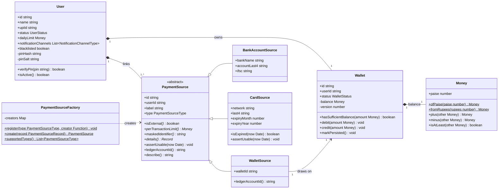

Every user has exactly one wallet (`wallets.user_id` is `UNIQUE`) and at least one payment source, because `UserService.register` creates the `WalletSource` together with the user and the wallet. The balance changes only through `debit()` and `credit()`; `version` supports the optimistic lock in `SqliteWalletRepository.save`. Each `PaymentSource` subclass answers the polymorphic questions (limit, masking, usability, ledger account) itself, and bank and card sources keep only the last four digits. `PaymentSourceFactory` in `src/domain/PaymentSource.ts` is a registry: it holds one creator function per type, and the three subclasses register theirs at the bottom of that file. It has no `switch` and does not know the subclasses.

### 1b. Payments and records

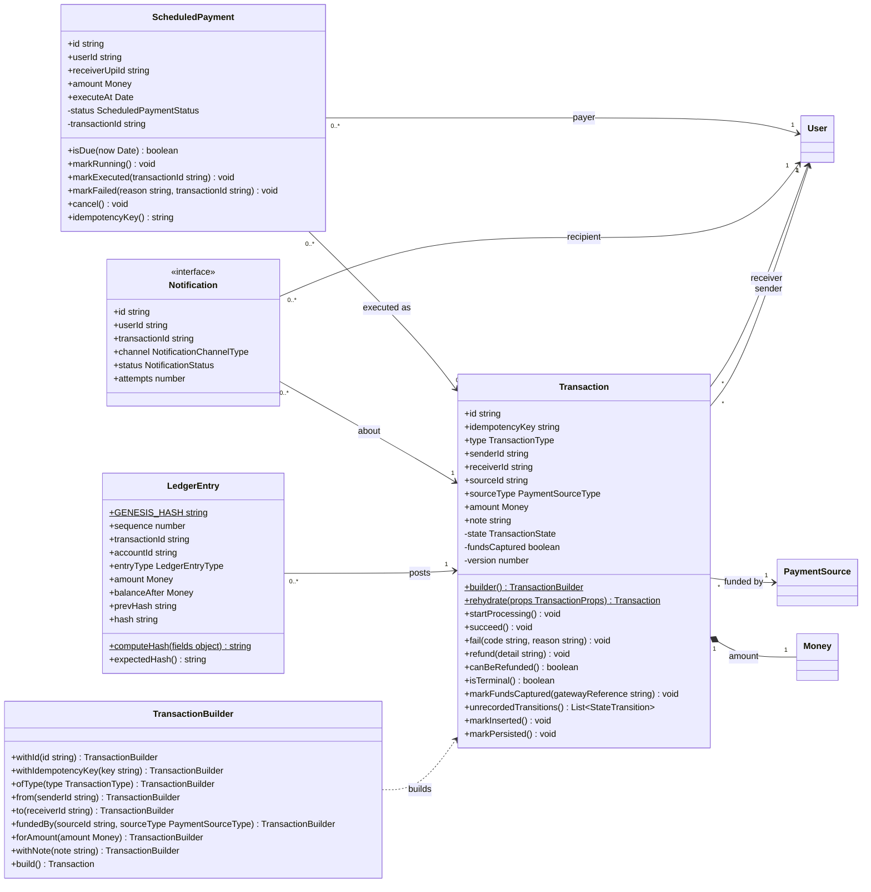

`Transaction` has a private constructor. A new one comes from `TransactionBuilder.build()`, which refuses missing fields, a zero amount and a note over 80 characters, then calls `Transaction.initiate()`; a stored one comes back through `Transaction.rehydrate()`. `version` is the optimistic-lock counter of the stored row; the repository calls `markInserted()` or `markPersisted()` after a successful insert or versioned update, which also clears `unrecordedTransitions()`. A settled payment has two ledger entries, one refunded after success has four, and a failed one has none. `LedgerEntry` freezes itself with `Object.freeze`, and its hash covers every stored field. `Notification` is a plain data interface. A `ScheduledPayment` moves `PENDING -> RUNNING` when the scheduler claims it (`markRunning()`); `markExecuted()` and `markFailed()` require `RUNNING` (`SCHEDULE_NOT_RUNNING` otherwise), and `cancel()` requires `PENDING`.

The enumerations live in `src/domain/enums.ts`, except `ErrorCategory`, which is in `src/domain/errors.ts` (section 8):

| Enumeration | Values |
|---|---|
| `TransactionStatus` | `INITIATED`, `PROCESSING`, `SUCCESS`, `FAILED`, `REFUNDED` |
| `TransactionType` | `P2P`, `TOPUP` |
| `PaymentSourceType` | `WALLET`, `BANK_ACCOUNT`, `CARD` |
| `LedgerEntryType` | `DEBIT`, `CREDIT` |
| `NotificationChannelType` | `SMS`, `PUSH`, `EMAIL` |
| `NotificationStatus` | `SENT`, `FAILED` |
| `UserStatus` | `ACTIVE`, `BLOCKED` |
| `WalletStatus` | `ACTIVE`, `FROZEN` |
| `ScheduledPaymentStatus` | `PENDING`, `RUNNING`, `EXECUTED`, `FAILED`, `CANCELLED` |
| `ErrorCategory` | `INVALID_INPUT`, `UNAUTHENTICATED`, `FORBIDDEN`, `NOT_FOUND`, `CONFLICT`, `RULE_VIOLATION`, `DECLINED`, `RATE_LIMITED`, `UNAVAILABLE`, `INTERNAL` |

## 2. Transaction lifecycle

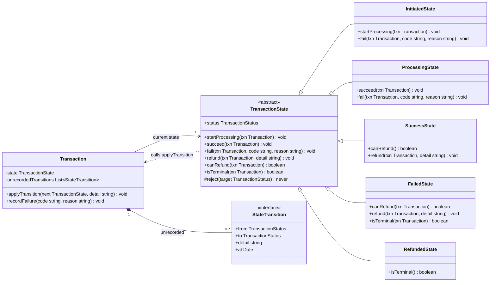

`Transaction` delegates each lifecycle call (`startProcessing`, `succeed`, `fail`, `refund`, `canBeRefunded`, `isTerminal`) to its current state object. The base class rejects every transition with `IllegalStateTransitionError`; a subclass overrides only the transitions that are legal from its status. `FailedState.isTerminal(txn)` is true only when no captured funds are left to return, because `FAILED -> REFUNDED` is still possible otherwise. The states hold no data, so `src/domain/TransactionState.ts` keeps one shared instance per status in the `STATES` map, returned by `stateFor(status)`. `applyTransition` queues each `StateTransition`; the repository writes the queue to `transaction_events` in the same unit of work as the new status, and `OutboxRelay` later tells the observers (section 5). The state machine is drawn in `04-design-patterns.md`.

## 3. Payment processing

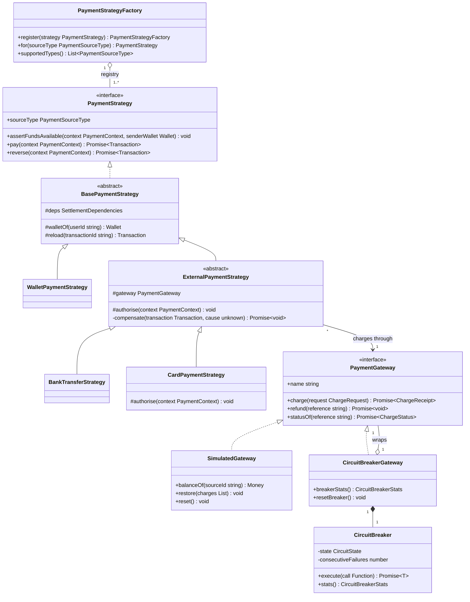

`PaymentStrategyFactory` maps each `PaymentSourceType` to one strategy; `src/container.ts` registers the wallet, bank and card strategies. `BasePaymentStrategy` (not exported) holds the shared `SettlementDependencies`: `unitOfWork`, `wallets`, `transactions`, `ledger`. `ExternalPaymentStrategy` takes `(deps, gateway)` and nothing else: it knows nothing about fault injection. Its `pay` fixes the bank and card skeleton: `authorise` hook, gateway charge, atomic credit and ledger, and `compensate` if the credit fails; when `compensate` cannot reach the gateway it leaves the transaction `FAILED` with funds captured and throws `CREDIT_FAILED_REFUND_PENDING`. `PaymentGateway.statusOf(reference)` answers `NOT_FOUND`, `CAPTURED` or `REFUNDED` (type `ChargeStatus`); it is how start-up recovery learns the outcome of a charge it never saw. Each gateway is a `SimulatedGateway` wrapped in its own `CircuitBreakerGateway`, which passes `charge`, `refund` and `statusOf` through the breaker. `SimulatedGateway.refund` shares one in-flight refund between concurrent callers, and `restore()` reloads its charge records at start-up.

## 4. Validation and fraud

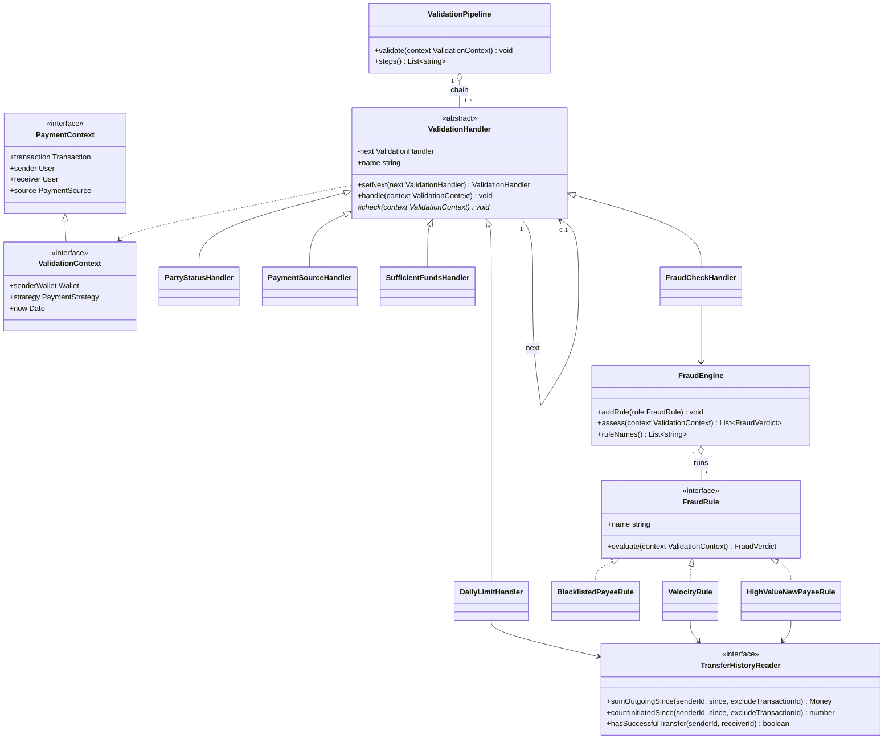

`ValidationPipeline` links the handlers it is given, in order, with `setNext`. `ValidationHandler.handle` runs `check`, writes a trace line and calls the next link; a failing check throws a `DomainError`, which stops the chain. `ValidationContext` adds the sender's fresh wallet, the chosen strategy and the current time to `PaymentContext`. `SufficientFundsHandler` asks the strategy, because only the strategy knows what "enough funds" means for its source. The history-based checks see only `TransferHistoryReader`, which `TransactionRepository` extends.

## 5. Events, outbox and notifications

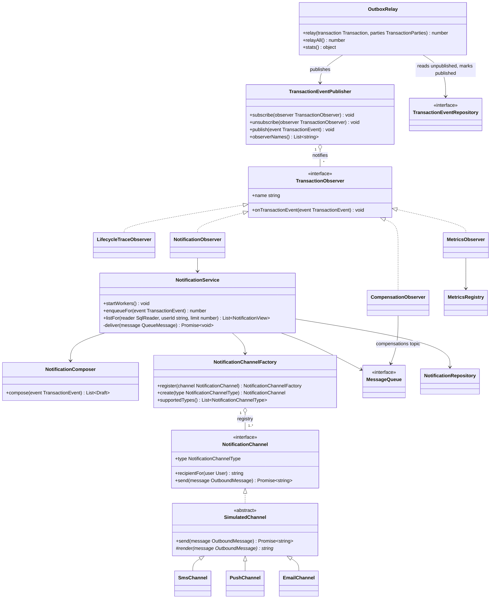

`transaction_events` is both the audit trail and the outbox: the repository writes each state change there in the same database transaction as the status, with `published_at` empty. `OutboxRelay` (`src/events/Outbox.ts`) reads the unpublished events of one transaction, hands them to `TransactionEventPublisher`, then marks them published; `relayAll()` does the same at start-up for anything a previous run left. Delivery to observers is therefore at-least-once. `src/container.ts` subscribes four observers, in this order: `LifecycleTraceObserver` (writes the state change to the request trace), `NotificationObserver`, `MetricsObserver`, and `CompensationObserver` (in `src/service/RefundService.ts`), which queues a refund retry on the `compensations` topic when a transaction is still `FAILED` with funds captured. `publish` catches and logs an observer's error, so an observer can never fail a payment. `NotificationChannelFactory` is a registry with no constructor arguments; the three channels are created and registered in `src/container.ts`. `SimulatedChannel` is module-private in `src/notification/channels.ts` and fixes the provider call; subclasses supply the address and the wording.

## 6. Services and repositories

### 6a. Services

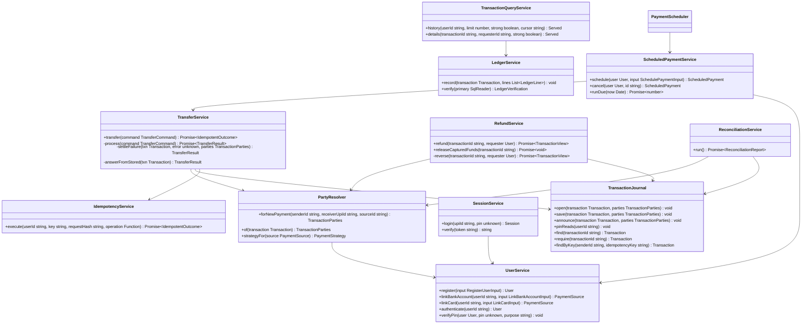

The diagram shows only service-to-service links. The full constructor parameters, as wired in `src/container.ts`:

| Class | Constructor parameters |
|---|---|
| `TransferService` | `parties: PartyResolver`, `journal: TransactionJournal`, `wallets: WalletRepository`, `idempotency: IdempotencyService`, `locks: LockManager`, `validation: ValidationPipeline`, `databaseRoundTrip: () => Promise<void>` |
| `RefundService` | `parties: PartyResolver`, `journal: TransactionJournal`, `locks: LockManager` |
| `PartyResolver` | `users: UserService`, `sources: PaymentSourceRepository`, `strategies: PaymentStrategyFactory` |
| `TransactionJournal` | `transactions: TransactionRepository`, `outbox: OutboxRelay`, `readRouter: ReadRouter` |
| `OutboxRelay` | `events: TransactionEventRepository`, `publisher: TransactionEventPublisher`, `load` (a function that rebuilds a transaction and its parties from storage) |
| `ReconciliationService` | `transactions: TransactionRepository`, `parties: PartyResolver`, `journal: TransactionJournal`, `outbox: OutboxRelay`, `idempotencyKeys: IdempotencyRepository`, `scheduled: ScheduledPaymentRepository`, `gatewayFor` (a function from a source to its `PaymentGateway`, or none for the wallet) |
| `SessionService` | `users: UserService`, `ttlMs`, optional `secret` (random per process when empty) |
| `IdempotencyService` | `IdempotencyRepository`, `Cache`, options (poll interval, max polls, cache TTL) |
| `LedgerService` | `LedgerRepository`, `WalletRepository` |
| `UserService` | `UserRepository`, `WalletRepository`, `PaymentSourceRepository`, `UnitOfWork`, `Cache`, settings (`upiHandle`, `defaultDailyLimitRupees`, `pinMaxAttempts`, `pinLockMs`) |
| `ScheduledPaymentService` | `ScheduledPaymentRepository`, `UserService`, `PaymentSourceRepository`, `TransferService` |
| `PaymentScheduler` | `ScheduledPaymentService`, interval in ms |
| `TransactionQueryService` | `TransactionQueryRepository`, `TransactionEventRepository`, `LedgerService`, `ReadRouter`, `PaymentSourceRepository` |
| `CompensationObserver` | `MessageQueue` |

`PartyResolver` and `TransactionJournal` (both in `src/service/TransactionJournal.ts`) hold the lookups and the store-and-announce steps that transfers, refunds, the outbox and recovery all need, so each rule lives in one place. `TransactionJournal.open` inserts a new transaction, `save` updates one, and both end in `announce`, which relays the outbox and pins the payer to the primary for read-your-writes; `pinReads(userId)` does the same for someone else, such as the receiver who just refunded. `ReconciliationService` runs once at start-up and returns a `ReconciliationReport` (interrupted payments, captured and queued for refund, undecided, relayed events, released keys, requeued schedules); a payment whose parties cannot be resolved is counted as undecided instead of stopping the start-up. `UserService.verifyPin(user, pin, purpose)` keeps separate wrong-PIN counters for `payment` (the default) and `sign-in`. `SessionService` issues stateless tokens `<userId>.<expiry>.<HMAC-SHA256 signature>`.

### 6b. Repositories

```mermaid
classDiagram
  class WalletRepository {
    <<interface>>
    +findByUserId(userId string) Wallet
    +findByUserIdForUpdate(userId string) Wallet
    +save(wallet Wallet) void
  }
  class TransactionRepository {
    <<interface>>
    +insert(txn Transaction) void
    +update(txn Transaction) void
    +findById(id string) Transaction
    +findBySenderAndKey(senderId string, idempotencyKey string) Transaction
    +findUnfinished() List~Transaction~
    +findCaptured() List~Transaction~
  }
  class TransactionEventRepository {
    <<interface>>
    +append(event TransactionEventRecord) void
    +findUnpublished(transactionId string) List~OutboxEvent~
    +markPublished(eventIds List, at Date) void
    +findTransactionsWithUnpublished() List~string~
  }
  class IdempotencyRepository {
    <<interface>>
    +tryBegin(userId string, key string, requestHash string, now Date) boolean
    +releaseAllInProgress() number
  }
  class ScheduledPaymentRepository {
    <<interface>>
    +transition(payment ScheduledPayment, expected ScheduledPaymentStatus) boolean
    +requeueRunning() number
    +findDue(now Date, limit number) List~ScheduledPayment~
  }
  class CachingWalletRepository {
    -inner WalletRepository
    -cache Cache
  }
  class FaultInjectingWalletRepository {
    -inner WalletRepository
    -chaos ChaosController
  }
  TransferHistoryReader <|-- TransactionRepository
  UserRepository <|.. SqliteUserRepository
  WalletRepository <|.. SqliteWalletRepository
  WalletRepository <|.. CachingWalletRepository
  WalletRepository <|.. FaultInjectingWalletRepository
  CachingWalletRepository "1" o-- "1" WalletRepository : decorates
  FaultInjectingWalletRepository "1" o-- "1" WalletRepository : decorates
  CachingWalletRepository --> Cache
  PaymentSourceRepository <|.. SqlitePaymentSourceRepository
  TransactionRepository <|.. SqliteTransactionRepository
  SqliteTransactionRepository --> TransactionEventRepository : writes events
  TransactionQueryRepository <|.. SqliteTransactionQueryRepository
  TransactionEventRepository <|.. SqliteTransactionEventRepository
  LedgerRepository <|.. SqliteLedgerRepository
  IdempotencyRepository <|.. SqliteIdempotencyRepository
  NotificationRepository <|.. SqliteNotificationRepository
  ScheduledPaymentRepository <|.. SqliteScheduledPaymentRepository
  <<interface>> UserRepository
  <<interface>> PaymentSourceRepository
  <<interface>> TransferHistoryReader
  <<interface>> TransactionQueryRepository
  <<interface>> LedgerRepository
  <<interface>> NotificationRepository
```

The ports are in `src/repository/interfaces.ts`. The SQLite implementations are grouped in `src/repository/sqlite/AccountRepositories.ts` (user, wallet, payment source), `TransactionRepositories.ts` (transaction, query, event) and `SupportRepositories.ts` (ledger, idempotency, notification, scheduled payment). Each takes a `SqlWriter` (the primary) in its constructor, with two differences. `SqliteTransactionRepository` takes `SqlWriter & UnitOfWork` and the `TransactionEventRepository`: `insert` and `update` write the row and its new events in one unit of work, and `update` is versioned (`WHERE id = ? AND version = ?`, `OptimisticLockError` on a stale copy). `SqliteTransactionQueryRepository` holds nothing and gets a `SqlReader` on every call; `findHistory` takes an optional `before` cursor (`createdAt`, `id`). The methods `findUnfinished`, `releaseAllInProgress` and `requeueRunning` exist for start-up reconciliation. The wallet repository that services receive is `FaultInjectingWalletRepository` around `CachingWalletRepository` around `SqliteWalletRepository`.

## 7. Infrastructure ports and adapters

### 7a. Cache, queue, lock, rate limiter, load balancer

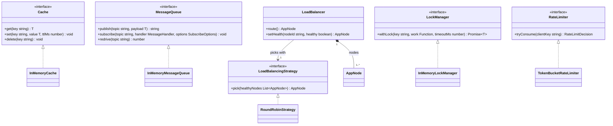

Each port has one in-process adapter: `InMemoryCache` (LRU with per-entry TTL; values stored as JSON, as a remote cache would), `InMemoryMessageQueue` (at-least-once, exponential backoff, dead-letter queue, redrive), `InMemoryLockManager` (FIFO waiters with a timeout), `TokenBucketRateLimiter` (one bucket per client; two instances, one keyed by client address and one by user id). `LoadBalancer` is a concrete class whose node-picking rule is a strategy; it creates its own `AppNode`s. All of them are under `src/infrastructure/`. These ports are synchronous where the in-process stand-in allows it (`Cache.get`, the repositories); a networked Redis or PostgreSQL adapter would need them to become asynchronous.

### 7b. Database access, migrations and replication

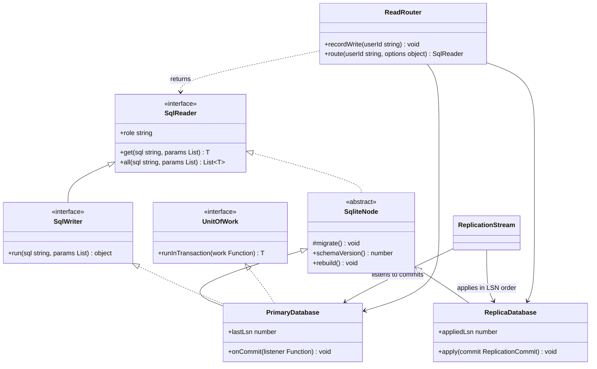

Only `PrimaryDatabase` implements `SqlWriter` and `UnitOfWork`; `ReplicaDatabase` implements only `SqlReader`, so code that tries to write to the replica does not compile. Every node runs `migrate()` when it opens: it applies each entry of `MIGRATIONS` (`src/infrastructure/db/schema.ts`; version 1 is the initial schema, version 2 adds `transaction_events.published_at` and the `idx_events_unpublished` index) whose version is above `PRAGMA user_version`, so an existing database file is upgraded in place; `schemaVersion()` reports the result. Each connection also sets `PRAGMA busy_timeout = 5000`. `runInTransaction` uses `BEGIN IMMEDIATE`, refuses asynchronous work and joins an outer transaction if one is open. Every commit gets an LSN and goes to `ReplicationStream`, which applies it to the replica after the configured lag and rebuilds the replica from a primary snapshot if a commit cannot be applied. `ReadRouter` returns the replica by default, and the primary for a strong read or while a user's last write has not reached the replica.

## 8. Errors

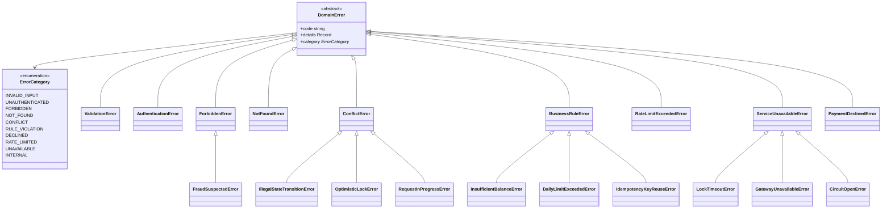

Every failure the system can explain is a `DomainError` with a stable `code` and a `category` (`src/domain/errors.ts`). The domain knows nothing about HTTP: `statusFor(category)` in `src/api/httpStatus.ts` is the only table from category to status code, used by `errorHandler` and `PaymentController.respond`. No subclass changes its parent's category. `ErrorCategory.INTERNAL` is never carried by a `DomainError`; `TransferService` uses it for an unexpected fault. The error codes are listed in `08-error-handling-and-edge-cases.md`.

## Relationship kinds

| Relationship | Kind | Multiplicity | Why this kind |
|---|---|---|---|
| `PaymentSource` to `WalletSource`, `BankAccountSource`, `CardSource` | Inheritance | 1 base, 3 subclasses | Shared identity fields and default behaviour (`describe`, `ledgerAccountId`, `assertUsable`), used through the base type. |
| `TransactionState` to its five states | Inheritance | 1 base, 5 subclasses | The base rejects everything; each subclass overrides only its legal transitions. |
| `ValidationHandler` to the five handlers | Inheritance | 1 base, 5 subclasses | The base owns the chain link and the `handle` template; subclasses add only `check`. |
| `ExternalPaymentStrategy` to `BankTransferStrategy`, `CardPaymentStrategy` | Inheritance | 1 base, 2 subclasses | Same payment skeleton; the card adds an `authorise` step. |
| `DomainError` to its subclasses | Inheritance | 1 base, 9 direct subclasses | Shared `code` and `details`; each branch fixes one `category`. |
| `PaymentStrategy` and `BasePaymentStrategy` | Realisation | 1 interface, 3 concrete strategies | Callers depend on the contract; implementations share helpers through the abstract base. |
| `PaymentGateway` and `SimulatedGateway`, `CircuitBreakerGateway` | Realisation | 1 interface, 2 classes | The decorator must fit wherever the raw gateway does. |
| `WalletRepository` and `SqliteWalletRepository`, `CachingWalletRepository`, `FaultInjectingWalletRepository` | Realisation | 1 interface, 3 classes | The two decorators are drop-in wrappers. |
| `TransferHistoryReader` to `TransactionRepository` | Interface inheritance | 1 to 1 | The narrow read slice is part of the full repository, so one object serves both kinds of client. |
| `User` to `Wallet` | Composition | 1 to 1 | Created with the user in one database transaction; meaningless without it. |
| `User` to `PaymentSource` | Composition | 1 to 1..* | Sources belong to one user; the wallet source always exists. |
| `Transaction` to `StateTransition` | Composition | 1 to 0..* | Unrecorded transitions belong to the transaction until the repository writes them. |
| `Wallet` and `Transaction` to `Money` | Composition | 1 to 1 | `Money` is an immutable value owned by its holder and replaced, never shared for change. |
| `CircuitBreakerGateway` to `CircuitBreaker` | Composition | 1 to 1 | Each gateway has its own breaker; its state describes that one gateway. |
| `LoadBalancer` to `AppNode` | Composition | 1 to 1..* | The balancer creates its nodes; they exist only inside it. |
| `PaymentStrategyFactory` to `PaymentStrategy` | Aggregation | 1 to 1..* | Strategies are created in `src/container.ts` and registered; the factory only holds them. |
| `NotificationChannelFactory` to `NotificationChannel` | Aggregation | 1 to 1..* | Channels are created in `src/container.ts` and registered; the factory only holds them. |
| `ValidationPipeline` to `ValidationHandler` | Aggregation | 1 to 1..* | Handlers are built outside and passed in; the pipeline links them. |
| `FraudEngine` to `FraudRule` | Aggregation | 1 to 0..* | Rules are passed in, and `addRule` can add more. |
| `TransactionEventPublisher` to `TransactionObserver` | Aggregation | 1 to 0..* | Observers live on their own and subscribe or unsubscribe. |
| `CachingWalletRepository`, `FaultInjectingWalletRepository` to inner `WalletRepository` | Aggregation | 1 to 1 | A decorator wraps an object it did not create. |
| `ValidationHandler` to next `ValidationHandler` | Association | 1 to 0..1 | A link to a peer; the last handler has none. |
| `Transaction` to `TransactionState` | Association | * to 1 | State objects are shared per status, so no transaction owns one. |
| `Transaction` to `User` (sender, receiver) and to `PaymentSource` | Association | * to 1 | Long-lived references, by id, to independent entities. |
| `LedgerEntry` to `Transaction` | Association | 0..* to 1 | Each entry records the transaction it posts; a failed transaction has none. |
| `ScheduledPayment` to `Transaction` | Association | 0..* to 0..1 | Set only once the scheduler has run the payment. |
| Services to `PartyResolver`, `TransactionJournal` and repository interfaces | Association | 1 to 1 per collaborator | Held for the service's lifetime, injected through the constructor. |
| `TransactionJournal` to `OutboxRelay`, `OutboxRelay` to `TransactionEventRepository` and `TransactionEventPublisher` | Association | 1 to 1 | Long-lived collaborators injected once. |
| `SqliteTransactionRepository` to `TransactionEventRepository` | Association | 1 to 1 | Used on every save, so the events join the same unit of work as the status. |
| `CompensationObserver` to `MessageQueue` | Association | 1 to 1 | The observer only publishes jobs; the queue lives on its own. |
| `TransactionBuilder` to `Transaction` | Dependency | creates | The builder constructs a transaction and keeps no reference to it. |
| `PaymentSourceFactory` to `PaymentSource` | Dependency | creates | It calls the registered creator and keeps nothing. |
| `ReadRouter` to `SqlReader` | Dependency | returns | It hands out a reader per call and keeps no link to the caller. |
