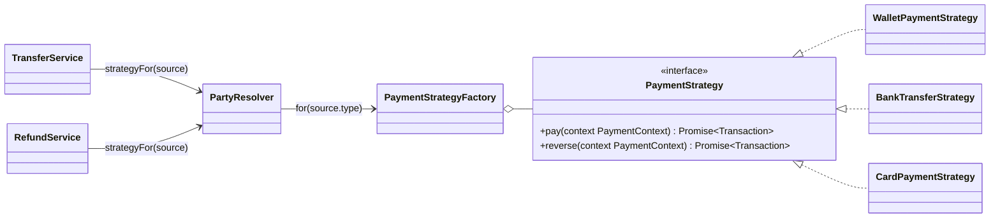
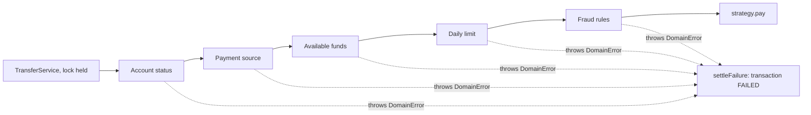
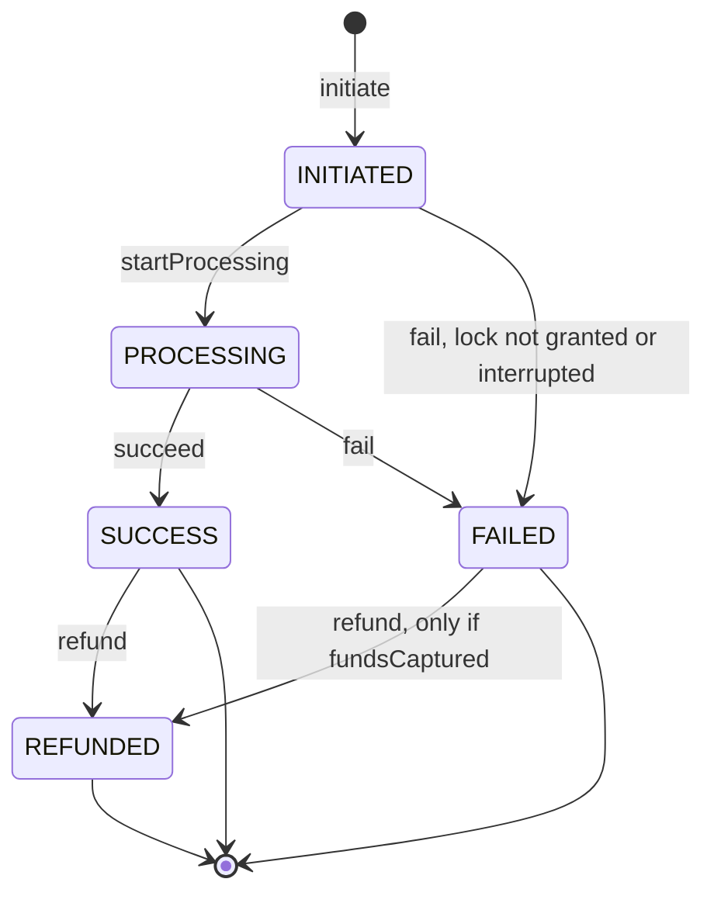
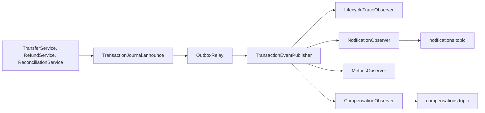
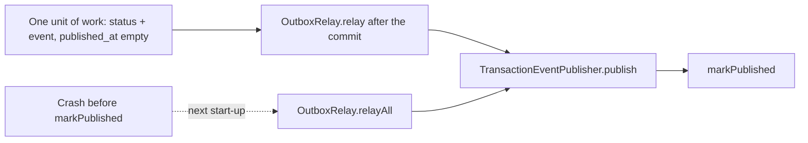

# Design patterns

This document answers the question "which design patterns does the code use, where, and why?". Each pattern below was verified by reading the class that implements it; every section names the problem it solves in this system, its participants, why it beats the obvious alternative, and how to extend it. The last section gives step-by-step recipes for the most common extensions.

## Summary

| Pattern | Category | Where | Problem it solves here |
|---|---|---|---|
| Singleton | Creational | `AppConfig` (`src/config/AppConfig.ts`), `Tracer` (`src/infrastructure/observability/Tracer.ts`), `MetricsRegistry` (`src/infrastructure/observability/MetricsRegistry.ts`) | One configuration, one trace store and one set of counters per process. |
| Factory | Creational | `PaymentSourceFactory` (`src/domain/PaymentSource.ts`), `PaymentStrategyFactory` (`src/payment/PaymentStrategy.ts`), `NotificationChannelFactory` (`src/notification/channels.ts`) | Get the right subclass or implementation for a type without `new` or `switch` at the call site. |
| Registry | Structural (enterprise base pattern) | The same three factories: `register(...)` at start-up, lookup by type | Let new kinds plug in without editing the factory. |
| Builder | Creational | `TransactionBuilder` (`src/domain/Transaction.ts`) | Assemble a transaction from many required parts and refuse an incomplete one. |
| Decorator | Structural | `CachingWalletRepository` (`src/repository/CachingWalletRepository.ts`), `FaultInjectingWalletRepository` (`src/infrastructure/chaos/FaultInjectingWalletRepository.ts`), `CircuitBreakerGateway` (`src/payment/gateway/PaymentGateway.ts`) | Add caching, fault injection or circuit breaking without changing the wrapped class or its callers. |
| Facade | Structural | `TransferService` (`src/service/TransferService.ts`) | One call that runs the whole payment over several subsystems. |
| Repository | Structural (data access) | Ports in `src/repository/interfaces.ts`, implementations in `src/repository/sqlite/` | Keep SQL out of domain classes and services. |
| Strategy | Behavioural | `PaymentStrategy`, `FraudRule`, `NotificationChannel`, `LoadBalancingStrategy` | Swap an algorithm by type or by configuration. |
| Chain of Responsibility | Behavioural | `ValidationHandler`, its five subclasses, `ValidationPipeline` (`src/validation/`) | Run independent checks in a configured order; the first failure stops the payment. |
| State | Behavioural | `TransactionState` and five states (`src/domain/TransactionState.ts`) | Allow only legal lifecycle transitions without `if (status === ...)` ladders. |
| Observer | Behavioural | `TransactionEventPublisher`, `TransactionObserver` and four observers | React to payments (trace, notify, count, retry stuck refunds) without the payment flow knowing who listens. |
| Template Method | Behavioural | `ValidationHandler.handle`, `ExternalPaymentStrategy.pay`, `SimulatedChannel.send` | Fix the order of steps and let subclasses fill in only the variable ones. |
| Transactional Outbox | Architectural (messaging) | `transaction_events.published_at`, `SqliteTransactionRepository`, `OutboxRelay` (`src/events/Outbox.ts`) | Never lose the announcement of a committed state change, even if the process dies right after the commit. |

## Singleton

**Problem.** Configuration must be read from the environment once. Request traces and metric counters must be shared by every component in the process.

**Participants.** Each class has a private constructor, a static `#instance` and `getInstance()`. `AppConfig` also offers `AppConfig.with(overrides)`, which builds a standalone configuration for tests without touching the singleton. `src/infrastructure/observability/Tracer.ts` exports `tracer = Tracer.getInstance()`.

**Why this pattern.** Module-level variables would work, but they cannot hide construction or offer a test-only variant. To limit the usual cost of singletons, `AppConfig.getInstance()` is called only in `src/main.ts` and `MetricsRegistry.getInstance()` only in `src/container.ts`; both are then passed down by constructor injection. The tracer is the exception: components import `tracer` directly (see `03-oop-and-solid.md`).

**How to extend.** Prefer injection for anything new. A new process-wide recorder would follow the `MetricsRegistry` shape: one `getInstance()` call at the composition root.

## Factory and Registry

**Problem.** Three places need "the object for this type": rebuilding a stored payment source, picking the strategy for a source, and picking the channel for a user's preference. New types must be addable without editing that place.

**Participants.**
- `PaymentSourceFactory` (static): `register(type, creator)`, `create(record)` (throws `UNSUPPORTED_SOURCE_TYPE` for an unknown type) and `supportedTypes()`. The three subclasses register their creator functions at the bottom of `src/domain/PaymentSource.ts`. `mapPaymentSource` in `src/repository/sqlite/AccountRepositories.ts` calls `create` for every `payment_sources` row.
- `PaymentStrategyFactory`: `register(strategy)` stores it under `strategy.sourceType`, `for(type)` returns it or throws `UNSUPPORTED_PAYMENT_METHOD`, and `supportedTypes()` feeds `GET /api/v1/system/design`.
- `NotificationChannelFactory`: no constructor arguments; `register(channel)`, `create(type)` (or `UNSUPPORTED_CHANNEL`) and `supportedTypes()`. `src/container.ts` registers the SMS, push and email channels. Channels are stateless, so one instance per type is enough.

```ts
  static register(type: PaymentSourceType, creator: PaymentSourceCreator): void {
    PaymentSourceFactory.#creators.set(type, creator);
  }

  static create(record: PaymentSourceRecord): PaymentSource {
    const creator = PaymentSourceFactory.#creators.get(record.type);
    if (!creator) {
      throw new ValidationError('UNSUPPORTED_SOURCE_TYPE', `Unsupported payment source type: ${String(record.type)}`);
    }
    return creator(record);
  }
```

**Why this pattern.** The alternative is a `switch` in every repository and service that needs a source, a strategy or a channel, or one `switch` in each factory that is edited for every new kind. A registry keyed by type keeps the factory closed: the new kind brings its own `register` call.

**How to extend.** See the payment method and notification channel recipes below.

## Builder

**Problem.** A transaction has seven required parts (id, idempotency key, sender, receiver, source id, source type, amount) plus rules: the amount must be positive and the note is trimmed and at most 80 characters. A constructor with that many positional parameters is easy to call wrongly.

**Participants.** `TransactionBuilder`, reached through `Transaction.builder()`, with fluent setters and `build()`, which reports every missing part at once (`INCOMPLETE_TRANSACTION`) and then calls `Transaction.initiate()`. The only call site is `TransferService.process`:

```ts
    let txn = Transaction.builder()
      .withId(newId('txn'))
      .withIdempotencyKey(command.idempotencyKey)
      .ofType(sender.id === receiver.id ? TransactionType.TOPUP : TransactionType.P2P)
      .from(sender.id)
      .to(receiver.id)
      .fundedBy(source.id, source.type)
      .forAmount(command.amount)
      .withNote(command.note)
      .build();
```

**Why this pattern.** An object literal passed to a constructor would name the parts but could not default `type` to `P2P` and `createdAt` to now, nor validate in one place. `Transaction`'s constructor is private, so a half-built transaction cannot exist.

**How to extend.** A new optional part is one setter with a default; a new rule goes in `build()`.

## Decorator

**Problem.** Wallet reads for display are frequent and should be cached. Demos need to make "credit the receiver" fail on demand. Calls to a failing bank should fail fast. None of these belongs in the SQLite repository, the payment strategies or the simulator.

**Participants.**
- `CachingWalletRepository` implements `WalletRepository` around an inner one and a `Cache`: `findByUserId` is cache-aside, `save` writes then invalidates, and `findByUserIdForUpdate` always goes to the database.
- `FaultInjectingWalletRepository` implements `WalletRepository` around an inner one and the `ChaosController`: when `failNextCredit` is armed, the next `save` that would increase a balance throws `CREDIT_FAILED` once. The payment strategies therefore know nothing about fault injection.
- `CircuitBreakerGateway` implements `PaymentGateway` around an inner gateway and a `CircuitBreaker`, passing `charge`, `refund` and `statusOf` through `breaker.execute`.

The wallet decorators are stacked in `src/container.ts`:

```ts
  const walletRepository = new FaultInjectingWalletRepository(
    new CachingWalletRepository(new SqliteWalletRepository(primary), cache),
    chaos,
  );
```

**Why this pattern.** A caching subclass of `SqliteWalletRepository` would tie caching to SQLite; caching or fault code inside the repository or the strategies would mix concerns. A decorator works for any implementation, can be stacked, and is removed by not wrapping.

**How to extend.** A new cross-cutting concern, such as timing every gateway call, is a new class that implements `PaymentGateway`, wraps another one, and is wired in `src/container.ts`. It must keep the wrapped contract.

## Facade

**Problem.** A payment touches idempotency, party lookup, storage and announcement, locking and validation, then the strategy, in a strict order. Three clients need it: `PaymentController.transfer` and `topUp`, `ScheduledPaymentService` and `DemoSeeder`.

**Participants.** `TransferService.transfer(command)` is the single entry point; `process` runs the steps; `settleFailure` turns any failure after the transaction is recorded into a stored `FAILED` result; `answerFromStored` answers a retry from the stored transaction when the key record was lost. Behind it: `IdempotencyService`, `PartyResolver`, `TransactionJournal`, `LockManager`, `ValidationPipeline` and the chosen `PaymentStrategy`. The `Application` interface in `src/container.ts` plays the same role one level up, for the HTTP layer.

**Why this pattern.** Without it each client would repeat the order and could get it wrong, for example by validating before taking the lock, which reopens the double-spend window.

**How to extend.** A new step of the flow goes here. A new check goes into the validation chain, and a new reaction becomes an observer.

## Repository

**Problem.** Services and domain classes must not know SQL, and reads must be routable to the primary or the replica.

**Participants.** Eleven ports in `src/repository/interfaces.ts`; one SQLite class each in `src/repository/sqlite/`; mapping through `User.toProps()`, `Wallet.fromSnapshot()`, `Transaction.rehydrate()` and `PaymentSourceFactory`. Read-side methods take a `SqlReader`, which the caller gets from `ReadRouter`. `SqliteTransactionRepository` also writes the audit trail and outbox: each `insert` or `update` stores the row and its new `transaction_events` rows in one unit of work.

**Why this pattern.** SQL in services would couple business rules to SQLite and make decorators such as `CachingWalletRepository` impossible. Active Record (entities that save themselves) would put persistence into `Wallet` and `Transaction`.

**How to extend.** A new aggregate gets a port, a SQLite implementation, a new entry in `MIGRATIONS` (`src/infrastructure/db/schema.ts`) for its table, and wiring in `src/container.ts`.

## Strategy

**Problem.** How money moves depends on where it comes from. A wallet payment is one local database transaction; a bank or card payment is a gateway charge followed by a local credit, with compensation if the credit fails. The same "one algorithm per type" problem appears for fraud heuristics, notification channels and load balancing.

**Participants.**
- `PaymentStrategy`: `WalletPaymentStrategy`, `BankTransferStrategy`, `CardPaymentStrategy`, chosen through `PartyResolver.strategyFor(source)`, which asks `PaymentStrategyFactory.for(source.type)`.
- `FraudRule`: `BlacklistedPayeeRule`, `VelocityRule`, `HighValueNewPayeeRule`, all run by `FraudEngine.assess`.
- `NotificationChannel`: `SmsChannel`, `PushChannel`, `EmailChannel`, chosen per user preference.
- `LoadBalancingStrategy`: `RoundRobinStrategy`, injected into `LoadBalancer`.



**Why this pattern.** The alternative is `if (source.type === ...)` in both services. Each strategy owns its own atomicity rules and its own reversal, so the services stay identical for every method. `SufficientFundsHandler` also asks the strategy, because only it knows what "enough funds" means: the wallet checks the balance, external strategies leave it to the network.

**How to extend.** A new strategy class registered in `src/container.ts` (recipes below).

## Chain of Responsibility

**Problem.** Before money moves, five independent checks must pass, cheapest first, and the first failure must stop the payment with a precise error.

**Participants.** `ValidationHandler` (abstract: `setNext`, `handle`, `check`); `PartyStatusHandler`, `PaymentSourceHandler`, `SufficientFundsHandler`, `DailyLimitHandler`, `FraudCheckHandler`; `ValidationPipeline`, which links them in the order `src/container.ts` gives; `ValidationContext`.



**Why this pattern.** One `validate()` method with five `if` blocks would grow with every rule. The chain makes the order configuration, makes each check testable alone, and lets `ValidationPipeline.steps()` report the chain at `GET /api/v1/system/design`. In this variant a handler always passes the request on when its check succeeds and stops the chain by throwing.

**How to extend.** A new `ValidationHandler` subclass placed in the list in `src/container.ts` (recipe below).

## State

**Problem.** A transaction may move only along `INITIATED -> PROCESSING -> SUCCESS or FAILED -> REFUNDED`, and `FAILED -> REFUNDED` only if money had left the payer's bank or card. Those rules must hold for every caller.

**Participants.** `Transaction` is the context and delegates `startProcessing`, `succeed`, `fail`, `refund`, `canBeRefunded` and `isTerminal` to its `#state`. `TransactionState` rejects everything with `IllegalStateTransitionError`; `InitiatedState`, `ProcessingState`, `SuccessState`, `FailedState` and `RefundedState` override the legal moves. The states hold no data, so one shared instance per status lives in the `STATES` map.



Any other call throws `ILLEGAL_STATE_TRANSITION` (409). `FAILED` is terminal only when no captured funds are left to return (`FailedState.isTerminal(txn)`).

**Why this pattern.** With a plain status field, every service would repeat the checks; `RefundService` would have to know about `fundsCaptured`. Here it asks `canBeRefunded()`. Every transition goes through `applyTransition`, which queues the `StateTransition` for the repository to store with the new status. Because strategies reload the transaction inside the same database transaction as the money movement, and `SqliteTransactionRepository.update` rejects a stale version, a payment cannot be settled or refunded twice. Who may ask for a transition is a separate rule kept in the service: only the receiver may refund a `SUCCESS` payment (`RefundService`), and the system may only release a `FAILED` one. Why a refund is a state of the payment and not a separate transaction is recorded in `03-oop-and-solid.md`.

**How to extend.** A new status needs a value in `TransactionStatus`, a state class, an entry in `STATES`, overrides in the states that lead into it, and a migration that widens the `CHECK` on `transactions.status`.

## Observer

**Problem.** A state change must be shown on the request trace, notified to the users and counted, and a payment left with captured money must get its refund retried, all without the payment services knowing any of them. Later reactions (cashback, a webhook) should plug in the same way.

**Participants.** Subject: `TransactionEventPublisher` (`subscribe`, `unsubscribe`, `publish`). Observers, subscribed in this order in `src/container.ts`: `LifecycleTraceObserver` (writes the transition to the request trace), `NotificationObserver` (enqueues notification jobs), `MetricsObserver` (increments counters), `CompensationObserver` (queues a refund retry when a transaction is still `FAILED` with funds captured). Event: `TransactionEvent`. The publisher is fed by `OutboxRelay`, which `TransactionJournal.announce` calls after every commit made by `TransferService`, `RefundService` or `ReconciliationService`.



**Why this pattern.** Calling the four directly would couple the payment flow to every reaction. Observers run synchronously, in subscription order; `publish` catches and logs an observer's error so that it cannot fail or roll back a payment. Slow work is pushed to the queue, as `NotificationObserver` and `CompensationObserver` do. Because the outbox delivers at least once, an observer should tolerate seeing an event twice.

**How to extend.** A new observer subscribed in `src/container.ts` (recipe below). `CompensationObserver` is the worked example: a reliability feature added by subscribing, with no change to `TransferService`.

## Template Method

**Problem.** Some algorithms have a fixed order that matters for correctness, with one or two steps that vary.

**Participants.**
- `ValidationHandler.handle`: run `check`, trace the result, call the next link. Subclasses supply only `check`.
- `ExternalPaymentStrategy.pay`: `authorise` hook, gateway charge, `markFundsCaptured`, then credit, ledger and `SUCCESS` in one database transaction, and `compensate` if that fails (`CREDIT_FAILED_REFUNDED`, or `CREDIT_FAILED_REFUND_PENDING` when the gateway cannot take the refund yet). `BankTransferStrategy` uses the empty hook; `CardPaymentStrategy` overrides `authorise` with a simulated 3-D Secure step.
- `SimulatedChannel.send`: wait for the provider latency, maybe inject a failure, then `render`. Subclasses supply `recipientFor` and `render`.

**Why this pattern.** In `ExternalPaymentStrategy.pay` the order (charge before credit, compensation on failure) protects money. A subclass can add a step but cannot reorder or skip the safe ones, which copying the method into each subclass would allow.

**How to extend.** A new external method extends `ExternalPaymentStrategy` and overrides `authorise` if needed. A new simulated channel extends `SimulatedChannel`, which is not exported, so it must live in `src/notification/channels.ts` or the base must be exported.

## Transactional Outbox

**Problem.** "Commit the payment" and "tell the observers" are two steps. If the process dies between them, the payment exists but nobody is notified and no refund retry is queued.

**Participants.** `transaction_events` is both the audit trail and the outbox (migration 2 added `published_at` and the partial index `idx_events_unpublished`). `SqliteTransactionRepository.insert` and `update` write each new state change there in the same unit of work as the status, with `published_at` empty. `OutboxRelay.relay(transaction, parties)` reads the unpublished events of that transaction, publishes them oldest first, and only then calls `markPublished`. `OutboxRelay.relayAll()`, run by `ReconciliationService` at start-up, does the same for every transaction a previous run left with unpublished events.



**Why this pattern.** Publishing from memory after the commit (the obvious alternative) loses the event on a crash; publishing inside the database transaction would hold the write lock while observers run and could announce a change that is then rolled back. The outbox makes the announcement as durable as the status.

**How to extend.** Another kind of durable event (for example ledger postings for an external system) would get its own outbox table, or a type column here, and its own relay.

## Other patterns in the code

| Pattern | Where | Purpose |
|---|---|---|
| Composition root and dependency injection | `createApplication` in `src/container.ts` | All wiring in one place; constructor injection everywhere else. |
| Unit of Work | `UnitOfWork`, `PrimaryDatabase.runInTransaction` | Balance changes, ledger lines, status and its event commit together. |
| Saga with compensation | `ExternalPaymentStrategy.compensate`; retried by `CompensationObserver` and `RefundService.releaseCapturedFunds` | Undo a gateway charge when the local credit fails, and keep trying until the gateway takes the refund. |
| Start-up reconciliation | `ReconciliationService.run` | Close interrupted payments (asking the gateway with `statusOf`), relay the outbox, release stuck idempotency keys, requeue claimed schedules. |
| Circuit Breaker | `CircuitBreaker` (`src/infrastructure/resilience/CircuitBreaker.ts`) | Fail fast while a gateway is down: `CLOSED`, `OPEN`, `HALF_OPEN`. |
| Ports and adapters | Interfaces under `src/infrastructure/`, `PaymentGateway`, repository ports, with in-memory or simulated adapters | Replace infrastructure without touching services. |
| Value Object | `Money` | Immutable integer-paise amounts with checked arithmetic. |
| Flyweight | The shared `STATES` instances; one channel object per type | Stateless objects shared instead of created per use. |
| Idempotency key and idempotent consumer | `IdempotencyService`; `NotificationService.idFor` with `SqliteNotificationRepository.upsert`; `releaseCapturedFunds` returns when there is nothing left to release | Safe retries of requests and of queue deliveries. |
| Cache-aside | `CachingWalletRepository`, `UserService.resolveUpiId` | Read through the cache, invalidate on write. |
| Optimistic locking | `SqliteWalletRepository.save` and `SqliteTransactionRepository.update` (`WHERE id = ? AND version = ?`) | Detect a concurrent change to a wallet or a transaction. |
| Compare-and-set | `ScheduledPaymentRepository.transition(payment, expected)` | Exactly one of "run" and "cancel" wins for a scheduled payment. |
| Ordered locking | `RefundService` takes both wallet locks in sorted key order | Two refunds can never deadlock. |
| Signed stateless token | `SessionService` (`<userId>.<expiry>.<HMAC-SHA256 signature>`) | Any app node holding the secret verifies a session without a session store. |
| Versioned schema migrations | `MIGRATIONS` and `SqliteNode.migrate()` with `PRAGMA user_version` | Upgrade an existing database file in place. |
| Data Transfer Object | `src/readmodel/views.ts` | Stable response shapes; secrets cannot leak. |
| Single-table inheritance | `payment_sources` (`type` discriminator, `details` JSON) | Store the `PaymentSource` hierarchy in one table. |

## Extension recipes

In every recipe the payment flow itself (`TransferService`, `RefundService`, `ValidationPipeline`, the existing handlers, strategies, observers and factories) stays unchanged. New classes are added and wired in `src/container.ts`; any other file that has to change is named.

### Add a fraud rule

1. Write a class that implements `FraudRule`: a `name` and `evaluate(context)` returning a `FraudVerdict`. If it needs history, take a `TransferHistoryReader` in the constructor.
2. Add an instance to the array passed to `new FraudEngine([...])` in `src/container.ts`.

Files touched: one new class, `src/container.ts`. `FraudCheckHandler` turns a suspicious verdict into `403 FRAUD_SUSPECTED`; the rule appears under `fraudRules` in `GET /api/v1/system/design`.

### Add a validation step

1. Subclass `ValidationHandler`: set `name`, implement `protected check(context)`, throw a `DomainError` to reject.
2. Insert an instance at the right position in the list passed to `new ValidationPipeline([...])` in `src/container.ts`.

Files touched: one new class, `src/container.ts`. Only if the check needs data that `ValidationContext` does not carry would that interface and `TransferService.process`, which builds it, change.

### Add a reaction to payments

1. Implement `TransactionObserver`: a `name` and `onTransactionEvent(event)`, filtering on `event.transition.to`. Make it safe to run twice for the same event, because the outbox delivers at least once.
2. Call `events.subscribe(...)` with it in `src/container.ts`.

Files touched: one new class, `src/container.ts`. Keep the observer fast; slow work belongs on the queue. `CompensationObserver` shows the full shape: it only publishes a job to the `compensations` topic, and `src/container.ts` also subscribes the worker that handles the job (`queue.subscribe(COMPENSATIONS_TOPIC, ...)` calling `RefundService.releaseCapturedFunds`, 6 attempts, backoff from 1 s).

### Add a payment method

If the method uses an existing source type, write a new `PaymentStrategy` (or extend `ExternalPaymentStrategy`) and register it in `src/container.ts` in place of the current one: one new class and the container. A new kind of source, for example a UPI Lite balance:

1. Add a value to `PaymentSourceType` in `src/domain/enums.ts`, and add a migration to `MIGRATIONS` in `src/infrastructure/db/schema.ts` that widens the `CHECK` constraints on `payment_sources.type` and `transactions.source_type` (SQLite cannot alter a `CHECK` in place, so the migration rebuilds those tables).
2. Add a `PaymentSource` subclass answering `isExternal`, `perTransactionLimit`, `maskedIdentifier` and `details`, and register its creator with `PaymentSourceFactory.register(type, creator)`, as the existing subclasses do. The factory is not edited.
3. Write the strategy. If it calls an external network, extend `ExternalPaymentStrategy` and create its gateway, wrapped in a `CircuitBreakerGateway`, in `src/container.ts`; also extend the `gatewayFor` function passed to `ReconciliationService` there.
4. Register the strategy with `.register(...)` in `src/container.ts`.
5. Let users link it: a method in `UserService` and a route in `src/api/createHttpApp.ts` with its controller method. This is the only existing class that changes.

### Add a notification channel

1. Add a value to `NotificationChannelType` in `src/domain/enums.ts`, and a migration that widens the `CHECK` on `notifications.channel`.
2. Write the channel: implement `NotificationChannel` (`type`, `recipientFor`, `send`), or extend `SimulatedChannel` inside `src/notification/channels.ts`.
3. Register it with `.register(new ...Channel(...))` on the `NotificationChannelFactory` in `src/container.ts`. The factory is not edited.

`NotificationService`, `NotificationComposer`, the queue and the payment flow do not change. A user receives the channel when it is in their `notificationChannels`.

| Recipe | New classes | Other edits besides `src/container.ts` |
|---|---|---|
| Fraud rule | 1 | None |
| Validation step | 1 | None, unless the context needs new data |
| Reaction to payments | 1 | None |
| Payment method, existing source type | 1 | None |
| Payment method, new source type | 2 (source subclass, strategy) | Enum value, a schema migration, the subclass's `register` call, `UserService` and a route with its controller method |
| Notification channel | 1 | Enum value, a schema migration |
