# Sequence and activity diagrams

This document shows, step by step, what happens inside the system for each important flow: a payment, a retry, a race, a bank payment with compensation, an outage, a refund, notifications, scheduled payments, reads, recovery after a crash and sign-in. Every diagram follows the real call order in the code (and the request traces the running server records at `GET /api/v1/system/traces/:id`), so it can be checked line by line against the files named below. The class structure behind these flows is in `02-class-diagram.md`; the API contract is in `06-api-design.md`.

## Participants used below

| Alias | Class or component | File |
|---|---|---|
| MW | Express middleware: `securityHeaders`, `sameSiteOnly`, `requestContext`, `loadBalancing`, `addressRateLimiting`, `authentication` (Bearer token or `X-User-Id`, then the per-user rate limit) | `src/api/middleware.ts` |
| PC | `PaymentController` | `src/api/controllers.ts` |
| US | `UserService` | `src/service/UserService.ts` |
| IS | `IdempotencyService` | `src/service/IdempotencyService.ts` |
| TS | `TransferService` | `src/service/TransferService.ts` |
| PR | `PartyResolver`: who and what a payment involves | `src/service/TransactionJournal.ts` |
| TJ | `TransactionJournal`: store a transaction, then announce it | `src/service/TransactionJournal.ts` |
| TR | `SqliteTransactionRepository`: the row and its `transaction_events` rows in one unit of work | `src/repository/sqlite/TransactionRepositories.ts` |
| OR | `OutboxRelay`: unpublished events to the observers, then mark them published | `src/events/Outbox.ts` |
| EP | `TransactionEventPublisher` and its observers (`LifecycleTraceObserver`, `NotificationObserver`, `MetricsObserver`, `CompensationObserver`) | `src/events/TransactionEvents.ts`, `src/service/RefundService.ts` |
| LM | `InMemoryLockManager` (behind `LockManager`) | `src/infrastructure/lock/LockManager.ts` |
| VP | `ValidationPipeline` and its handlers | `src/validation/` |
| WS / ES | `WalletPaymentStrategy` / `ExternalPaymentStrategy` (`BankTransferStrategy`, `CardPaymentStrategy`) | `src/payment/strategies.ts` |
| DB | `PrimaryDatabase` (SQLite, the only writer) | `src/infrastructure/db/Database.ts` |
| Q | `InMemoryMessageQueue` (behind `MessageQueue`) | `src/infrastructure/queue/MessageQueue.ts` |
| RS | `ReplicationStream` and `ReplicaDatabase` | `src/infrastructure/db/Replication.ts` |

## 1. Send money, wallet to wallet (happy path)

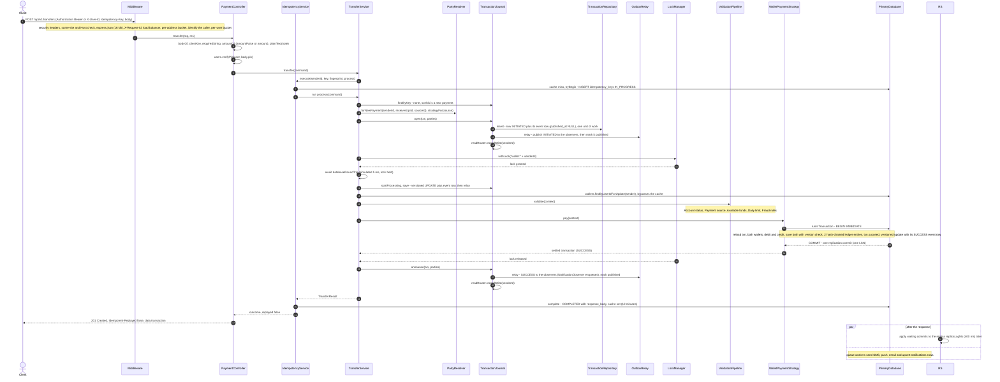

What to notice: the payer lock covers exactly the part that must see one consistent balance (fresh wallet read, validation chain, money movement), and the simulated database round trip inside it makes concurrent payments by one payer really queue behind the lock. Observers are never called directly: every state change is first written to `transaction_events` in the same unit of work as the status (that table is both the audit trail and the outbox), and only after the commit does `OutboxRelay.relay` hand the unpublished events to the observers and set `published_at`. A crash between the commit and the relay therefore loses nothing: the events are relayed at the next start (diagram 10).

## 2. Retry with the same Idempotency-Key

### 2a. After the first request finished

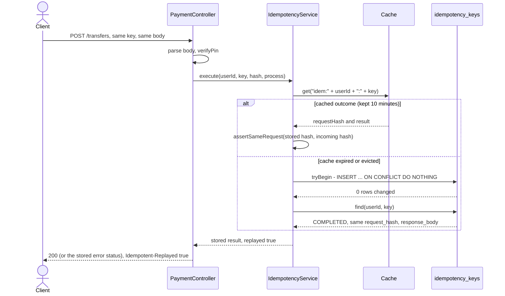

What to notice: `process()` never runs again, so no second transaction, debit or notification can happen. The `idempotency_keys` row is the source of truth; the cache is only a fast path. If the key row were missing while a transaction exists (for example after start-up reconciliation released it), `process()` still does not pay twice: its first step, `TransactionJournal.findByKey`, finds the earlier transaction and `answerFromStored` answers from it, or returns 409 `REQUEST_IN_PROGRESS` if that transaction is not finished.

### 2b. While the first request is still in flight

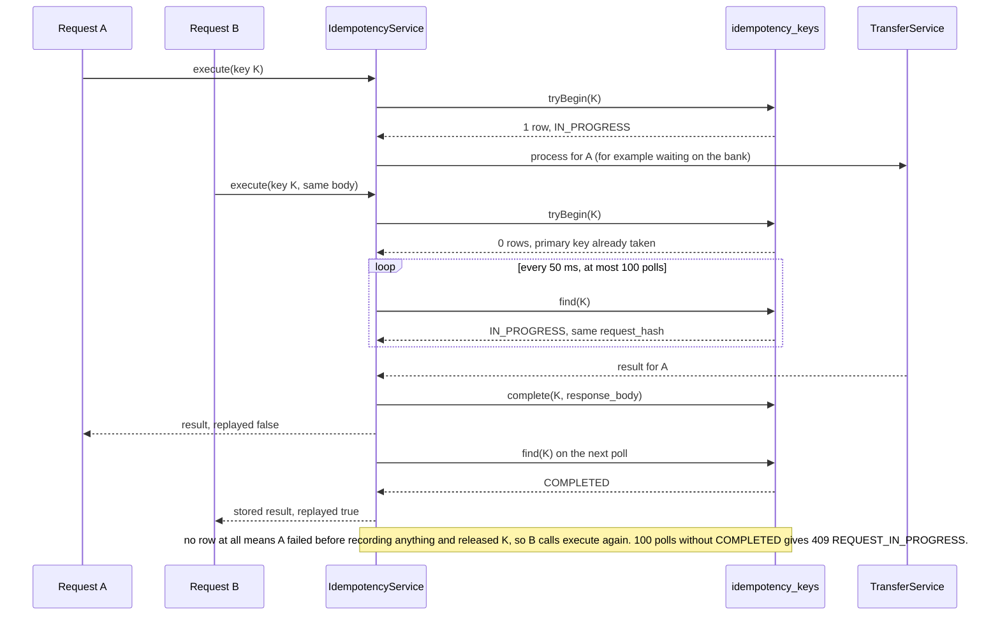

What to notice: the atomic claim is the `PRIMARY KEY (user_id, idem_key)` of `idempotency_keys`, so exactly one of two simultaneous requests wins. The loser waits up to about five seconds (`idempotencyMaxPolls` times `idempotencyPollIntervalMs`) and then answers with the winner's result.

### 2c. Same key, different body

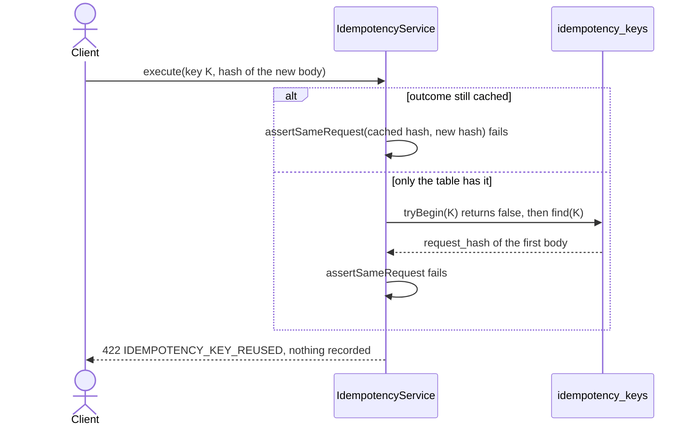

What to notice: the hash is `fingerprint()` in `src/service/TransferService.ts`, a SHA-256 of the lower-cased receiver UPI ID, the amount in paise, the source id (or `WALLET`) and the trimmed note. The PIN is not part of it, and `"amountPaise": 200` and `"amount": 2` are the same request. Client keys starting with `scheduled:` are refused (400 `IDEMPOTENCY_KEY_RESERVED`) because that namespace belongs to the scheduler (diagram 8).

## 3. Double-spend race on one wallet

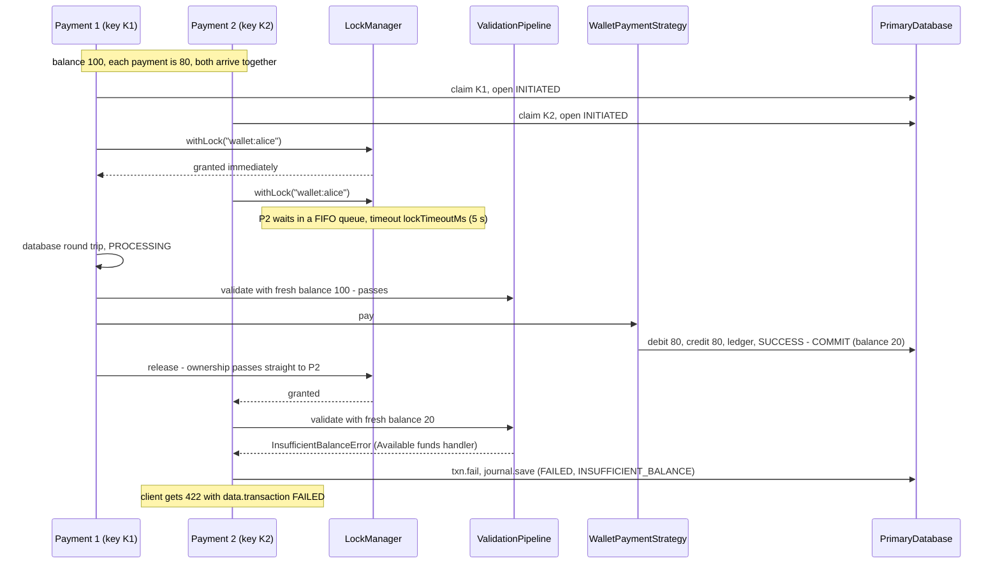

What to notice: the lock key is the payer (`wallet:<senderId>`), so payments by different people never wait for each other, and the second payment reads the balance only after the first has committed. Behind the lock there are more guards that would each stop an overdraft if the lock were ever bypassed: `Wallet.debit` re-checks the balance inside the unit of work; `SqliteWalletRepository.save` updates `WHERE id = ? AND version = ?` and throws `OptimisticLockError` (409 `CONCURRENT_MODIFICATION`, rolling back) if the row changed; transactions are versioned the same way; and the table has `CHECK (balance_paise >= 0)`. If P1 held the lock longer than five seconds (a slow bank), P2 would be recorded as FAILED with 503 `LOCK_TIMEOUT`.

## 4. Bank or card funded payment with saga compensation

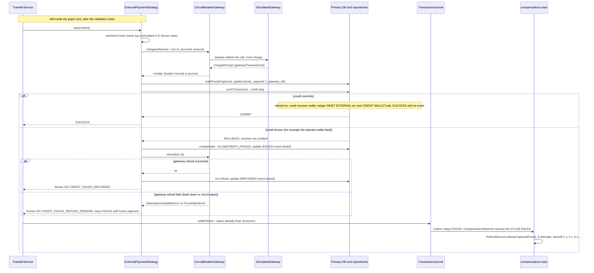

What to notice: the charge and the credit cannot share one database transaction because the bank is another system, so the code records `funds_captured` before the credit and undoes the charge if the credit fails (a saga: FAILED, then REFUNDED). The gateway is idempotent on `reference` (our transaction id), and two callers refunding the same charge at once share one in-flight refund. The strategy knows nothing about fault injection: the demo's "fail the next credit" is a decorator, `FaultInjectingWalletRepository`, that makes the next balance-increasing `save` throw once. If the refund cannot reach the gateway, the `compensations` job retries it, `recover()` in `src/container.ts` queues it again after a restart, `POST /api/v1/system/queue/redrive` re-queues it after the retries run out, and either party may release it with `POST /transactions/:id/refund`.

## 5. Bank outage and the circuit breaker

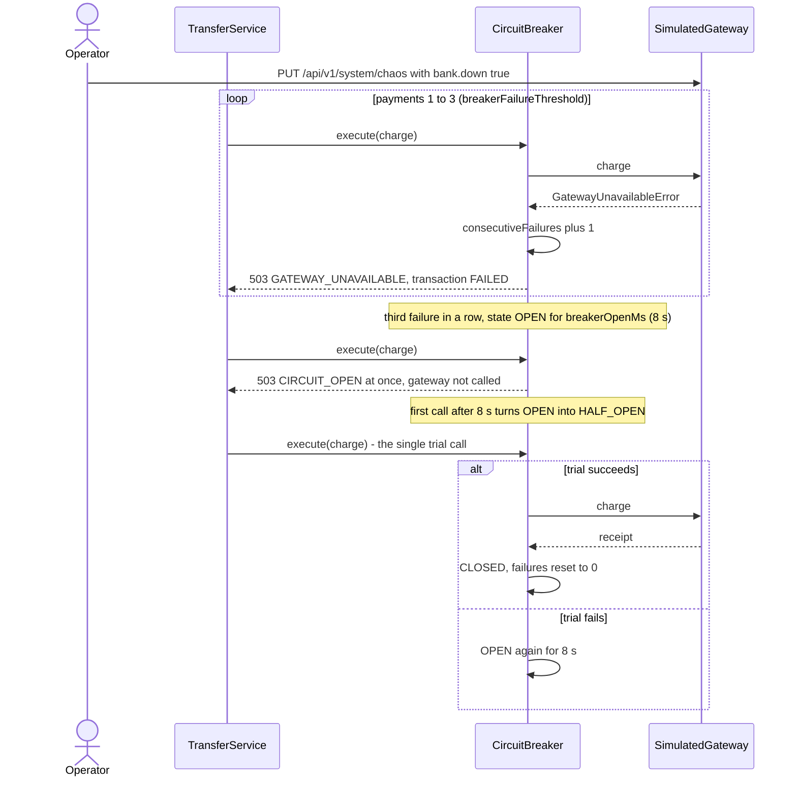

What to notice: only `GatewayUnavailableError` counts as a failure (the `isOutage` predicate in `src/container.ts`); a decline (`PaymentDeclinedError`, 402) means the bank answered and resets the count. While HALF_OPEN, a second concurrent call is rejected with `CIRCUIT_OPEN`, and every state change bumps an epoch so a slow call admitted in an earlier state cannot close or reopen the circuit when it finally returns. Bank and card each have their own breaker, and the same breaker guards `charge`, `refund` and `statusOf`.

## 6. Refund of a successful payment

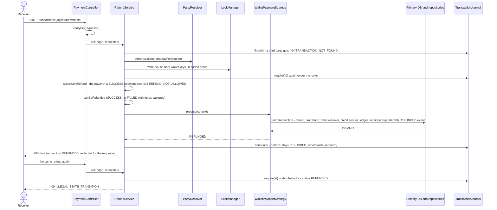

What to notice: only the receiver can give back a successful payment, and the rule is checked on the transaction re-read under the locks, not on an earlier snapshot. Refunds carry no Idempotency-Key because the state machine makes them idempotent: SUCCESS to REFUNDED happens once, and the strategy re-reads the status in the same unit of work that moves the money. Both wallets are locked, always in sorted key order so two refunds cannot deadlock. If the receiver has already spent the money, `Wallet.debit` throws 422 `INSUFFICIENT_BALANCE` and the unit of work rolls back; for bank or card payments the strategy checks first (and dry-runs the debit) and returns 422 `REFUND_NOT_POSSIBLE` before calling the gateway. Note that `announce` pins the payer, not the receiver who asked for the refund, to the primary (diagram 9a).

## 7. Asynchronous notifications

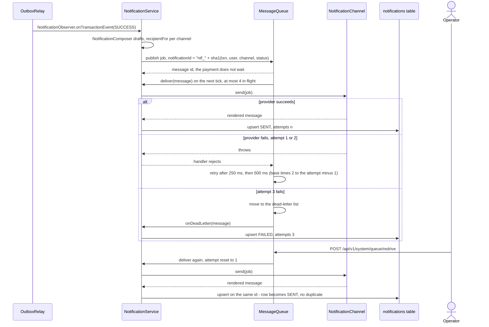

What to notice: delivery is at-least-once twice over (the outbox may relay an event again after a crash, and the queue retries), so the consumer is made idempotent by the deterministic notification id and the `INSERT ... ON CONFLICT (id) DO UPDATE` in `SqliteNotificationRepository.upsert`. That protects the stored record; a redelivered message would still call the (simulated) provider again. Channels are registered in `src/container.ts` (`NotificationChannelFactory.register`), so a new channel is a new class plus one line there.

## 8. Scheduled payment

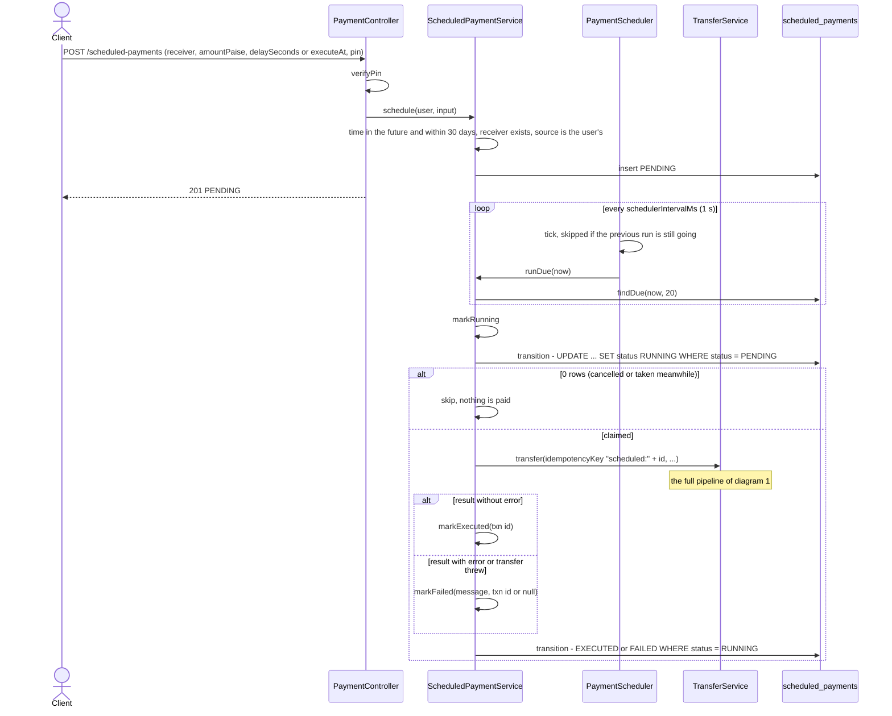

What to notice: scheduling adds no payment logic of its own; it calls the same `TransferService.transfer` as the API, so limits, fraud rules, locking and the ledger apply at execution time. Run and cancel both use the compare-and-set `ScheduledPaymentRepository.transition(payment, expected)`, so exactly one of them wins. If the process dies while a schedule is RUNNING, start-up reconciliation puts it back to PENDING (diagram 10); the re-run uses the same key `scheduled:<id>`, so it replays the stored result instead of paying again. The PIN is checked once, when the schedule is created.

## 9. Read path

### 9a. History from the replica with read-your-writes and pages

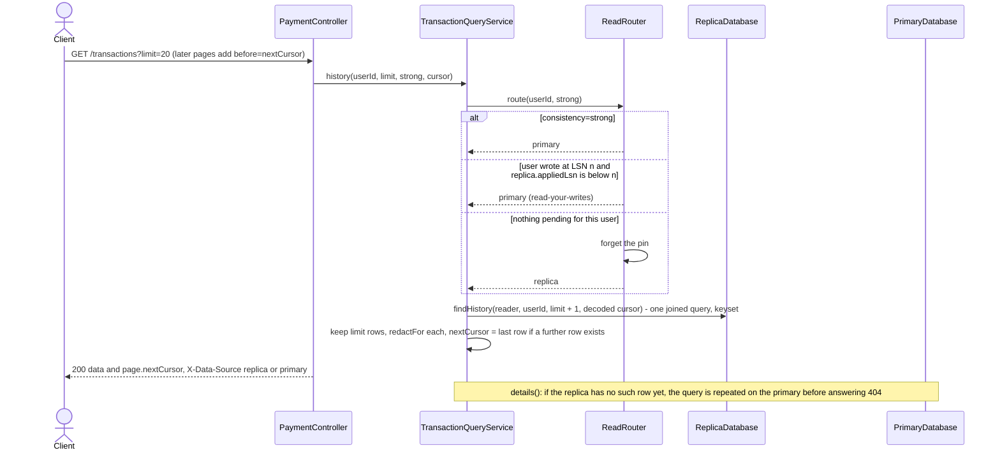

What to notice: `TransactionJournal.open`, `save` and `announce` call `readRouter.recordWrite` for the payer (and `pinReads` does the same for a receiver who has just refunded), pinning that user to the primary until the replica's applied LSN reaches the primary's LSN of that write. The other party to a payment is not pinned and reads the replica, which may be a few hundred milliseconds behind. Pages use a keyset cursor (`created_at`, `id` of the last row, base64url-encoded), so new payments never shift or repeat rows between pages. Views are redacted per viewer.

### 9b. Wallet balance with cache-aside

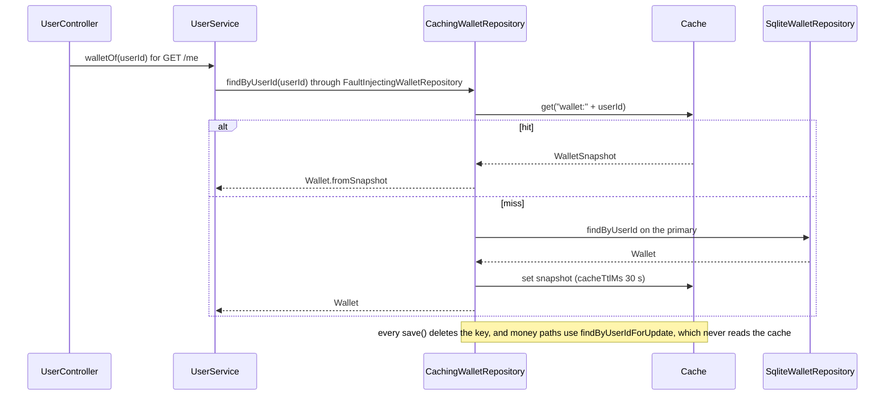

What to notice: two decorators wrap `SqliteWalletRepository` (`FaultInjectingWalletRepository` around `CachingWalletRepository`), and none of the services knows they exist. Balances shown to the user may come from the cache; balances used to decide a payment never do.

## 10. Start-up reconciliation after a crash

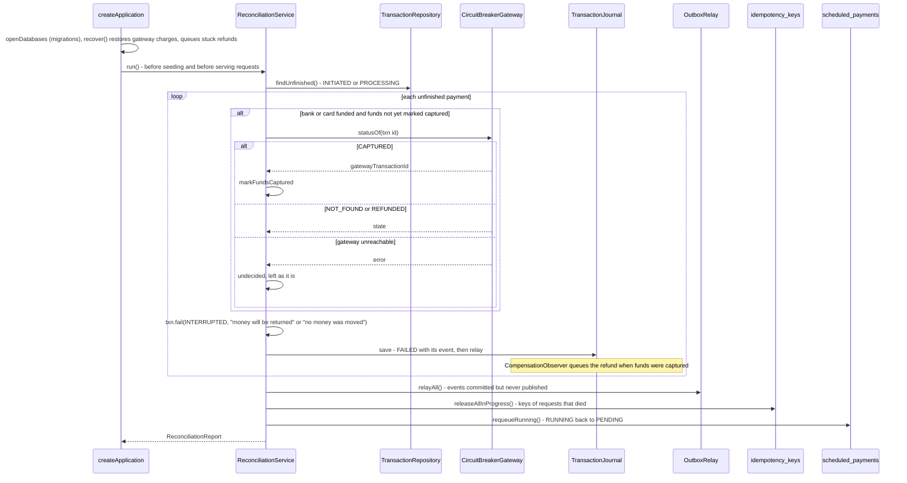

What to notice: money itself is never half-moved by a crash, because every money movement commits atomically; what a crash leaves behind is bookkeeping in a non-final state, and this job closes it. It never guesses about an external charge: it asks the gateway with `statusOf`, and if the gateway cannot be reached it leaves the payment undecided rather than assume. After a key is released, a client's retry is answered from the now-FAILED transaction (`answerFromStored`). With several app nodes this would have to become a periodic job that only touches rows older than a lease time, as the class comment in `src/service/ReconciliationService.ts` says.

## 11. Sign-in and a Bearer-authenticated request

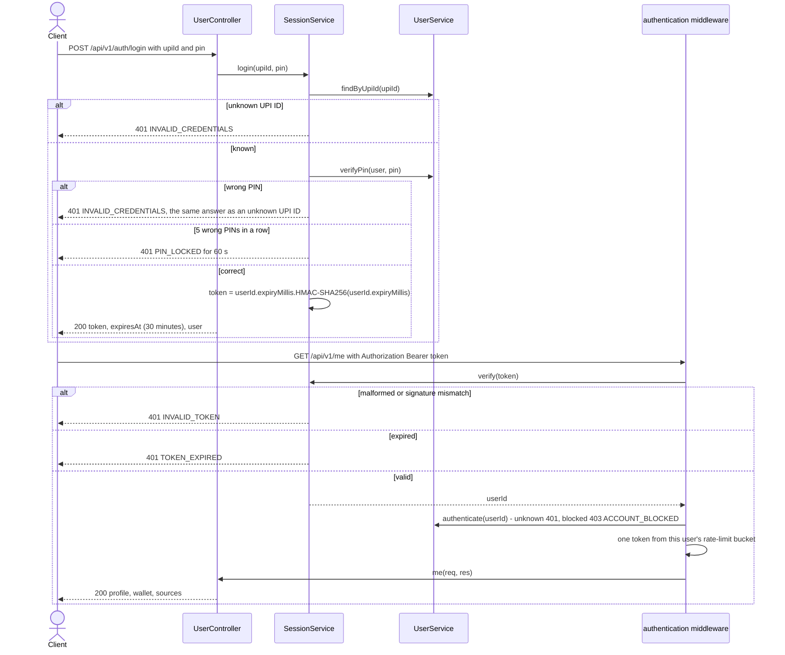

What to notice: the token is stateless (no session table), so any app node holding `sessionSecret` can verify it; without a configured secret a random one is used and tokens die with the process. A Bearer token always wins over `X-User-Id`, and the header is honoured only while `allowHeaderIdentity` is true (the default, for the demo UI). Sign-in answers a wrong PIN exactly like an unknown UPI ID (`INVALID_CREDENTIALS`), so it does not reveal which UPI IDs exist; it uses the same PIN counter as payments, so guessing PINs through `/auth/login` is limited too, and a lockout is still reported as `PIN_LOCKED`.

## Activity diagram of the transfer pipeline

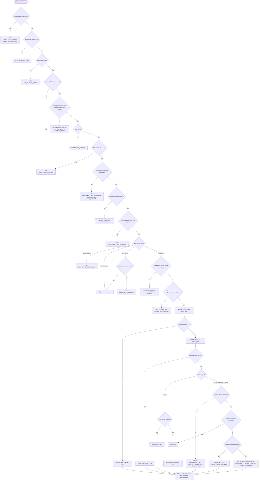

Every exit above the "Open INITIATED" box is rejected before anything is recorded (for the exits after the claim, the key is released). Every exit below it is a recorded transaction whose result is stored against the key, so a retry with the same key replays it.

## Transaction lifecycle

The transitions and their triggers come from `src/domain/TransactionState.ts`; the detail text in quotes is what the audit trail stores.

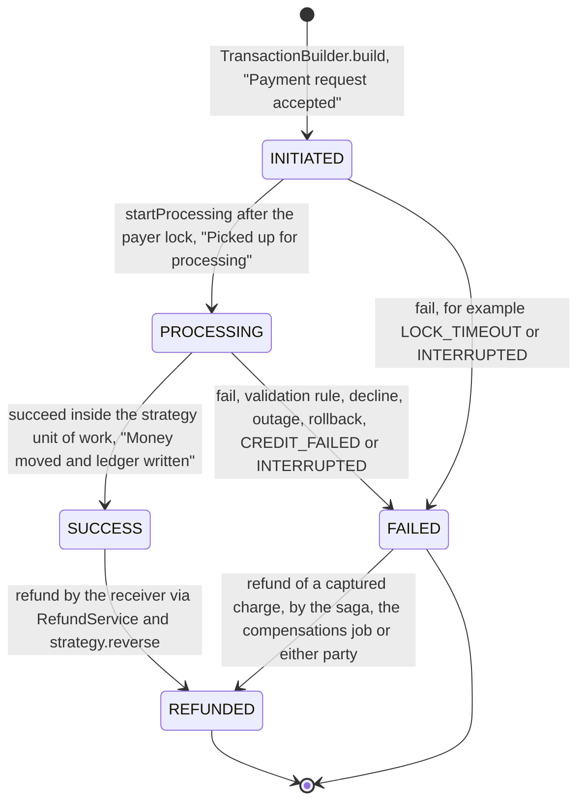

Any other call, such as `succeed()` on a FAILED transaction or a second `refund()`, reaches the base class `TransactionState.reject` and throws `IllegalStateTransitionError` (409). SUCCESS is not terminal because it can still be refunded; FAILED is terminal unless `fundsCaptured` is true (`FailedState.isTerminal` returns `!canRefund`), in which case the single FAILED to REFUNDED step is still owed. `INTERRUPTED` is the failure code start-up reconciliation gives to payments a crash left unfinished.
