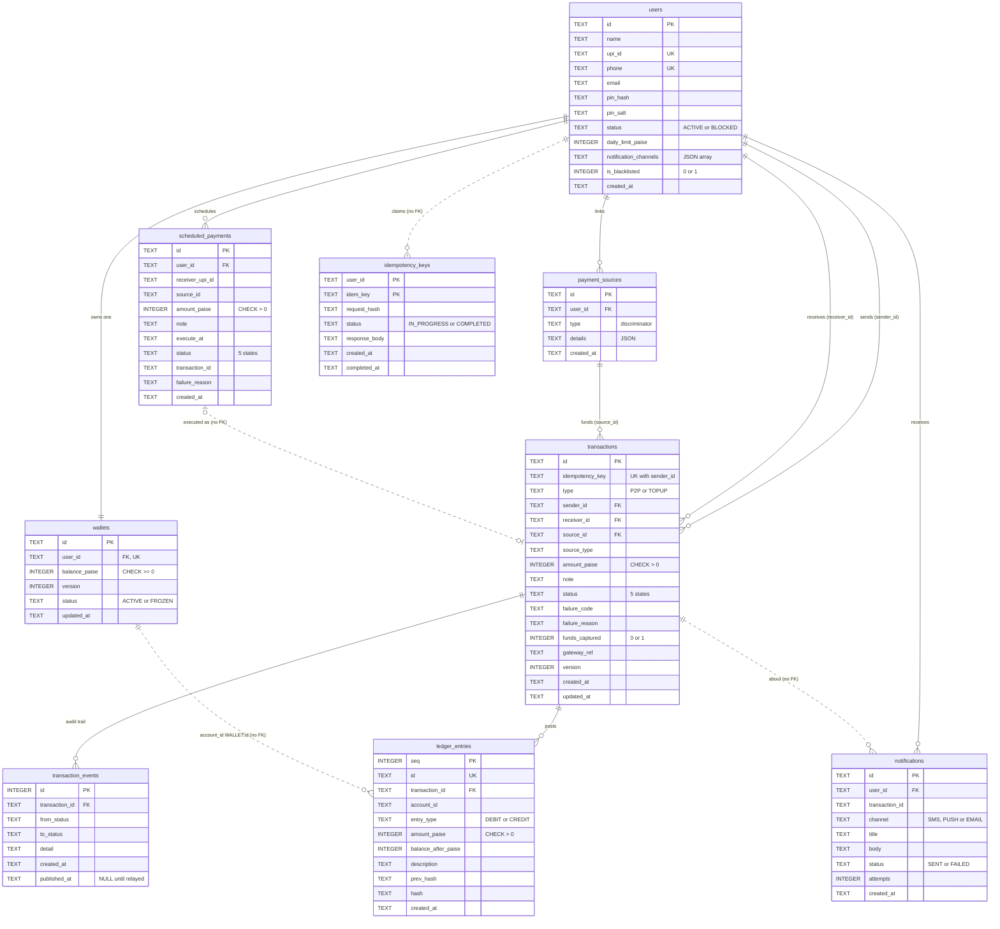

# Database schema

This document describes how the system stores its data: the nine tables in `src/infrastructure/db/schema.ts`, their keys, constraints and indexes, how the classes map onto them, and which database mechanisms protect the money. It also covers schema migrations, what runs inside one database transaction, how the read replica is kept up to date, and what would change on PostgreSQL at scale.

The prototype uses Node's built-in SQLite (`node:sqlite`). The same schema is applied to two databases, `data/primary.db` (all writes) and `data/replica.db` (reads only). Every table is declared `STRICT`, so SQLite rejects a value of the wrong type instead of silently storing it. Each connection runs `PRAGMA foreign_keys = ON`, `PRAGMA recursive_triggers = ON` (so `INSERT OR REPLACE` cannot slip past the ledger triggers), `PRAGMA busy_timeout = 5000` (another process holding the write lock makes a writer wait up to 5 s instead of failing at once) and, for files, `PRAGMA journal_mode = WAL`; it then applies any pending schema migrations (below). Money is `INTEGER` paise; timestamps are ISO-8601 `TEXT`, which sorts correctly as text.

## Entity-relationship diagram

Solid lines are declared foreign keys; dotted lines are logical references the schema does not enforce.

## Tables

Identifiers are random prefixed strings from `newId()` in `src/util/ids.ts` (`usr_`, `wal_`, `src_`, `txn_`, `sch_`), except the two auto-increment integer keys.

### users

A registered person. Written by `SqliteUserRepository` (`src/repository/sqlite/AccountRepositories.ts`).

| Column | Type | Constraints |
|---|---|---|
| `id` | TEXT | PRIMARY KEY |
| `name`, `pin_hash`, `pin_salt`, `created_at` | TEXT | NOT NULL |
| `upi_id` | TEXT | NOT NULL UNIQUE, for example `alice@miniupi` |
| `phone` | TEXT | NOT NULL UNIQUE |
| `email` | TEXT | nullable |
| `status` | TEXT | NOT NULL, CHECK IN ('ACTIVE','BLOCKED') |
| `daily_limit_paise` | INTEGER | NOT NULL, CHECK >= 0 |
| `notification_channels` | TEXT | NOT NULL, JSON array such as `["SMS","PUSH"]` |
| `is_blacklisted` | INTEGER | NOT NULL DEFAULT 0, CHECK IN (0,1) |

### wallets

The stored-value account, exactly one per user (`user_id` is UNIQUE). Keys: `id` PRIMARY KEY, `user_id` REFERENCES `users(id)`.

| Column | Type | Constraints |
|---|---|---|
| `id`, `user_id`, `updated_at` | TEXT | NOT NULL (`id` is the key) |
| `balance_paise` | INTEGER | NOT NULL, CHECK (balance_paise >= 0) |
| `version` | INTEGER | NOT NULL DEFAULT 0, incremented by every save |
| `status` | TEXT | NOT NULL, CHECK IN ('ACTIVE','FROZEN') |

### payment_sources

Where money for a payment comes from: the user's wallet, a bank account or a card, in one table. Keys: `id` PRIMARY KEY, `user_id` REFERENCES `users(id)`.

| Column | Type | Constraints |
|---|---|---|
| `type` | TEXT | NOT NULL, CHECK IN ('WALLET','BANK_ACCOUNT','CARD'), the discriminator |
| `details` | TEXT | NOT NULL, JSON with the subclass attributes, for example `{"bankName":"HDFC Bank","accountLast4":"6789","ifsc":"HDFC0001234"}` |
| `user_id`, `created_at` | TEXT | NOT NULL |

### transactions

One movement of money and its current state. Keys: `id` PRIMARY KEY; `sender_id` and `receiver_id` REFERENCES `users(id)`; `source_id` REFERENCES `payment_sources(id)`; `UNIQUE (sender_id, idempotency_key)`.

| Column | Type | Constraints |
|---|---|---|
| `idempotency_key` | TEXT | NOT NULL, the client's key (or `scheduled:<id>`) |
| `type` | TEXT | NOT NULL, CHECK IN ('P2P','TOPUP') |
| `source_type` | TEXT | NOT NULL, CHECK IN ('WALLET','BANK_ACCOUNT','CARD'), copy of the source's type |
| `amount_paise` | INTEGER | NOT NULL, CHECK (amount_paise > 0) |
| `note` | TEXT | NOT NULL DEFAULT '' |
| `status` | TEXT | NOT NULL, CHECK IN ('INITIATED','PROCESSING','SUCCESS','FAILED','REFUNDED') |
| `failure_code`, `failure_reason` | TEXT | nullable, set when the payment fails |
| `funds_captured` | INTEGER | NOT NULL DEFAULT 0, CHECK IN (0,1): the bank or card was charged |
| `gateway_ref` | TEXT | nullable, the gateway's transaction id |
| `version` | INTEGER | NOT NULL DEFAULT 0, optimistic-lock counter, incremented by every update |
| `created_at`, `updated_at` | TEXT | NOT NULL |

### transaction_events

One row per state change, with two roles. It is the **audit trail** behind the timeline of `GET /transactions/:id`, and it is the **outbox** from which observers are told about the change. Rows are written by `SqliteTransactionRepository.insert` and `update` in the same unit of work as the transaction row, from the transaction's `unrecordedTransitions()`, with `published_at` NULL. After the commit, `OutboxRelay.relay` reads the transaction's rows that are still NULL, publishes them to the observers and then sets `published_at`; `relayAll()` does the same at start-up for anything a crash left behind. Keys: `id INTEGER PRIMARY KEY AUTOINCREMENT` (the order of events), `transaction_id` REFERENCES `transactions(id)`. Columns: `from_status` (nullable, NULL for the first event), `to_status`, `detail`, `created_at`, all TEXT and NOT NULL except `from_status`, and `published_at` (TEXT, nullable, added by migration 2). The partial index `idx_events_unpublished` covers only rows not yet published.

### ledger_entries

The append-only, double-entry, hash-chained ledger written by `LedgerService.record`. Keys: `seq INTEGER PRIMARY KEY AUTOINCREMENT` (the ledger order), `id` UNIQUE, `transaction_id` REFERENCES `transactions(id)`.

| Column | Type | Constraints |
|---|---|---|
| `account_id` | TEXT | NOT NULL, `WALLET:<wallet id>` or `EXTERNAL:<source id>` |
| `entry_type` | TEXT | NOT NULL, CHECK IN ('DEBIT','CREDIT') |
| `amount_paise` | INTEGER | NOT NULL, CHECK (amount_paise > 0) |
| `balance_after_paise` | INTEGER | nullable: NULL for external accounts the system does not hold |
| `description`, `prev_hash`, `hash`, `created_at` | TEXT | NOT NULL |

Two triggers, `ledger_entries_no_update` and `ledger_entries_no_delete`, run `RAISE(ABORT, ...)` before any UPDATE or DELETE.

### idempotency_keys

One row per (user, Idempotency-Key): the claim and, once finished, the stored response. Key: `PRIMARY KEY (user_id, idem_key)`; no foreign key. Columns: `request_hash` (SHA-256 of the meaningful request fields), `status` CHECK IN ('IN_PROGRESS','COMPLETED'), `response_body` (JSON of the `TransferResult`, NULL while in progress), `created_at`, `completed_at`.

### notifications

One row per (transaction event, recipient, channel). Keys: `id` PRIMARY KEY (deterministic `ntf_` plus a SHA-1 prefix), `user_id` REFERENCES `users(id)`; `transaction_id` is NOT NULL but not a foreign key. Columns: `channel` CHECK IN ('SMS','PUSH','EMAIL'), `title`, `body`, `status` CHECK IN ('SENT','FAILED'), `attempts`, `created_at`.

### scheduled_payments

A payment authorised now and executed later. Keys: `id` PRIMARY KEY, `user_id` REFERENCES `users(id)`. Columns: `receiver_upi_id` (resolved again at execution time), `source_id` (nullable, NULL means the wallet), `amount_paise` CHECK > 0, `note` DEFAULT '', `execute_at`, `status` CHECK IN ('PENDING','RUNNING','EXECUTED','FAILED','CANCELLED'), `transaction_id` and `failure_reason` (nullable, filled at execution), `created_at`.

## Indexes and the queries they serve

Every `findById` is served by the table's primary key and is not repeated below. The plans in the last column were checked with `EXPLAIN QUERY PLAN` on an empty copy of the current schema; with real data the planner may choose differently.

| Index | Columns | Query it serves (repository method) | Plan |
|---|---|---|---|
| `users` unique on `upi_id` | `upi_id` | `SqliteUserRepository.findByUpiId`: every payment and payee lookup | search by `upi_id` |
| `users` unique on `phone` | `phone` | `findByPhone`: duplicate check at registration | search by `phone` |
| `wallets` unique on `user_id` | `user_id` | `SqliteWalletRepository.findByUserId` and `findByUserIdForUpdate` | search by `user_id` |
| `idx_sources_user` | `payment_sources(user_id)` | `SqlitePaymentSourceRepository.findByUserId` (GET /me, ledger redaction) and `findWalletSource` (default source) | search, then sort for `ORDER BY created_at, rowid` |
| `transactions` unique `(sender_id, idempotency_key)` | both | enforces one transaction per key; `findBySenderAndKey`, the first step of every `TransferService.process` | search on both columns |
| `idx_txn_sender_time` | `(sender_id, created_at DESC)` | `sumOutgoingSince` (daily limit) and `countInitiatedSince` (velocity rule); the sender half of `findHistory` | range search on `created_at` |
| `idx_txn_receiver_time` | `(receiver_id, created_at DESC)` | the receiver half of `SqliteTransactionQueryRepository.findHistory` (`sender_id = ? OR receiver_id = ?` uses both indexes; with a `before` cursor each half becomes a range search on `created_at`) | multi-index OR, then sort |
| `idx_txn_pair_success` | `(sender_id, receiver_id) WHERE status = 'SUCCESS'` (partial) | `hasSuccessfulTransfer` (the new-payee fraud rule) | covering search |
| `idx_txn_status` | `status` | `countByStatus` for `GET /system/metrics`; `findUnfinished` (INITIATED or PROCESSING) for start-up reconciliation | covering scan; search, then sort |
| `idx_events_txn` | `(transaction_id, id)` | `SqliteTransactionEventRepository.findByTransaction` (timeline, in order) | search, already ordered |
| `idx_events_unpublished` | `(transaction_id, id) WHERE published_at IS NULL` (partial) | `findUnpublished(transactionId)` after every save, and `findTransactionsWithUnpublished` at start-up | search; small scan, since it only holds unpublished rows |
| `idx_ledger_txn` | `transaction_id` | `SqliteLedgerRepository.findByTransaction` (transaction details) | search |
| `ledger_entries` primary key `seq` | `seq` | `lastHash` (`ORDER BY seq DESC LIMIT 1`), `findRecent`, `findAllInOrder` | walks the rowid order, no sort |
| `idx_ledger_account` | `(account_id, seq)` | no current query; it fits a per-account statement, which the code does not have yet | not used |
| `idempotency_keys` primary key | `(user_id, idem_key)` | `tryBegin` (the atomic claim), `find`, `complete`, `release` | search on both columns |
| `idx_notifications_user` | `(user_id, created_at DESC)` | `SqliteNotificationRepository.findByUser` (GET /notifications) | search, then sort the `id` tie-breaker |
| `idx_scheduled_due` | `(status, execute_at)` | `SqliteScheduledPaymentRepository.findDue`: `status = 'PENDING' AND execute_at <= ?` every second; `requeueRunning` at start-up | range search; search by `status` |
| `idx_scheduled_user` | `(user_id, execute_at DESC)` | `SqliteScheduledPaymentRepository.findByUser` (GET /scheduled-payments) | search, already ordered |

Two queries scan, both once at start-up: `SqliteTransactionRepository.findCaptured()` (`WHERE gateway_ref IS NOT NULL`, in `recover()`) and `SqliteIdempotencyRepository.releaseAllInProgress()` (`DELETE ... WHERE status = 'IN_PROGRESS'`, in reconciliation).

## From the class design to tables

| Class or concept | Table and columns | How it is mapped |
|---|---|---|
| `User` | `users` | One row per object; `#pinHash` and `#pinSalt` leave the object only through `toProps()` for the repository; `dailyLimit` (Money) becomes `daily_limit_paise`; the channel list is a JSON array |
| `Wallet` | `wallets` | `balance` becomes `balance_paise`; `version` is the optimistic-lock counter, bumped by `markPersisted()` after a successful versioned UPDATE |
| `PaymentSource` with `WalletSource`, `BankAccountSource`, `CardSource` | `payment_sources` | Single-table inheritance: `type` is the discriminator, `details` holds each subclass's own fields as JSON (`details()` writes it, `PaymentSourceFactory.create` reads it back into the right subclass) |
| `Transaction` | `transactions` | The State object is not stored; its `status` string is. `Transaction.rehydrate` calls `stateFor(status)` to get the shared state instance back. `Money` becomes `amount_paise`; `version` is loaded with the row and checked on every update |
| `StateTransition` | `transaction_events` | Each transition is queued on the `Transaction` for the repository (`unrecordedTransitions()`, cleared by `markInserted()` and `markPersisted()`); observers learn about it only from the stored row, through `OutboxRelay` (`OutboxEvent` is the row with its `id`) |
| `LedgerEntry` | `ledger_entries` | Immutable object, immutable row; `sequence` is assigned by the database as `seq` |
| `ScheduledPayment` | `scheduled_payments` | Plain mapping; the status is a simple enum guarded by `assertPending` and `assertRunning`, and written with a compare-and-set |
| `Notification` | `notifications` | Plain mapping, written with an upsert |
| `IdempotencyRecord` | `idempotency_keys` | Plain mapping; the stored outcome is a JSON string |
| `Money` (value object) | every `*_paise` column | Integer paise, so no floating-point arithmetic on money anywhere; converted to rupees only in DTOs |
| `TransactionView` (read model) | join of `transactions`, `users` twice and `payment_sources` | `SqliteTransactionQueryRepository` in `src/repository/sqlite/TransactionRepositories.ts` builds the DTO from one `JOIN` query (`VIEW_SELECT`) instead of loading three aggregates; redaction per viewer happens afterwards in `TransactionQueryService` |

## Integrity mechanisms

| Mechanism | Where | What it guarantees |
|---|---|---|
| `CHECK (balance_paise >= 0)` | `wallets` | No committed state can show a negative balance, even if every application check were bypassed; the statement fails and the unit of work rolls back |
| `UNIQUE (sender_id, idempotency_key)` | `transactions` | At most one transaction per sender and key, a second line of defence behind the idempotency table (and `findBySenderAndKey` answers from it if the key row was lost) |
| `PRIMARY KEY (user_id, idem_key)` | `idempotency_keys` | The atomic claim: of two concurrent `INSERT ... ON CONFLICT DO NOTHING` statements only one changes a row, so only one request executes |
| `version` with `WHERE id = ? AND version = ?` | `wallets` (`SqliteWalletRepository.save`) and `transactions` (`SqliteTransactionRepository.update`) | Optimistic locking: a write based on a stale read changes 0 rows and raises `OptimisticLockError` (409 `CONCURRENT_MODIFICATION`) |
| Status and its event in one unit of work | `SqliteTransactionRepository.insert` and `update` | The audit trail can never disagree with the stored status, and no committed change can be lost before the observers hear of it: `published_at` stays NULL until the relay has run (transactional outbox, at-least-once) |
| Compare-and-set `WHERE id = ? AND status = ?` | `scheduled_payments` (`transition`) | Of a scheduler run and a user's cancel, exactly one wins |
| Triggers `ledger_entries_no_update`, `ledger_entries_no_delete`, plus `recursive_triggers` | `ledger_entries` | The ledger is append-only at the database level, including `INSERT OR REPLACE` (which deletes first and so fires the delete trigger); `POST /api/v1/system/ledger/tamper-test` shows all three statements refused |
| Hash chain (`prev_hash`, `hash`) | `ledger_entries`, `LedgerService.record` and `verify` | Each entry's SHA-256 covers a JSON array of the previous hash and every stored field (id, transaction, account, type, amount, balance after, description, time), so changing any column of an earlier row breaks every later link; `GET /api/v1/system/ledger/verify` reports the first broken `seq` |
| Double entry | `LedgerService.record` | Each posting must have as many debits as credits (otherwise it throws inside the unit of work), and `verify` checks every transaction nets to zero and every wallet equals its ledger total |
| Foreign keys | all solid lines in the diagram | No wallet, source, transaction, event, ledger line, notification or schedule can point at a missing user, source or transaction |
| CHECK-constrained enums and `STRICT` types | every `status`, `type`, `source_type`, `entry_type`, `channel` and 0/1 flag; every column | A bug cannot store a state the code does not know or a value of the wrong type; only the `transaction_events` status columns have no CHECK |
| `CHECK (amount_paise > 0)` | `transactions`, `ledger_entries`, `scheduled_payments` | No zero or negative movement is ever recorded |

## Schema migrations

`src/infrastructure/db/schema.ts` exports `MIGRATIONS`, an ordered list of `{ version, description, sql }`. A change to the schema is a new entry, never an edit to an old one.

| Version | Description | What it does |
|---|---|---|
| 1 | Initial schema | `SCHEMA_SQL`: every table, index and trigger above except the outbox column (all `CREATE ... IF NOT EXISTS`) |
| 2 | Transactional outbox | `ALTER TABLE transaction_events ADD COLUMN published_at TEXT`; `UPDATE transaction_events SET published_at = created_at` (events that existed before the outbox were already announced the old way); `CREATE INDEX idx_events_unpublished ... WHERE published_at IS NULL` |

`SqliteNode.migrate()` (`src/infrastructure/db/Database.ts`) reads `PRAGMA user_version`, the last version the database file applied, and runs every newer migration in its own `BEGIN ... COMMIT`, setting `PRAGMA user_version` to that version inside the same transaction. A failing migration rolls back and stops start-up with "Migration n (description) failed". An existing `primary.db` is therefore upgraded in place, keeping its data; `schemaVersion()` reports the current version. The replica runs the same migrations on its fresh file before it copies the primary's rows, and `rebuild()` (demo reset) sets `user_version` to 0 and migrates from scratch.

## What runs inside one unit of work

`PrimaryDatabase.runInTransaction` (`src/infrastructure/db/Database.ts`) is the only way to group statements. It issues `BEGIN IMMEDIATE`, which takes SQLite's write lock up front, runs the callback, and commits or rolls back; a nested call joins the open transaction, and even a failing `ROLLBACK` clears the in-transaction flag and rethrows the original error. The call sites are:

- `UserService.register`: the user, the wallet and the wallet payment source.
- `SqliteTransactionRepository.insert` and `update`: the transaction row and its new `transaction_events` rows. Called on its own (INITIATED, PROCESSING, FAILED, `markFundsCaptured`, the saga's updates) it is its own small unit of work; called inside a strategy it joins the strategy's.
- `WalletPaymentStrategy.pay`: re-read the transaction, both wallet updates, two ledger entries, status SUCCESS with its event.
- `WalletPaymentStrategy.reverse`: the same in reverse, status REFUNDED.
- `ExternalPaymentStrategy.pay` (credit step) and `reverse` (debit step): one wallet update, two ledger entries, the status change.

Single auto-committed statements remain for the idempotency claim, completion and release, the outbox's `markPublished` (one UPDATE per event, after the observers ran), notification upserts, schedule inserts and transitions, and linking a bank account or card.

The callback must be synchronous: if it returns a Promise, `runInTransaction` throws "a transaction must not span an await" and rolls back. Two reasons. First, there is one SQLite connection per process and a process-wide "in transaction" flag; if the callback awaited, another request could run statements during the pause and they would silently join this transaction, committing or rolling back with someone else's payment. Second, a transaction held open across a network call (the bank) would hold the write lock for the whole call and block every other writer. That is why `ExternalPaymentStrategy` charges the gateway first, outside any transaction, and only then opens the short credit transaction; the simulated database round trip in `TransferService` is likewise awaited outside any transaction, while only the payer lock is held.

## Replication

- **Statement-based commit log.** `PrimaryDatabase.run` records every write as `{ sql, params }`. Inside a unit of work the statements are buffered and published together on COMMIT (dropped on ROLLBACK); outside one, each statement is published alone. Every published batch is a `ReplicationCommit` with the next **LSN** (log sequence number), the commit time and the request trace.
- **Shipping.** `ReplicationStream` (`src/infrastructure/db/Replication.ts`) queues commits and applies them to `ReplicaDatabase` in LSN order once `committedAt + replicaLagMs` has passed (400 ms by default, adjustable through `PUT /api/v1/system/chaos`). `ReplicaDatabase.apply` runs each commit in its own transaction and advances `appliedLsn`. All values are bound parameters computed by the application, so replaying the SQL in the same order gives the same rows. If a commit cannot be applied, the stream does not skip it: it drops the waiting commits and rebuilds the replica from a snapshot of the primary (counted as `resyncs`), since the snapshot already contains them.
- **Bootstrap.** At start-up `openDatabases` deletes `replica.db` and its WAL files, opens a fresh replica and calls `bootstrapFrom(primary)`, which copies every table in dependency order inside one transaction and sets `appliedLsn` to the primary's current LSN. The LSN counter lives in memory, so it starts again at 0 in each process.
- **Lag.** `ReplicationStream.stats()` reports `primaryLsn`, `replicaLsn`, `pendingCommits`, the age of the oldest pending commit (`lagMs`) and `resyncs`, shown under `database.replication` in `GET /api/v1/system/metrics`.
- **ReadRouter rules.** Routed reads are `GET /transactions`, `GET /transactions/:id`, `GET /notifications` and `GET /system/ledger`. (1) `?consistency=strong` reads the primary. (2) After `recordWrite(userId)`, which `TransactionJournal` calls for the payer whenever it opens, saves or announces a transaction (including after a refund), the user is pinned to the primary until `replica.appliedLsn` reaches the LSN recorded at that write (read-your-writes). (3) Otherwise the replica answers and the pin is dropped. In addition, `TransactionQueryService.details` repeats a replica miss on the primary before returning 404. Everything else (profile, wallet balance behind its cache, payment sources, schedules, idempotency lookups and every read made while deciding a payment) uses repositories constructed with the primary.

## Moving to PostgreSQL at scale

These are recommendations for a production version; the prototype does none of them.

- **What stays.** The tables, keys and constraints carry over almost unchanged: `CHECK (balance_paise >= 0)`, the unique keys, the idempotency primary key with `INSERT ... ON CONFLICT DO NOTHING`, the versioned updates and compare-and-set transitions, the append-only rule (as triggers, or simply by granting the application role only INSERT and SELECT on the ledger), integer paise (`BIGINT`), and the repository interfaces, so only the `Sqlite*Repository` classes and `src/container.ts` change.
- **Row locks instead of an in-process lock.** Replace `InMemoryLockManager` with `SELECT ... FROM wallets WHERE user_id = $1 FOR UPDATE` inside the money transaction (locking both wallets in a fixed order for refunds, as today), keeping the version check as a second guard. Use `READ COMMITTED` plus these row locks, or `SERIALIZABLE` with retry on serialisation failures.
- **Connection pooling.** Many app nodes means many connections; put PgBouncer (transaction pooling) in front, keep money transactions short, and never hold one open across the bank call, exactly as today.
- **Partition the ledger by time.** `ledger_entries` and `transaction_events` only grow; range-partition them by month on `created_at` so recent partitions stay hot and old ones can be archived. The hash chain then needs a per-partition anchor (the last hash of the previous month).
- **Shard by user id.** When one primary is not enough, shard by `user_id` (sender for `transactions`). A payment between two shards becomes a two-step saga with an outbox, the same shape as `ExternalPaymentStrategy` today.
- **Read replicas.** Use PostgreSQL streaming replication for the replica and keep the `ReadRouter` rule, using `pg_current_wal_lsn()` on the primary and `pg_last_wal_replay_lsn()` on the replica instead of the in-memory LSN.
- **Migrations.** Keep the same discipline (ordered, append-only migrations with a recorded version), using a migration tool and the database's own transactional DDL.
- **Outbox.** Keep `transaction_events` as the outbox, but let a separate relay process (or change data capture) publish it to the broker, and delete or archive published rows on a schedule.
- **Housekeeping.** Expire `idempotency_keys` after a retention window (for example 24 hours), and index `transactions(status, updated_at)` for a periodic reconciliation job that only touches rows older than a lease time.
