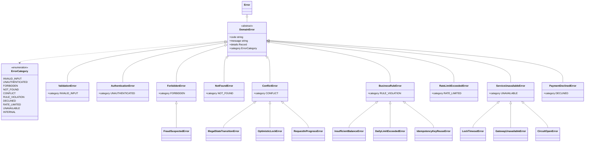

# Error handling, validation and edge cases

This document explains how the system reports failures, where each input rule is checked, and what happens in the awkward situations a payment system must survive: retries, races, outages, partial failures, crashes, abuse and tampering. Each claim names the class or file that implements it, so an evaluator can check it in the code. The known limits of the prototype are listed honestly at the end.

## The error model

Every failure the system can explain to a client is a `DomainError` (`src/domain/errors.ts`) carrying a stable machine-readable `code`, a human `message`, optional `details` and a `category` of type `ErrorCategory`. The domain knows nothing about HTTP: it says what kind of failure happened, not which status code to send. Anything that is not a `DomainError` is treated as a bug.

No subclass overrides its parent's meaning: a fraud block is a `ForbiddenError` (the caller may not make this payment), and a bank decline is its own category, `DECLINED`. `INTERNAL` is not used by any class; it is the category given to non-`DomainError` failures. Many codes are raised inline on the base classes, for example `new ForbiddenError('REFUND_NOT_ALLOWED', ...)`; the full list is below.

**The rule: a `DomainError` becomes the status of its category and its own code; anything else becomes 500 with no internals.** The category-to-status table is `statusFor` in `src/api/httpStatus.ts` (INVALID_INPUT 400, UNAUTHENTICATED 401, DECLINED 402, FORBIDDEN 403, NOT_FOUND 404, CONFLICT 409, RULE_VIOLATION 422, RATE_LIMITED 429, INTERNAL 500, UNAVAILABLE 503). It is applied in one place for thrown errors, `errorHandler()` in `src/api/middleware.ts`, the last middleware of the app:

- `DomainError`: `res.status(statusFor(error.category)).json({ error: { code, message, details, requestId } })`, plus `Retry-After` for `RateLimitExceededError`.
- Body-parser failures (`entity.parse.failed`, `entity.too.large`): 400 or 413 with code `INVALID_JSON`.
- Anything else: the error and request id are written to the server log, and the client gets `{ "error": { "code": "INTERNAL_ERROR", "message": "Something went wrong on our side.", "requestId" } }`.

`requestId` is missing from errors raised before `requestContext` runs: the same-site guard, the body parser, and everything under `/api/v1/system`.

Payments have one extra step. Once a transaction has been recorded, `TransferService.settleFailure` catches the error, marks the transaction FAILED and turns the error into a `TransferFailure` `{ code, message, category, details? }` (`toFailure`): a `DomainError` keeps its code and category, anything else becomes `INTERNAL_ERROR` with category `INTERNAL` and a generic message (the real error is logged). `PaymentController.respond` then sends `statusFor(category)` with both `error` and `data.transaction`. Express 5 forwards rejected promises from the async controllers to `errorHandler`, so no controller needs its own try/catch.

## Error code reference

Every code raised anywhere in `src/`. "Recorded" means the payment exists as a FAILED (or REFUNDED) transaction when this code is returned.

| Code | Category, HTTP | Class | Raised when (where) |
|---|---|---|---|
| `HOST_NOT_ALLOWED` | FORBIDDEN 403 | `ForbiddenError` | `Host` header is not localhost, 127.0.0.1, [::1] or the configured host (DNS rebinding); `sameSiteOnly` |
| `CROSS_SITE_REQUEST` | FORBIDDEN 403 | `ForbiddenError` | `Sec-Fetch-Site: cross-site`, or an `Origin` whose host differs from `Host`; `sameSiteOnly` |
| `OPERATOR_KEY_REQUIRED` | FORBIDDEN 403 | `ForbiddenError` | `operatorKey` is configured and a non-GET operator call has no or a wrong `X-Operator-Key`; `operatorOnly` |
| `INVALID_JSON` | 400, 413 | none (body parser) | Malformed JSON, or body over 16 kB; `errorHandler` |
| `ROUTE_NOT_FOUND` | 404 | none | No route under `/api`; `routeNotFound` in `src/api/middleware.ts` |
| `INTERNAL_ERROR` | INTERNAL 500 | none | Any non-`DomainError`; `errorHandler`, and `toFailure` in `TransferService` (recorded) |
| `RATE_LIMIT_EXCEEDED` | RATE_LIMITED 429 | `RateLimitExceededError` | The client address's bucket (`addressRateLimiting`) or the user's bucket (`authentication`) is empty |
| `NO_HEALTHY_NODES` | UNAVAILABLE 503 | `ServiceUnavailableError` | Every app node marked unhealthy; `LoadBalancer.route` |
| `INVALID_CREDENTIALS` | UNAUTHENTICATED 401 | `AuthenticationError` | Sign-in with an unknown UPI ID or a wrong PIN (the same answer, so sign-in does not reveal which UPI IDs exist); `SessionService.login` |
| `INVALID_TOKEN` | UNAUTHENTICATED 401 | `AuthenticationError` | Bearer token not three parts, or its HMAC signature does not match; `SessionService.verify` |
| `TOKEN_EXPIRED` | UNAUTHENTICATED 401 | `AuthenticationError` | Bearer token past its expiry (30 minutes after sign-in); `SessionService.verify` |
| `UNAUTHENTICATED` | UNAUTHENTICATED 401 | `AuthenticationError` | No usable identity (no token, and `X-User-Id` missing, unknown or not allowed); `UserService.authenticate` |
| `ACCOUNT_BLOCKED` | FORBIDDEN 403 | `ForbiddenError` | The identified user's status is BLOCKED; `UserService.authenticate` |
| `INVALID_BODY` | INVALID_INPUT 400 | `ValidationError` | Body is not a JSON object (also when no JSON body was sent); `bodyOf` in `src/api/requests.ts` |
| `MISSING_FIELD` | INVALID_INPUT 400 | `ValidationError` | Required field missing or blank (`requiredString`, `requiredNumber`); `upiId` query missing (`UserController.resolve`); neither `executeAt` nor `delaySeconds` (`PaymentController.schedule`) |
| `FIELD_TOO_LONG` | INVALID_INPUT 400 | `ValidationError` | Text longer than the field's limit (for example `note` 80, `receiverUpiId` 60) |
| `INVALID_FIELD` | INVALID_INPUT 400 | `ValidationError` | Wrong JSON type (`optionalString`, `optionalNumber`); control or format characters or `<` `>` in a name, bank name or note (`plainText`); `healthy` not boolean (`SystemController.nodeHealth`) |
| `INVALID_AMOUNT` | INVALID_INPUT 400 | `ValidationError` | `amountPaise` not a safe whole number above 0, or above ₹10,00,000 (`amountOf`); `amount` not above 0, above the ceiling, more than 2 decimals or negative (`amountOf`, `Money.fromRupees`, `Money.ofPaise`); zero (`TransactionBuilder.build`, `ScheduledPaymentService.schedule`) |
| `INVALID_LIMIT` | INVALID_INPUT 400 | `ValidationError` | `?limit=` not a positive integer; `limitOf` |
| `INVALID_CURSOR` | INVALID_INPUT 400 | `ValidationError` | `?before=` does not decode to a time and an id; `decodeCursor` in `TransactionQueryService` |
| `IDEMPOTENCY_KEY_RESERVED` | INVALID_INPUT 400 | `ValidationError` | Client key starts with `scheduled:`; `clientKey` in `src/api/controllers.ts` |
| `INVALID_NAME` | INVALID_INPUT 400 | `ValidationError` | Name not 2 to 50 characters; `UserService.register` |
| `INVALID_PHONE` | INVALID_INPUT 400 | `ValidationError` | Phone does not match `^[6-9]\d{9}$`; `register` |
| `INVALID_PIN` | INVALID_INPUT 400 | `ValidationError` | Registration PIN not 4 to 6 digits; `register` |
| `INVALID_PIN` | UNAUTHENTICATED 401 | `AuthenticationError` | Wrong or missing PIN on a money-moving call, with `details.attemptsLeft`; `UserService.verifyPin` (sign-in turns it into `INVALID_CREDENTIALS`) |
| `PIN_LOCKED` | UNAUTHENTICATED 401 | `AuthenticationError` | 5 wrong PINs in a row (payments and sign-in are counted separately): PIN entry refused for 60 s, with `details.retryAfterSeconds`; `verifyPin` |
| `INVALID_EMAIL` | INVALID_INPUT 400 | `ValidationError` | Email does not look like an address; `register` |
| `INVALID_DAILY_LIMIT` | INVALID_INPUT 400 | `ValidationError` | Daily limit not above 0 or above ₹1,00,000; `register` |
| `INVALID_UPI_HANDLE` | INVALID_INPUT 400 | `ValidationError` | Handle does not match `^[a-z0-9._-]{3,30}$`; `register` |
| `UPI_ID_TAKEN` | CONFLICT 409 | `ConflictError` | UPI ID already registered; `register` |
| `PHONE_TAKEN` | CONFLICT 409 | `ConflictError` | Phone already registered; `register` |
| `INVALID_BANK_NAME` | INVALID_INPUT 400 | `ValidationError` | Bank name not 2 to 40 characters; `UserService.linkBankAccount` |
| `INVALID_ACCOUNT_NUMBER` | INVALID_INPUT 400 | `ValidationError` | Account number not 9 to 18 digits; `linkBankAccount` |
| `INVALID_IFSC` | INVALID_INPUT 400 | `ValidationError` | IFSC does not match `^[A-Z]{4}0[A-Z0-9]{6}$`; `linkBankAccount` |
| `INVALID_CARD_NETWORK` | INVALID_INPUT 400 | `ValidationError` | Not Visa, Mastercard or RuPay; `UserService.linkCard` |
| `INVALID_CARD_NUMBER` | INVALID_INPUT 400 | `ValidationError` | Not 13 to 19 digits or fails the Luhn check; `linkCard` |
| `INVALID_EXPIRY` | INVALID_INPUT 400 | `ValidationError` | Month not 1 to 12, or year not 2000 to 2100; `linkCard` |
| `CARD_EXPIRED` | RULE_VIOLATION 422 | `BusinessRuleError` | Linking an expired card (`linkCard`), or paying with one (`CardSource.assertUsable` via `PaymentSourceHandler`, recorded) |
| `USER_NOT_FOUND` | NOT_FOUND 404 | `NotFoundError` | Unknown user id; `UserService.require` |
| `UPI_ID_NOT_FOUND` | NOT_FOUND 404 | `NotFoundError` | Payee lookup for an unknown UPI ID; `UserService.resolveUpiId` |
| `WALLET_NOT_FOUND` | NOT_FOUND 404 | `NotFoundError` | User has no wallet; `UserService.walletOf`, `TransferService.requireWallet`, strategies' `walletOf` |
| `IDEMPOTENCY_KEY_REQUIRED` | INVALID_INPUT 400 | `ValidationError` | Key missing, under 8 characters after trimming, or over 128; `IdempotencyService.assertValidKey` |
| `IDEMPOTENCY_KEY_REUSED` | RULE_VIOLATION 422 | `IdempotencyKeyReuseError` | Same key with a different request fingerprint; `IdempotencyService.assertSameRequest` |
| `REQUEST_IN_PROGRESS` | CONFLICT 409 | `RequestInProgressError` | Original request with this key still running after 100 polls of 50 ms (`waitForOriginal`); or the key row is gone and the transaction for the key is still INITIATED or PROCESSING (`TransferService.answerFromStored`) |
| `PAYMENT_NOT_COMPLETED` | RULE_VIOLATION 422 | none (a `TransferFailure`) | The key row is gone and the finished, non-SUCCESS transaction for the key has no failure code (a REFUNDED payment); `answerFromStored` |
| `SENDER_BLOCKED` | FORBIDDEN 403 | `ForbiddenError` | Sender status is BLOCKED; `TransferService.process` and `PartyStatusHandler` (through the API, `ACCOUNT_BLOCKED` fires first) |
| `RECEIVER_NOT_FOUND` | NOT_FOUND 404 | `NotFoundError` | Receiver UPI ID unknown; `PartyResolver.forNewPayment`, `ScheduledPaymentService.schedule` |
| `SOURCE_NOT_FOUND` | NOT_FOUND 404 | `NotFoundError` | Source missing or owned by someone else (`PartyResolver.forNewPayment`, `schedule`); original source gone (`PartyResolver.of`) |
| `UNSUPPORTED_PAYMENT_METHOD` | INVALID_INPUT 400 | `ValidationError` | No strategy registered for the source type; `PaymentStrategyFactory.for` |
| `UNSUPPORTED_SOURCE_TYPE` | INVALID_INPUT 400 | `ValidationError` | Stored source row has a type nobody registered; `PaymentSourceFactory.create` |
| `UNSUPPORTED_CHANNEL` | INVALID_INPUT 400 | `ValidationError` | No channel registered for a type; `NotificationChannelFactory.create` (inside the observer or worker, never returned to a client) |
| `INCOMPLETE_TRANSACTION` | INVALID_INPUT 400 | `ValidationError` | Builder missing a required part; `TransactionBuilder.build` (a programming error, not reachable from the API) |
| `NOTE_TOO_LONG` | INVALID_INPUT 400 | `ValidationError` | Builder note over 80 characters (the parser's `FIELD_TOO_LONG` fires first) |
| `LOCK_TIMEOUT` | UNAVAILABLE 503 | `LockTimeoutError` | A wallet lock not acquired within 5 s; `InMemoryLockManager.acquire` (recorded for payments, not for refunds) |
| `RECEIVER_BLOCKED` | RULE_VIOLATION 422 | `BusinessRuleError` | Receiver status is BLOCKED; `PartyStatusHandler` (recorded) |
| `SELF_TRANSFER` | RULE_VIOLATION 422 | `BusinessRuleError` | Paying yourself from your own wallet; `PartyStatusHandler` (recorded) |
| `SOURCE_LIMIT_EXCEEDED` | RULE_VIOLATION 422 | `BusinessRuleError` | Amount above the source's per-payment limit (₹1,00,000 wallet and bank, ₹50,000 card); `PaymentSourceHandler` (recorded) |
| `INSUFFICIENT_BALANCE` | RULE_VIOLATION 422 | `InsufficientBalanceError` | Wallet balance below the amount; `WalletPaymentStrategy.assertFundsAvailable`, `Wallet.debit` (recorded); also a wallet refund when the receiver has spent the money |
| `DAILY_LIMIT_EXCEEDED` | RULE_VIOLATION 422 | `DailyLimitExceededError` | Today's P2P total plus this payment above the user's limit; `DailyLimitHandler` (recorded) |
| `FRAUD_SUSPECTED` | FORBIDDEN 403 | `FraudSuspectedError` | A fraud rule objects (`BlacklistedPayeeRule`, `VelocityRule`, `HighValueNewPayeeRule`); `FraudCheckHandler` (recorded) |
| `WALLET_FROZEN` | RULE_VIOLATION 422 | `BusinessRuleError` | Wallet status is FROZEN; `Wallet.debit` and `credit` (recorded), and the refund dry run in `ExternalPaymentStrategy.reverse` |
| `CONCURRENT_MODIFICATION` | CONFLICT 409 | `OptimisticLockError` | A versioned wallet or transaction update matched 0 rows; `SqliteWalletRepository.save`, `SqliteTransactionRepository.update` |
| `PAYMENT_DECLINED` | DECLINED 402 | `PaymentDeclinedError` | Bank or card network refused (insufficient funds in the linked account); `SimulatedGateway.charge` (recorded) |
| `GATEWAY_UNAVAILABLE` | UNAVAILABLE 503 | `GatewayUnavailableError` | Network down or timed out (chaos settings); `SimulatedGateway.simulateNetwork` (recorded) |
| `CIRCUIT_OPEN` | UNAVAILABLE 503 | `CircuitOpenError` | Breaker OPEN, or HALF_OPEN with its trial call in flight; `CircuitBreaker.admit` (recorded) |
| `CREDIT_FAILED` | RULE_VIOLATION 422 | `BusinessRuleError` | The demo fault: the next balance-increasing wallet save fails once when `failNextCredit` is armed; `FaultInjectingWalletRepository.save`. After a bank or card charge it becomes the transaction's `failure_code` and `details.cause` |
| `CREDIT_FAILED_REFUNDED` | RULE_VIOLATION 422 | `BusinessRuleError` | Credit failed after the charge and the saga returned the charge; `ExternalPaymentStrategy.pay` (recorded, REFUNDED) |
| `CREDIT_FAILED_REFUND_PENDING` | RULE_VIOLATION 422 | `BusinessRuleError` | Credit failed and the gateway refund failed too; the transaction stays FAILED with funds captured and the refund is retried; `ExternalPaymentStrategy.compensate` (recorded) |
| `INTERRUPTED` | stored failure code | none (set by `txn.fail`) | Start-up reconciliation closes a payment a crash left INITIATED or PROCESSING; `ReconciliationService.run`. A retry with the original key gets it back as 422 through `answerFromStored` |
| `TRANSACTION_NOT_FOUND` | NOT_FOUND 404 | `NotFoundError` | Unknown id or caller not a party (`RefundService`, `TransactionQueryService.details`); row vanished (`TransactionJournal.require`, `BasePaymentStrategy.reload`) |
| `REFUND_NOT_ALLOWED` | FORBIDDEN 403 | `ForbiddenError` | The payer of a SUCCESS payment asks for a refund; `RefundService.assertMayRefund` |
| `ILLEGAL_STATE_TRANSITION` | CONFLICT 409 | `IllegalStateTransitionError` | A transition the current state does not allow, for example a second refund; `TransactionState.reject`, `RefundService` |
| `REFUND_NOT_POSSIBLE` | RULE_VIOLATION 422 | `BusinessRuleError` | Bank or card refund while the receiver's wallet no longer holds the amount; `ExternalPaymentStrategy.reverse` |
| `CHARGE_NOT_FOUND` | NOT_FOUND 404 | `NotFoundError` | Gateway has no record of the charge; `SimulatedGateway.refund` (records are restored at start-up by `recover()`) |
| `INVALID_SCHEDULE_TIME` | INVALID_INPUT 400 | `ValidationError` | Time invalid, not in the future, or more than 30 days ahead; `ScheduledPaymentService.schedule` |
| `SCHEDULE_NOT_FOUND` | NOT_FOUND 404 | `NotFoundError` | Unknown schedule or not the caller's; `ScheduledPaymentService.cancel` |
| `SCHEDULE_NOT_PENDING` | CONFLICT 409 | `ConflictError` | Cancelling or starting a schedule that is no longer PENDING, including losing the compare-and-set to the scheduler; `ScheduledPayment.assertPending`, `ScheduledPaymentService.cancel` |
| `SCHEDULE_NOT_RUNNING` | CONFLICT 409 | `ConflictError` | Marking a schedule EXECUTED or FAILED when it is not RUNNING (a programming error); `ScheduledPayment.assertRunning` |
| `TRACE_NOT_FOUND` | NOT_FOUND 404 | `NotFoundError` | Trace id unknown or evicted (300 kept); `SystemController.trace` |
| `INVALID_CHAOS_SETTING` | INVALID_INPUT 400 | `ValidationError` | Rate outside 0 to 1, delay outside 0 to 60000 ms, or a non-boolean flag; `ChaosController.validate` |
| `NODE_NOT_FOUND` | NOT_FOUND 404 | `NotFoundError` | Unknown app node id; `LoadBalancer.setHealth` |

`INVALID_PIN` is deliberately listed twice: the same code means a malformed PIN at registration (400) and a wrong PIN on a payment (401).

## Validation in depth

Input is checked in layers, from the cheapest and most generic to the most specific, and the database has the final word.

1. **Transport and edge.** `sameSiteOnly` refuses cross-site requests and unknown host names; `express.json({ limit: '16kb' })` rejects malformed or oversized bodies; `operatorOnly` guards state-changing operator calls; the per-address and per-user token buckets reject floods; `authentication` verifies the Bearer token (or accepts `X-User-Id` while allowed). All in `src/api/createHttpApp.ts` and `src/api/middleware.ts`, before any controller runs.
2. **Request parsing.** `src/api/requests.ts` (`bodyOf`, `requiredString`, `optionalString`, `optionalNumber`, `requiredNumber`, `amountOf`, `limitOf`, `plainText`) and `clientKey` in the controllers turn untrusted JSON into typed values or throw.
3. **Service-level validation.** Each service checks the rules of its use case: `SessionService.login` and `verify`; `UserService.register`, `linkBankAccount`, `linkCard`, `authenticate`, `verifyPin`; `IdempotencyService.assertValidKey`; `PartyResolver.forNewPayment` and `TransferService.process` (receiver exists, source owned, sender active, method supported); `ScheduledPaymentService.schedule`; `RefundService` (party, receiver-only for SUCCESS, refundable state); `TransactionQueryService` (cursor).
4. **The validation chain.** `ValidationPipeline` runs `PartyStatusHandler`, `PaymentSourceHandler`, `SufficientFundsHandler`, `DailyLimitHandler` and `FraudCheckHandler` in that order, under the payer lock, on a recorded PROCESSING transaction.
5. **Domain invariants.** Objects refuse to enter an invalid state: `Money`, `Wallet.debit` and `credit`, `TransactionState`, `TransactionBuilder.build`, `ScheduledPayment.assertPending` and `assertRunning`, `CardSource.assertUsable`, and `LedgerService.record` for balanced postings.
6. **Database constraints.** `src/infrastructure/db/schema.ts`: STRICT types, CHECK, UNIQUE, PRIMARY KEY, FOREIGN KEY, NOT NULL, the versioned updates and the ledger triggers (details in `07-database-schema.md`).

| Rule | Layer | Why there |
|---|---|---|
| Same-site request, known host name | Edge (`sameSiteOnly`) | Stops another web page, or a DNS-rebinding host, from driving the API through the user's browser |
| Operator key on state-changing operator calls, when configured | Edge (`operatorOnly`) | A role check that applies to a whole router, not to business logic |
| At most 300 requests in a burst per address, 30 per user (refill 150 and 15 per second) | Edge (`addressRateLimiting`, `authentication`) | The address limit applies before the caller is known; the user limit is keyed on the identified user, not on a header the client picks |
| Valid, unexpired, correctly signed Bearer token | Edge calling `SessionService.verify` | Identity must be settled before any controller runs |
| Valid JSON, at most 16 kB | Transport | Cheapest possible rejection; bounds memory per request |
| Body is an object, fields have the right type, required fields present, maximum lengths | Request parsing | Untrusted input becomes typed values once, at the edge |
| No control characters or `<` `>` in names, bank names, notes | Request parsing (`plainText`) | These texts are shown to other people; refusing markup and direction tricks at the edge keeps them out of storage |
| `amountPaise` a safe whole number above 0; any amount at most ₹10,00,000 | Request parsing (`amountOf`) | Integer paise avoid floating point entirely; the ceiling does not depend on the user or source |
| `amount` in rupees: at most two decimals, non-negative whole paise | Domain (`Money.fromRupees`, `Money.ofPaise`) | Money must be exact wherever it is created, including by the seeder and scheduler; extra decimals are refused, not rounded |
| `limit` a positive integer, clamped to a maximum; `before` a decodable cursor | Request parsing (`limitOf`), service (`decodeCursor`) | Bounds the cost of list queries; the cursor format belongs to the service that issued it |
| Client key not in the `scheduled:` namespace | Controller (`clientKey`) | Only the scheduler may use those keys, so a client cannot collide with a schedule's payment |
| Idempotency-Key 8 to 128 characters | Service (`IdempotencyService`) | The service owns the key; the scheduler and seeder call it without HTTP |
| Caller known and not blocked | Service (`UserService.authenticate`) | Identity is a service concern; the middleware only calls it |
| PIN correct and not locked | Service (`UserService.verifyPin`), called by the controller and by sign-in | A second factor; with 10,000 possible 4-digit PINs, guessing is stopped by the failure counter |
| Name, phone, PIN format, email, UPI handle, daily limit range | Service (`UserService.register`) | Business formats, shared by every caller including the seeder |
| UPI ID and phone unique | Service pre-check and database UNIQUE | Friendly 409 normally; the constraint still holds under a race |
| IFSC, account number, card network, Luhn, expiry | Service (`linkBankAccount`, `linkCard`) | Catch typos before any network would be called |
| Receiver exists, source owned by the sender, sender active | Service (`PartyResolver.forNewPayment`, `TransferService.process`) | Decides whether there is a payment at all; failing here records nothing |
| Only the receiver refunds a successful payment | Service (`RefundService.assertMayRefund`, on the row re-read under the locks) | A payer must not be able to pull money out of someone else's wallet |
| Schedule time in the future and within 30 days | Service (`ScheduledPaymentService.schedule`) | Only meaningful for scheduling |
| Receiver active, no self transfer from the own wallet | Validation chain (`PartyStatusHandler`) | A payment-level rule; the attempt is kept as FAILED for the audit trail |
| Card not expired, amount within the source's limit | Validation chain (`PaymentSourceHandler`) | Each `PaymentSource` subclass answers for itself (polymorphism) |
| Enough funds | Validation chain (`SufficientFundsHandler`) delegating to the strategy | Only the strategy knows what enough means: the wallet balance, or "the bank decides" |
| Daily limit, fraud rules | Validation chain (`DailyLimitHandler`, `FraudCheckHandler`) | They read history, and run under the payer lock so two payments cannot both slip under a limit |
| Balance never negative, wallet active | Domain (`Wallet`) | Invariant of the object, checked again inside the unit of work |
| Only legal lifecycle moves | Domain (`TransactionState`, `ScheduledPayment`) | One place owns each lifecycle; anything else throws 409 |
| Debits equal credits | Service (`LedgerService.record`) | The bookkeeping rule at the ledger's only writer |
| Balance at least 0, amounts above 0, valid enums and types, one transaction per key, references exist, versions match, ledger append-only | Database | Holds even if application code has a bug |

## Recorded as FAILED, or rejected before anything is recorded

`TransferService.process` has a clear dividing line: `TransactionJournal.open`, which inserts the INITIATED transaction. Before it, a failure is thrown, nothing is stored, and `IdempotencyService` deletes the IN_PROGRESS key (`release`), so the client may correct the request and try again even with the same key. After it, every outcome, success or failure, is returned as a `TransferResult`, the transaction row and its events record it, and the key is stored as COMPLETED with that response.

| Stage | Examples | Transaction row | Idempotency key |
|---|---|---|---|
| Edge and parsing | `CROSS_SITE_REQUEST`, `INVALID_JSON`, `RATE_LIMIT_EXCEEDED`, `UNAUTHENTICATED`, `INVALID_TOKEN`, `ACCOUNT_BLOCKED`, `IDEMPOTENCY_KEY_RESERVED`, `MISSING_FIELD`, `INVALID_AMOUNT`, `INVALID_PIN`, `PIN_LOCKED` | none | never touched |
| Key checks | `IDEMPOTENCY_KEY_REQUIRED`, `IDEMPOTENCY_KEY_REUSED`, `REQUEST_IN_PROGRESS` | none | not claimed by this request |
| Claimed, a finished transaction already exists for the key | answered by `answerFromStored` (the stored status; any stored failure is returned as 422) | unchanged | COMPLETED with that answer |
| Claimed, an unfinished transaction exists for the key | 409 `REQUEST_IN_PROGRESS` from `answerFromStored` | unchanged | released |
| Claimed, before INITIATED | `SENDER_BLOCKED`, `RECEIVER_NOT_FOUND`, `SOURCE_NOT_FOUND`, `UNSUPPORTED_PAYMENT_METHOD`, a database error on the insert | none | released (row deleted) |
| After INITIATED | `LOCK_TIMEOUT`, every validation-chain code, `PAYMENT_DECLINED`, `GATEWAY_UNAVAILABLE`, `CIRCUIT_OPEN`, `CREDIT_FAILED_REFUNDED`, `CREDIT_FAILED_REFUND_PENDING`, `INTERNAL_ERROR` | FAILED (or REFUNDED by the saga) | COMPLETED with the error response |
| Process died after INITIATED | closed at the next start by `ReconciliationService` with `INTERRUPTED` | FAILED (funds captured if the gateway says the charge happened) | released at start-up; a retry is answered from the transaction |

The consequence of the "After INITIATED" row: a retry with the same key replays the stored failure, including a transient 503 such as `GATEWAY_UNAVAILABLE`. A client that wants a fresh attempt after an outage must send a new key. This is consistent (one key, one recorded payment) but the error messages do not say it; see known limits.

## Edge-case matrix

Rows marked "captured" were reproduced against the dev server while writing `06-api-design.md`. Measured evidence for the concurrency and crash rows (a double-spend race across separate processes and a live crash-recovery run) is in `11-load-and-concurrency-evidence.md`.

| Scenario | What the system does | Mechanism | Where |
|---|---|---|---|
| Client retries after a timeout | If the first attempt finished: the stored response, `Idempotent-Replayed: true` (captured). If it is still running: waits up to 5 s, then replays or returns 409 `REQUEST_IN_PROGRESS` | Idempotency table plus cache | `IdempotencyService.execute`, `waitForOriginal` |
| Concurrent duplicate requests | Exactly one executes; the other waits and replays its result | `PRIMARY KEY (user_id, idem_key)` with `INSERT ... ON CONFLICT DO NOTHING` | `SqliteIdempotencyRepository.tryBegin` |
| Same payment sent as `amount` and as `amountPaise` | Treated as the same request (captured) | The fingerprint uses paise | `fingerprint()` in `TransferService` |
| Idempotency record gone, transaction exists | No second payment; the answer is built from the stored transaction, or 409 `REQUEST_IN_PROGRESS` if it is not finished | `findByKey` before anything else | `TransferService.process`, `answerFromStored` |
| Same key, different body | 422 `IDEMPOTENCY_KEY_REUSED`, nothing recorded (captured) | Request fingerprint comparison | `IdempotencyService.assertSameRequest` |
| Client uses a `scheduled:` key | 400 `IDEMPOTENCY_KEY_RESERVED` (captured) | Reserved namespace | `clientKey` in `src/api/controllers.ts` |
| Two payments racing for one balance | Serialised; the second reads the new balance and is FAILED `INSUFFICIENT_BALANCE` | Per-payer lock held across the database round trip, then `Wallet.debit`, the version checks and `CHECK (balance_paise >= 0)` | `TransferService.process`, `WalletPaymentStrategy.pay`, `SqliteWalletRepository.save` |
| Lock timeout | FAILED `LOCK_TIMEOUT` 503 after 5 s, stored against the key | FIFO waiter with a timer | `InMemoryLockManager.acquire`, `InitiatedState.fail` |
| Stale transaction object written | 409 `CONCURRENT_MODIFICATION`, the write is refused | `transactions.version` | `SqliteTransactionRepository.update` |
| Self transfer | From the own wallet: FAILED `SELF_TRANSFER` 422. From the own bank or card: a TOPUP, allowed | `sender.id === receiver.id && !source.isExternal()` | `PartyStatusHandler` |
| Unknown receiver | 404 `RECEIVER_NOT_FOUND`, nothing recorded, key released | Lookup before the insert | `PartyResolver.forNewPayment` |
| Source belonging to someone else | 404 `SOURCE_NOT_FOUND`, the same answer as a missing source | Ownership check that never confirms the id exists | `PartyResolver.forNewPayment` |
| Expired card | At linking: 422 `CARD_EXPIRED`, nothing stored. At payment: FAILED `CARD_EXPIRED` | Valid through the last day of the expiry month | `CardSource.assertUsable`, `UserService.linkCard`, `PaymentSourceHandler` |
| Per-source limit | FAILED `SOURCE_LIMIT_EXCEEDED` 422 | Polymorphic `perTransactionLimit()` | `PaymentSourceHandler` |
| Daily limit | FAILED `DAILY_LIMIT_EXCEEDED` 422; counts P2P SUCCESS and PROCESSING since local midnight, not top-ups, failed or refunded payments | `sumOutgoingSince` on `idx_txn_sender_time` | `DailyLimitHandler` |
| Blacklisted payee | FAILED `FRAUD_SUSPECTED` 403 (captured) | `receiver.blacklisted` | `BlacklistedPayeeRule` |
| Payment velocity | The 7th attempt within 60 s is FAILED `FRAUD_SUSPECTED`; failed attempts count too | `countInitiatedSince` with `fraudMaxTransfersPerMinute` 6 | `VelocityRule` |
| Large first payment to a new payee | ₹10,000 or more with no earlier SUCCESS to that receiver: FAILED `FRAUD_SUSPECTED` | `hasSuccessfulTransfer` on `idx_txn_pair_success` | `HighValueNewPayeeRule` |
| Bank outage | Bank and card payments FAILED 503 `GATEWAY_UNAVAILABLE`, nothing captured; wallet payments unaffected | Chaos `down` flag; breaker counts the failures | `SimulatedGateway`, `CircuitBreaker` |
| Bank decline | FAILED 402 `PAYMENT_DECLINED`; does not trip the breaker | `countsAsFailure` is false, so `onSuccess` | `SimulatedGateway.charge`, `CircuitBreaker.execute` |
| Circuit open | Immediate 503 `CIRCUIT_OPEN`, FAILED, gateway not called; one trial after 8 s; late answers from calls admitted in an earlier state are ignored | CLOSED, OPEN, HALF_OPEN with an epoch counter | `CircuitBreaker.admit`, `execute` |
| Credit fails after the charge | FAILED `CREDIT_FAILED`, charge refunded, REFUNDED; client gets 422 `CREDIT_FAILED_REFUNDED` with the REFUNDED transaction | Saga compensation | `ExternalPaymentStrategy.pay`, `compensate` |
| Compensation itself fails | Client gets 422 `CREDIT_FAILED_REFUND_PENDING`; stays FAILED with `funds_captured = 1`; a `compensations` job retries the refund (6 attempts, 1 s to 16 s apart), the operator can redrive it, `recover()` re-queues it after a restart, and either party may release it by hand | `CompensationObserver`, `RefundService.releaseCapturedFunds` | `src/service/RefundService.ts`, `src/container.ts` |
| Two refunds of one charge at the same moment | One gateway payout; the second caller shares the in-flight refund | `#refundsInFlight` keyed by reference | `SimulatedGateway.refund` |
| Refund requested by the payer of a SUCCESS payment | 403 `REFUND_NOT_ALLOWED` (captured) | Receiver-only rule, checked under the locks | `RefundService.assertMayRefund` |
| Refund requested by a non-party | 404 `TRANSACTION_NOT_FOUND` | Party check | `RefundService.refund` |
| Double refund | 409 `ILLEGAL_STATE_TRANSITION` (captured) | State re-read under both wallet locks and inside the unit of work | `RefundService.reverse`, `WalletPaymentStrategy.reverse` |
| Refund racing the payer's own payment or compensation | Serialised | Both wallet locks, taken in sorted key order so two refunds cannot deadlock | `RefundService.reverse` |
| Refund after the receiver spent the money | Wallet payment: 422 `INSUFFICIENT_BALANCE`, rolled back. Bank or card: 422 `REFUND_NOT_POSSIBLE` (or `WALLET_FROZEN` from the dry-run debit) before calling the gateway | `Wallet.debit`; balance pre-check | `WalletPaymentStrategy.reverse`, `ExternalPaymentStrategy.reverse` |
| Crash mid-payment | At the next start the payment is closed as FAILED `INTERRUPTED`. Wallet-funded: nothing had moved. Bank or card: the gateway is asked with `statusOf`; if it says CAPTURED the payment is failed with funds captured and its refund is queued; if it cannot be reached the payment is left undecided | Start-up reconciliation | `ReconciliationService.run`, `PaymentGateway.statusOf` |
| Crash between commit and announcement | The committed events still have `published_at` NULL and are relayed at the next start; observers may see an event twice | Transactional outbox, at-least-once | `OutboxRelay.relayAll`, `idx_events_unpublished` |
| Crash leaving an idempotency key IN_PROGRESS | The key is released at the next start; a retry is answered from the transaction (or starts a fresh payment if none was recorded) | `releaseAllInProgress`, then `answerFromStored` | `ReconciliationService.run`, `TransferService.process` |
| Crash leaving a schedule RUNNING | Put back to PENDING at the next start and run again; the fixed key `scheduled:<id>` replays any payment already made | `requeueRunning` | `ReconciliationService.run`, `ScheduledPayment.idempotencyKey` |
| Restart with captured charges | Gateway records are restored from `transactions`, and stuck FAILED charges are queued for refund again | `recover()` with `findCaptured` and `SimulatedGateway.restore` | `src/container.ts` |
| Notification provider failure | Retried after 250 ms and 500 ms; after 3 attempts dead-lettered and stored FAILED; the payment is unaffected | Exponential backoff, dead-letter list | `InMemoryMessageQueue.scheduleRetry`, `NotificationService.recordUndeliverable` |
| Dead-letter redrive | `POST /api/v1/system/queue/redrive` re-queues dead notifications and stuck compensations with attempt 1 | `redrive` on both topics | `SystemService.redriveDeadLetters` |
| Duplicate event or message delivery | Same deterministic notification id, so the row is updated, never duplicated | `ntf_` plus SHA-1 of transaction, user, channel, status | `NotificationService.idFor`, `SqliteNotificationRepository.upsert` |
| Replica lag and read-your-writes | The payer reads from the primary until the replica catches up (captured: Alice after Bob's refund). The receiver who refunds is pinned the same way (`TransactionJournal.pinReads`). Everyone else may see the replica's older state for about 400 ms (captured: Bob saw SUCCESS right after refunding) | LSN pin per payer | `TransactionJournal.announce`, `ReadRouter` |
| Replica miss | Transaction details are re-read on the primary before answering 404 | Fallback query | `TransactionQueryService.details` |
| A commit fails to apply on the replica | The replica is rebuilt from a primary snapshot instead of skipping the commit | `resyncs` counter | `ReplicationStream.applyHead` |
| History pages while payments arrive | No row skipped or repeated; a bad cursor is 400 `INVALID_CURSOR` (captured) | Keyset pagination on (`created_at`, `id`) | `TransactionQueryService.history`, `SqliteTransactionQueryRepository.findHistory` |
| Viewing the other party's side | Only the payer sees the funding source; the other party's ledger lines have no account id, balance or real description (captured) | Per-viewer redaction | `redactFor`, `redactLedgerFor` |
| A failing observer | Traced and logged; the other observers still run and the payment result is unchanged | try/catch per observer | `TransactionEventPublisher.publish` |
| Scheduler and user cancel at the same moment | Exactly one wins: a losing cancel gets 409 `SCHEDULE_NOT_PENDING`, a losing run pays nothing | Compare-and-set on `status` | `ScheduledPaymentRepository.transition` |
| Cancelled schedule | Status CANCELLED, so `findDue` never returns it; cancelling again gives 409 `SCHEDULE_NOT_PENDING` | `assertPending` | `ScheduledPayment.cancel` |
| PIN guessing | 401 `INVALID_PIN` with `attemptsLeft` on payments, `INVALID_CREDENTIALS` at sign-in (captured); after 5 wrong PINs, 401 `PIN_LOCKED` for 60 s even for the right PIN | Per-user failure counters, one for payments and one for sign-in, so guesses at the sign-in endpoint cannot lock the owner out of paying | `UserService.verifyPin`, `SessionService.login` |
| Forged or expired session token | 401 `INVALID_TOKEN` (captured) or `TOKEN_EXPIRED` | HMAC-SHA256 compared in constant time, expiry inside the signed part | `SessionService.verify` |
| Rate limit exceeded | 429 `RATE_LIMIT_EXCEEDED` with `Retry-After`; the controller never runs | Token buckets per address and per identified user | `addressRateLimiting`, `authentication`, `TokenBucketRateLimiter` |
| Cross-site page or rebinding host | 403 `CROSS_SITE_REQUEST` (captured) or `HOST_NOT_ALLOWED` | `Origin`, `Sec-Fetch-Site`, `Host` checks | `sameSiteOnly` |
| No healthy app node | Every public `/api/v1` call 503 `NO_HEALTHY_NODES`; the operator API still answers, so a node can be marked healthy again | Ops router mounted before the load-balanced chain | `LoadBalancer.route`, `createHttpApp` |
| Malformed JSON | 400 `INVALID_JSON`, no request id because the parser runs first (captured) | Body-parser error type | `errorHandler` |
| Oversized body | 413 `INVALID_JSON` | `limit: '16kb'` | `createHttpApp`, `errorHandler` |
| Unknown route | 404 `ROUTE_NOT_FOUND` under `/api`; other paths fall through to the static UI | Catch-all after the API router | `routeNotFound` |
| Ledger tampering attempt | UPDATE, DELETE and INSERT OR REPLACE all refused by the database (`POST /api/v1/system/ledger/tamper-test`); a change made around the triggers breaks the hash chain, which `GET /api/v1/system/ledger/verify` reports | Triggers with `recursive_triggers`, hash over every field | `schema.ts`, `Database.ts`, `LedgerService.verify` |
| Unexpected exception mid-payment | FAILED `INTERNAL_ERROR` 500 with a generic message; the real error goes to the log | `toFailure` | `TransferService.settleFailure` |

## Known limits of the prototype

Each item was re-checked against the code; it is what the code does today and how a production system would harden it.

- **Reconciliation runs once, at start-up, on everything unfinished.** That is correct for one process (nothing else is running yet), but with several app nodes a starting node would close payments another node is still processing. A payment whose gateway could not be asked is left undecided until the next restart. Production: a periodic job that only touches rows older than a lease time, as the comment in `src/service/ReconciliationService.ts` says.
- **The simulated gateway only knows what we recorded.** After a restart `SimulatedGateway` is rebuilt by `recover()` from transactions with a `gateway_ref`; a charge made in the instant before a crash, before `markFundsCaptured` was saved, would answer `NOT_FOUND` to `statusOf`. A real bank remembers its own charges, which is exactly what `statusOf` relies on.
- **Transient failures are stored against the key.** `LOCK_TIMEOUT`, `GATEWAY_UNAVAILABLE` and `CIRCUIT_OPEN` messages invite a retry, but a retry with the same key replays the stored 503. Production: either release the key for retryable failures or tell clients that a retry needs a new key.
- **Stored failures replayed with a different status.** When `answerFromStored` answers from an existing transaction, every finished non-SUCCESS outcome comes back as 422, even if the original was 403 `FRAUD_SUSPECTED` or 503; a REFUNDED payment comes back as the error `PAYMENT_NOT_COMPLETED`.
- **Read-your-writes covers whoever wrote.** The payer is pinned by `TransactionJournal.announce` and a refunding receiver by `pinReads`; the other party to a payment reads the replica and can be about 400 ms behind, which is the intended eventual consistency.
- **Single-node state.** The wallet locks, cache, rate-limiter buckets, PIN failure counters, read-your-writes pins, circuit-breaker state and queue live in one process, and the session secret is random per process unless `sessionSecret` is set. With several real nodes this needs row locks or a distributed lock, Redis for the cache and counters, a broker such as Kafka or SQS, and a shared secret.
- **Synchronous ports and a global tracer.** Repositories and the cache are synchronous because SQLite runs in-process; a networked database or Redis would make these interfaces asynchronous. The `tracer` is a process-wide singleton imported wherever steps are recorded, not an injected dependency.
- **Header identity on by default.** While `allowHeaderIdentity` is true (the default for the demo UI), `X-User-Id` is trusted as is: anyone who knows a user id can read that user's history and notifications or link sources; only moving money needs the PIN. `GET /api/v1/users` lists every user with phone and email. Production: set `ALLOW_HEADER_IDENTITY=false` and use Bearer tokens only.
- **Sign-in lockout can be triggered by anyone.** Sign-in answers an unknown UPI ID and a wrong PIN the same way, and its failures are counted separately from payment PIN failures, so a stranger cannot stop the owner from paying. A stranger can still lock the owner's sign-in for 60 s, and `PIN_LOCKED` then confirms the UPI ID exists (as `GET /api/v1/users` does anyway in the demo). Production: per-device and per-address attempt limits in front of the per-user lock, with growing lock times.
- **Operator API open by default.** With `operatorKey` empty, anyone who can reach the server can reset data, change chaos settings or mark nodes unhealthy; even with a key, the GET operator routes (metrics, feed, traces, ledger) stay open. Production: a separate admin service behind authentication and network controls.
- **At-least-once side effects.** The outbox may relay an event twice after a crash and the queue retries: notification rows are deduplicated, but a provider could send an SMS twice and `MetricsObserver` could count an outcome twice.
- **Dead-lettered compensations need an operator.** The `compensations` job gives up after 6 attempts (about 31 s of outage). The refund then waits, counted as `stuckCompensations` in `GET /api/v1/system/metrics`, until someone calls `POST /api/v1/system/queue/redrive`, the process restarts, or a party requests the refund.
- **Ledger tamper evidence is internal only.** With direct database access someone could drop the triggers and recompute the whole chain. Production: anchor the head hash externally at intervals and keep the ledger on write-once storage.
- **No partial refunds.** A refund moves the original transaction to REFUNDED instead of creating a refund transaction, a deliberate choice to keep the lifecycle INITIATED, PROCESSING, SUCCESS or FAILED, REFUNDED.
- **Blocked users and frozen wallets.** The statuses and their checks exist (`ACCOUNT_BLOCKED`, `RECEIVER_BLOCKED`, `WALLET_FROZEN`), but no endpoint sets them; they arise only from editing the database.
