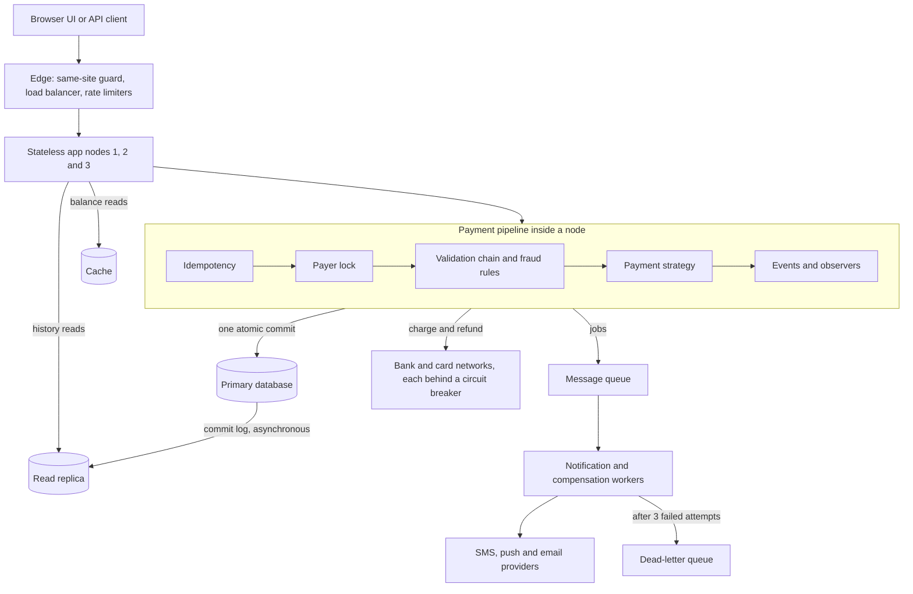
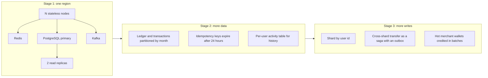

# Architecture and scaling

This document answers three questions: which components sit around the payment code and why each one is there, what each in-process stand-in becomes in production, and how the design grows from one laptop to real traffic. It also lists, honestly, what the prototype does not do.

## The system at a glance

Everything below runs inside one Node.js process. Each box is a class behind an interface, wired in `src/container.ts`.

The app tier keeps no state of its own. Anything two requests must agree on lives in the database, the cache, the lock manager or the queue. That is why a node can be stopped in the Live system screen and nobody notices.

## What each component is for

| Component | Problem it solves | Class and file | What to watch in the UI |
|---|---|---|---|
| Load balancer | Spread requests, survive a dead node | `LoadBalancer`, `RoundRobinStrategy` in `src/infrastructure/loadbalancer/LoadBalancer.ts` | `X-Served-By` rotates; stop a node in Live system |
| Rate limiter | One client cannot starve the rest | `TokenBucketRateLimiter` in `src/infrastructure/ratelimit/RateLimiter.ts` | Lab: "Rate limiting a noisy client" |
| Idempotency store | A retried payment must not pay twice | `IdempotencyService` in `src/service/IdempotencyService.ts` | Lab: "Retry storm"; Wallet: "Send the same request again" |
| Payer lock | Checks and debit must see the same balance | `InMemoryLockManager` in `src/infrastructure/lock/LockManager.ts` | Lab: "Double-spend race"; Live system: "Had to wait" |
| Cache | Balance is read far more often than it changes | `InMemoryCache`, `CachingWalletRepository` | Lab: "Cache-aside on the wallet balance" |
| Primary database | Single source of truth for money, atomic commits | `PrimaryDatabase` in `src/infrastructure/db/Database.ts` | Trace stop "Committed atomically" |
| Read replica | Take history and audit reads off the primary | `ReplicaDatabase`, `ReplicationStream`, `ReadRouter` | `X-Data-Source`; Lab: "Read replica lag" |
| Message queue | Slow side effects must not slow or fail a payment | `InMemoryMessageQueue` in `src/infrastructure/queue/MessageQueue.ts` | Lab: "Notification provider down" |
| Circuit breaker | Do not wait on a dependency that is down | `CircuitBreaker`, `CircuitBreakerGateway` | Lab: "Bank outage and the circuit breaker" |
| Immutable ledger | Prove where every rupee went | `LedgerService`, `ledger_entries` triggers | Ledger screen: audit and tamper test |
| Tracer | See what one request did, across async work | `Tracer` in `src/infrastructure/observability/Tracer.ts` | Wallet: "What just happened" |

## From prototype to production

Every stand-in implements the interface a real system would sit behind. Moving to production replaces the right-hand column of `src/container.ts`; services, strategies, handlers and the domain model do not change.

| Port (interface) | Prototype adapter | Production adapter | What changes besides the adapter |
|---|---|---|---|
| `Cache` | `InMemoryCache` (LRU + TTL, values stored as JSON) | Redis or Memcached cluster | Methods become asynchronous |
| `MessageQueue` | `InMemoryMessageQueue` (retry, backoff, dead letters) | Kafka, RabbitMQ or SQS | Messages survive restarts; consumers scale independently |
| `LockManager` | `InMemoryLockManager` (FIFO, timeout) | Redis lock with a fencing token, or `SELECT ... FOR UPDATE` on the wallet row | The lock must hold across nodes |
| `SqlWriter`, `UnitOfWork` | `PrimaryDatabase` on SQLite | PostgreSQL primary | Transactions become asynchronous; row locks replace `BEGIN IMMEDIATE` |
| `SqlReader` | `ReplicaDatabase` fed by a statement log | PostgreSQL streaming replicas | Lag is measured with real LSNs |
| `PaymentGateway` | `SimulatedGateway` | Bank switch and card network clients | Timeouts are ambiguous and need a status query |
| `NotificationChannel` | simulated SMS, push, email | Provider SDKs | Provider rate limits |
| `LoadBalancer` | in-process round robin | Nginx, Envoy or a cloud load balancer | Health checks become real probes |
| `RateLimiter` | in-process token buckets | Buckets in Redis, or at the API gateway | Limits hold across nodes |
| identity | signed session token (`SessionService`), or the `X-User-Id` header in demo mode | The same token scheme behind TLS, or JWT verified at the gateway | PIN attempt counters move to the shared store |

The synchronous signatures are the one honest gap: the cache, the repositories and the unit of work are synchronous here because SQLite is in-process. With a networked store those methods return promises. The prototype simulates that gap with a short database round trip inside the payer lock (`databaseLatencyMs`), so concurrent payments really do interleave and the lock really is contended.

## Correctness under load

### No payment twice: idempotency

The client sends the same `Idempotency-Key` on every retry of one payment.

1. Fast path: a finished key is answered from the cache.
2. Otherwise the key is claimed with one `INSERT` into `idempotency_keys`. Its primary key `(user_id, idem_key)` lets exactly one concurrent request win.
3. The loser waits for the winner to finish (polling the row) and then returns the winner's stored response.
4. The same key with a different body is refused: the stored request fingerprint does not match.
5. Second line of defence: `transactions` has `UNIQUE (sender_id, idempotency_key)`, and `TransferService` answers from an existing transaction if the key record was ever lost.
6. After a crash, keys left IN_PROGRESS are released at start-up, and the retry is answered from the stored transaction.

A failure that happens before anything is recorded (unknown payee, bad input) releases the key, so the client can correct the request. Every outcome after the transaction row exists, success or failure, is stored and replayed.

### No money spent twice: four layers

| Layer | Mechanism | Stops |
|---|---|---|
| 1 | Per-payer lock around validation and debit | Two payments validating against the same balance, daily limit or velocity count |
| 2 | `Wallet.debit()` refuses to go below zero, re-read inside the unit of work | A debit that slipped past validation |
| 3 | `version` column on wallets and transactions (optimistic locking) | A write based on a stale read, on any node |
| 4 | `CHECK (balance_paise >= 0)` in the database | Everything else, including bugs |

The debit, the credit, both ledger entries and the status change commit in one database transaction, so there is no moment at which money has left one wallet and not reached the other.

### What is consistent and what is eventual

| Read | Served by | Consistency |
|---|---|---|
| Decisions about money (balance check, debit) | Primary, inside the lock | Strong, always |
| Wallet balance on screen | Cache, invalidated on every change | Fresh after any write |
| History, details, notifications | Replica | Eventual, typically a few hundred milliseconds behind |
| The same reads, by someone who has just paid | Primary, until the replica has applied their write | Read-your-writes |

`ReadRouter` remembers the commit number (LSN) of each user's last write and compares it with the replica's applied LSN. A client can also ask for `?consistency=strong`.

### No lost events: the outbox

A state change and the event that announces it are written in one database transaction (`transaction_events` is both the audit trail and the outbox). After the commit, `OutboxRelay` hands the unpublished events to the observers and only then marks them published. If the process dies in between, start-up reconciliation publishes them. Delivery is therefore at-least-once, and observers tolerate a repeat: notification ids are deterministic and releasing captured funds is a no-op the second time.

### Correct without the single thread

The app server is single-threaded, so it is fair to ask whether the design is safe only for that reason. `npm run race` answers it: four separate processes pay from one wallet at once, without the in-process lock, and exactly the affordable number of payments succeed. The guards that matter are in the database. See `11-load-and-concurrency-evidence.md`.

## Staying up when dependencies fail

| Failure | What the system does | Mechanism |
|---|---|---|
| Bank or card network down | Payments from that source fail fast; wallet payments are unaffected | Circuit breaker opens after 3 failures, allows one trial call after 8 seconds |
| Bank charged, wallet credit fails | The charge is refunded and the payment ends REFUNDED | Saga compensation in `ExternalPaymentStrategy` |
| That refund cannot reach the bank either | The payment stays FAILED with funds captured and the refund is retried until it succeeds | `CompensationObserver`, `compensations` queue topic, start-up recovery |
| SMS, push or email provider down | The payment succeeds; messages retry with backoff, then park | Queue retries, dead-letter queue, redrive |
| The same message delivered twice | One stored notification, never a duplicate row. The provider call itself could repeat; production checks the id before sending | Deterministic notification id and upsert (idempotent consumer) |
| A notification or metrics observer throws | The payment is unaffected; the failure is traced and logged | Isolation in `TransactionEventPublisher` |
| App node dies | Requests go to the other nodes | Stateless nodes behind the load balancer |
| Replica cannot apply a commit | It is rebuilt from a snapshot of the primary | `ReplicationStream` |
| Someone guesses PINs | PIN entry locks after 5 wrong attempts | `UserService.verifyPin` |
| The process dies in the middle of a payment | At the next start the payment is closed as FAILED (after asking the gateway whether a bank charge happened), unpublished events are announced, stuck keys and schedules are released | `ReconciliationService` |

## What is cached, and what never is

| Cached | Key | Invalidation | Why it is safe |
|---|---|---|---|
| Wallet snapshot | `wallet:<userId>` | Deleted on every `save`, plus a 30 second TTL | Only used for display; money decisions bypass it |
| Public profile behind a UPI ID | `upi:<upiId>` | TTL | Names and ids rarely change; no credentials are cached |
| Finished idempotency results | `idem:<userId>:<key>` | 10 minute TTL | The table is the source of truth; the cache only saves a query |

Never cached: anything a debit or a limit check depends on. `findByUserIdForUpdate` always reads the primary.

## Capacity thinking

These are planning assumptions for a real deployment. What the prototype actually does under load is measured in `11-load-and-concurrency-evidence.md`: about 8,600 balance reads and 276 payments per second on one core, with every money invariant holding.

| Quantity | Assumption | Result |
|---|---|---|
| Daily active users | 10 million | |
| Payments per user per day | 5 | 50 million payments per day |
| Average write rate | 50 million / 86,400 s | about 580 payments per second |
| Peak (festival evening, 5 times average) | | about 3,000 payments per second |
| Reads per write (balance, history) | 10 to 1 | about 30,000 reads per second at peak |
| Storage per payment | 1 transaction row, 2 ledger rows, about 4 event rows | roughly 1.2 kB |
| Storage growth | 50 million times 1.2 kB | about 60 GB per day, 22 TB per year |

What follows from the numbers:

- Reads dominate, so they must not touch the primary: cache for balances, replicas for history.
- A single primary can absorb the average write rate but not the growth in storage, so the ledger and transactions are partitioned by month and old partitions move to cold storage.
- Notifications are three to five messages per payment, about 15,000 per second at peak, which is why they are on a queue and never in the request.

## How it scales out

- **App tier.** Add nodes. Nothing else is needed because nodes are stateless.
- **Reads.** Add replicas; the `ReadRouter` rule (replica unless the user has an unreplicated write) stays the same with real LSNs.
- **Cache.** A Redis cluster. The decorator and the key scheme do not change.
- **Queue.** Partition by user id so one user's notifications stay ordered; scale consumers per topic.
- **Locks.** One lock per payer wallet, so contention is per user, not global. A merchant who only receives is never locked, because a credit takes no payer lock.
- **Writes.** Shard by the wallet owner's user id. A transfer between shards cannot be one database transaction any more: it becomes debit, credit, confirm, driven by a transactional outbox, with the same compensation idea already used for bank payments.
- **Ledger.** One global hash chain would serialise all writers. At scale, chain per account (under that account's row lock) and checkpoint the chain heads outside the database.

## Known limits of the prototype

Stated plainly so they are not discovered during a demo.

| Limit | Consequence | What production does |
|---|---|---|
| Cache, queue, locks, PIN counters and rate limits are in one process | They do not hold across several real nodes | Move them to Redis and Kafka behind the same interfaces |
| Crash recovery runs once, at start-up (`ReconciliationService`) | Correct for one process. With several nodes, "unfinished" cannot mean "left by a dead process" | Run it periodically and only touch rows older than a lease time |
| A real gateway timeout is ambiguous (charged or not?) | Recovery already asks the gateway (`statusOf`) before deciding, but the live payment path treats a gateway error as "not charged", which only the simulator guarantees | Query by reference, or retry with the same reference, before failing the payment |
| Transient failures (bank down, circuit open) are stored against the idempotency key | A retry with the same key replays the failure; a new attempt needs a new key | Same as major payment APIs; clients generate a new key for a new attempt |
| The ledger hash chain is not anchored outside the database | Someone with full write access could rebuild the chain | Sign entries with a key held elsewhere, or publish chain heads |
| Statement-based replication | Works because every value is a bound parameter; fragile in general | Physical (WAL) replication |
| The demo UI identifies users with the `X-User-Id` header | Signed session tokens exist (`POST /auth/login`, `Authorization: Bearer`) and an operator key can protect the operator API, but both are opt-in so the demo can switch users freely | Set `ALLOW_HEADER_IDENTITY=false` and `OPERATOR_KEY`; add TLS and token refresh |
| PIN hashing is synchronous and uses a low scrypt cost | It blocks the event loop for 2 ms per payment (the largest single cost measured in `11-load-and-concurrency-evidence.md`), and a stolen database file would give up PINs quickly | Asynchronous hashing with a higher cost, a server-side pepper, hardware-backed keys |
| A refund marks the original transaction REFUNDED | Follows the lifecycle in the brief; there are no partial refunds and the original outcome is overwritten | Model a refund as its own transaction linked to the original |
| Repositories, the cache and the unit of work are synchronous | A networked store makes them asynchronous, which changes those signatures and their callers | Introduce the asynchronous signatures first, then swap the adapters |
| A scheduled payment interrupted by a crash ends FAILED | It is never paid twice (its key is fixed), but it is not retried either | Retry transient failures under a new attempt key, a bounded number of times |
| The simulated gateway forgets a charge it made just before a crash, if we had not yet recorded it | Recovery's status query answers "not found" where a real bank would remember | None needed: a real gateway keeps its own records, which is why recovery asks it |
| Notifications and bank calls are simulated | No real messages or money | Provider integrations behind `NotificationChannel` and `PaymentGateway` |
